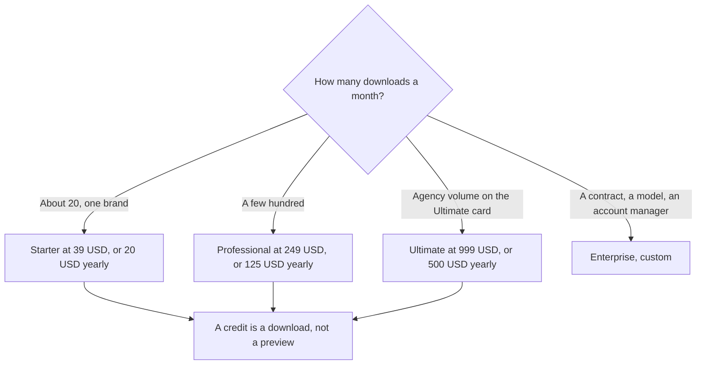

**AdCreative.ai Starter is $39 a month, or $20 a month billed yearly, for 20 download credits.** Professional is $249 a month, or $125 a month billed yearly, for 300 credits. Ultimate is $999 a month, or $500 a month billed yearly, for a 300-credit base. Enterprise is custom. A credit is spent when you download a creative. Generations are unlimited. We read these figures on AdCreative.ai's homepage on October 24, 2026.

The product page is [AdCreative.ai review](/blog/adcreative-ai-review-2026/). A layout tool that is not an ad-credit meter is [Canva Magic Studio pricing explained](/blog/canva-magic-studio-pricing-explained-2026/). On-brand sentences, if the ad also needs a brief, are [Jasper pricing explained](/blog/jasper-pricing-explained-2026/).

Prices are US list prices from the homepage cards, excluding whatever tax the checkout adds. The cards label quarterly and yearly as a per-month equivalent, with a "6 months free" savings line. Published October 24, 2026. We did not score ad performance.

## The base plans

| Plan | Monthly | Quarterly, per month | Yearly, per month | Base credits |
|---|---|---|---|---|
| Starter | $39 | $29, billed quarterly | $20, billed yearly | 20 a month, 1 brand on the monthly card |
| Professional | $249 | $185, billed quarterly | $125, billed yearly | 300 a month |
| Ultimate | $999 | $749, billed quarterly | $500, billed yearly | 300 a month on the base row |
| Enterprise | Custom | Custom | Custom | Tailored. Contact sales |

Larger credit bundles sit on the same cards at higher prices. On the monthly cards we read: Starter also lists 50 credits at $89, 85 at $139, and 120 at $189. Professional lists 450 at $339 and 600 at $400. Ultimate lists 450 at $1,099 and 600 at $1,399. Quarterly and yearly blocks list their own bundle prices. Brand limits and user caps were not identical across the monthly, quarterly, and yearly blocks, so confirm the cap on the toggle you select. This page does not pick one of those conflicting caps and call it the plan.

## What the credit is

The homepage says a credit is used when you download a generated ad creative. You can generate without spending a credit. Credits renew every month. Preview freely, download the ones you will actually run. A 7-day trial is on the page. One trial block says you get 20 credits during the trial. An older directory note said 10. The October 24 homepage is the number this article uses: 20 trial credits, cancel before the trial converts if you do not want the plan.

Every listed paid plan on those cards includes the AI assets, unlimited generations, ad platform integrations, and Creative Insight. That is the card's feature line. It is not a performance claim from us.

## When a different tool is the bill

**[Canva](/tools/canva/) Pro** is $18 a month, or $180 a year, for one person, on the directory card checked October 16, 2026. Buy Canva when the job is a social layout you will edit by hand. Buy AdCreative when the job is many ad sizes and the credit is the download. Light users who download fewer than 20 ads a month should look at the yearly $20 only after they know they will use the credits. Unused credits are a subscription, not a savings, unless the product rolls them, and the page we read said they renew every month rather than stacking forever.

**[Jasper](/tools/jasper/) Pro** is $69 a seat a month, or $59 billed yearly. Business is custom. Jasper writes from a brief. It does not replace a download credit for a banner. [Midjourney](/tools/midjourney/) Basic is $10 a month, or $8 billed annually, with no free plan. It is a stylized image tool, a weak fit for a wordmark that must be spelled correctly. The logo pair is [Midjourney vs Ideogram for logos](/blog/midjourney-vs-ideogram-for-logos-2026/).

A creative the model drafts still needs a person to check the claim on the image. An invented discount on a banner is [what an AI hallucination is](/blog/what-is-ai-hallucination-2026/).

## FAQ

### Is there a free plan?

No permanent free plan showed on the homepage. There is a 7-day trial. The trial block we read included 20 credits. Cancel before it converts if you only wanted to look.

### Do credits roll over?

The page says monthly credits renew every month and are consumed on download. It does not say unused credits carry into the next month. Plan to download what you will use inside the month.

### Why are there two prices on one card?

The higher number is the monthly rate. The lower number is the per-month equivalent of quarterly or yearly billing, marked as such, often with a "6 months free" savings line. The charge that hits the card is the billing period you selected, not the smaller teaser alone. Read the asterisk.

### Is Enterprise a published dollar?

No. The Enterprise block says custom price, tailored credits, and contact sales. Do not use Ultimate's $999 as a stand-in for a contract.

## Last verified

October 24, 2026, from AdCreative.ai's homepage plan cards. Canva, Jasper, and Midjourney comparisons use directory pages checked October 16, 2026. Published October 24, 2026.

**Sources:** [AdCreative.ai](https://www.adcreative.ai/), [Canva pricing](https://www.canva.com/pricing/), [Jasper pricing](https://www.jasper.ai/pricing).

*Published by Andrew for [AI Tools Optimizer](https://aitoolsoptimizer.com).*

[AdCreative.ai](/tools/adcreative-ai/) is in the [marketing and SEO directory](/tools/category/marketing-seo/). Directory pages may use affiliate links. A purchase through them may earn us a commission at no extra cost to you.
