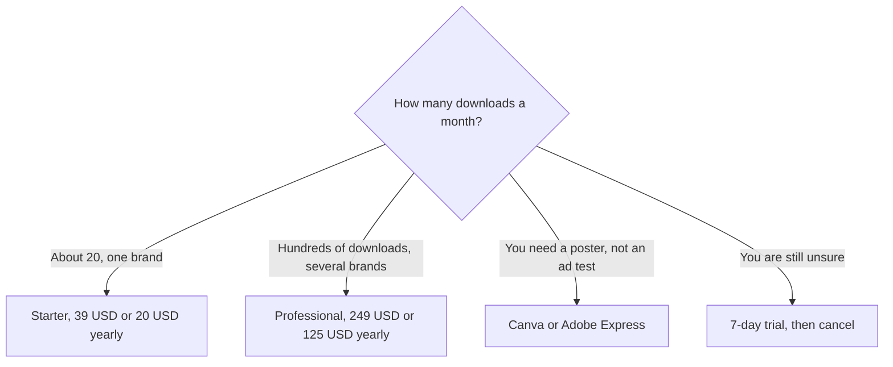

**[AdCreative.ai](/tools/adcreative-ai/) generates ad creative: banners, copy, product photos, and short video, sized for paid campaigns.** You spend a credit when you download, not when you preview. On October 24, 2026 the homepage plan cards, which carry monthly, quarterly, and yearly toggles, showed Starter at **$39 a month**, **$29 a month** on the quarterly discount, and **$20 a month** on the yearly discount, for **20 credits** and **1 brand**. Professional showed **$249 a month** and **$125 a month billed yearly** for **300 credits** and **10 brands**, with **save $1,488** printed on the yearly card. There is a **7-day trial**. The trial copy we saw mentions **20 creative credits**. There is no standing free plan.

We did not measure lift against a control ad. Scores inside the product are the vendor's model. Run your own test. This review is so a 20-credit plan is not mistaken for 20 free-form design hours.

## The toggles

The page labels quarterly **25% off** and yearly **50% off**. Starter's three headlines match that shape closely enough to quote as printed: $39, $29, and $20. Yearly also says save $220. Professional's yearly math is exact: $249 × 12 = $2,988, and $125 × 12 = $1,500, and the difference is **$1,488**, the savings figure on the card. "Six months free" is their way of describing the yearly cut. Use the dollar figure.

| Starter credits | Brands | Monthly | Quarterly card | Yearly card |
|---|---|---|---|---|
| 20 | 1 | $39 | $29 | $20 |
| 50 | 2 | $89 | $65 | $45 |
| 85 | 2 | $139 | $105 | $70 |
| 120 | 2 | $189 | Higher steps are on the card | $95 |

| Professional credits | Brands | Monthly headline | Yearly |
|---|---|---|---|
| 300 | 10 | $249 | $125 |
| 450 | 10 | On the higher steps | $170 |
| 600 | 10 | On the higher steps | $200 |

The invoice is [AdCreative.ai pricing explained](/blog/adcreative-ai-pricing-explained-2026/).

Ultimate is a further agency card with larger credit packs. If you are an agency, read that card rather than stretching Professional's 10 brands. Users on Starter are listed as 1. Professional is the multi-user conversation.

## Credits are downloads

The product generates variations and lets you preview them. The credit leaves when you download the file you will actually run. That is a better meter than charging for every preview, and it still punishes a team that downloads "just in case." Twenty credits is twenty finished assets, or fewer if a single concept needs several sizes and each size is a download. Ask that question in the trial. If a Meta test needs square, story, and landscape, three credits can be one idea. Twenty credits are then about six ideas, not twenty campaigns.

Every listed plan on the cards we read includes the AI asset tools, unlimited generations, ad platform integrations, and creative insight. The plan changes the credit count, the brand count, and the user count. You are not unlocking the generator at Professional. You are unlocking volume and extra brands. Competitive insights and scoring are part of the pitch on the Starter feature list. Treat scores as a hypothesis. The [image generator roundup](/blog/best-ai-image-generators-2026/) and the [Canva Magic Studio review](/blog/canva-magic-studio-review-2026/) are the design-suite alternatives when the job is a brand template rather than a pile of ad sizes. [Adobe Express](/tools/adobe-express/) is the other quick layout tool. [Jasper](/tools/jasper/) is the writing suite if the gap is copy, not the image.

A yearly Starter at $20 is **$240 a year**. Monthly is **$468** if you stay. The yearly discount is the largest honest reason to commit, and it is only honest after the trial shows that 20 downloads a month are real. A yearly Professional at $125 is **$1,500 a year** against **$2,988**. That is the $1,488. It is a good discount on a plan you need and a bad discount on a plan you hoped would replace a designer. Light advertisers will spend less in [Canva](/tools/canva/). Heavy performance teams are who the 300-credit card is for.

## Who should pay

**Use the trial** and count downloads, not previews. **Buy Starter yearly at $20** when one brand and about 20 downloads a month are the steady state. **Buy a larger Starter credit step** when the brand count hits two or the downloads pass 20, and compare that step with Professional before you assume Professional is the next click. Fifty credits at $45 yearly may be enough. Three hundred at $125 is a different company. **Buy Professional** when 10 brands or a team of users is the constraint. **Skip AdCreative** when you ship a few designed pieces a month and you already pay for Canva or Adobe. The ad-specific scoring does not pay for itself at that volume.

Cancel before the trial ends if the sizes and the brand kit are wrong. A 50% yearly discount is not a reason to keep a generator that cannot hold your logo.

## FAQ

### How much does AdCreative.ai cost?

Starter is $39 a month, $29 on the quarterly card, or $20 a month billed yearly, for 20 credits and one brand. Professional is $249 a month or $125 a month billed yearly for 300 credits. Checked October 24, 2026.

### When is a credit used?

When you download a creative. Previews are described as unlimited. Plan the credit around exports, including each size you will upload to an ad platform.

### Is there a free plan?

No. There is a 7-day trial. The trial materials we saw include a block of creative credits. Cancel if you will not use the paid plan.

### What does yearly save?

The toggle is labeled 50% off. On Professional, $125 versus $249 is a $1,488 yearly difference, which matches the card. Starter yearly at $20 versus $39 is the small-team version of the same idea.

### Can one login serve an agency?

Starter lists one user and one brand at the 20-credit step. Higher credit steps add a second brand. Professional lists 10 brands. Agency volume is the Ultimate card, not a shared Starter password.

## Last verified

October 24, 2026, from the plan cards on adcreative.ai. Credit steps between the headlines are easy to misread because monthly, quarterly, and yearly prices are all in the page. Match the toggle to the column before you quote $20 or $39.

**Sources:** [AdCreative.ai](https://www.adcreative.ai/), [Creative Utility Suite](https://www.adcreative.ai/creative-utility-suite).

[AdCreative.ai](/tools/adcreative-ai/) is in the [marketing and SEO directory](/tools/category/marketing-seo/). Directory pages may use affiliate links. A purchase through them may earn us a commission at no extra cost to you.
