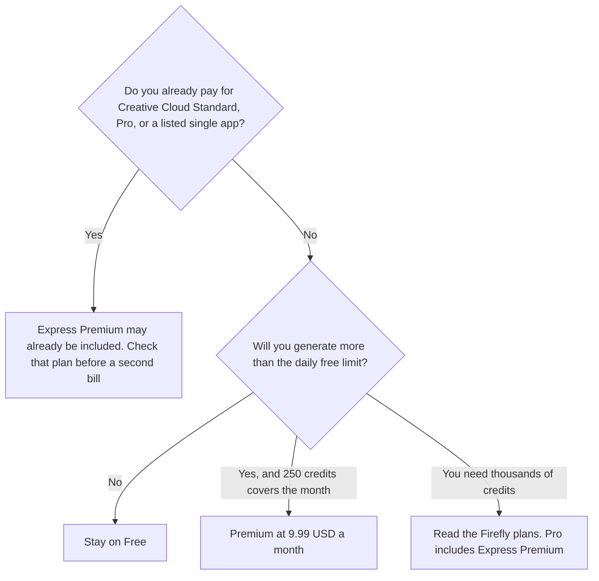

**Adobe Express Premium is $9.99 a month in the US, with 250 Firefly generative credits a month, premium templates, Adobe Stock, brand kits, and 100 GB of storage.** Free is $0 and includes core templates, core editing, and a limited number of free daily AI generations. Teams and Enterprise are not given a dollar figure on the directory card. K-12 schools that qualify can get Premium features at no cost. If you already pay for Creative Cloud, check that plan before you buy Express again.

The credit ladder when 250 is not enough is [Adobe Firefly pricing explained](/blog/adobe-firefly-pricing-explained-2026/). The other template editor is [Canva pricing explained](/blog/canva-pricing-explained-2026/). The side-by-side is [Canva vs Adobe Express for AI design](/blog/canva-vs-adobe-express-for-ai-design-2026/). The product page is [Adobe Express review](/blog/adobe-express-review-2026/).

Prices are US list prices from Adobe pages recorded in the directory on October 16, 2026. A later read of the pricing page on October 24, 2026 did not return a new table, so this article keeps the October 16 record. Published October 24, 2026. We did not score designs. Tax can change checkout.

## The plans

| Plan | Price on the card | What you are paying for | What you do not get from this row |
|---|---|---|---|
| Free | $0 | Core templates and tools, limited free daily AI generations | Premium templates, the 250-credit bucket, brand kits as a paid feature |
| Premium | $9.99 a month | Premium templates and features, Adobe Stock, brand kits, 100 GB, 250 generative credits a month | A larger Firefly credit pack. That is a Firefly plan |
| Teams / Enterprise | Varies. No dollar on the card | Admin Console, 1 TB storage per user, 24/7 support, company ownership of assets. Enterprise adds custom Firefly models | A price you can paste into a forecast |
| K-12 Education | $0 for eligible schools | Premium features with safe search and admin controls | A business workspace |

Monthly Premium can be canceled anytime, on the card. Annual prepaid plans are non-refundable after 14 days. That sentence is the reason to know which toggle you clicked.

The card says Express Premium is included with Creative Cloud Standard, Creative Cloud Pro, and most single-app plans, except InCopy, Substance, and Acrobat Standard. "Included" means you should not add a separate $9.99 if the Creative Cloud plan you already pay lists Express Premium. Confirm it on your account. This page cannot see your subscription.

## Credits versus the Firefly ladder

Express Premium's 250 credits and [Adobe Firefly](/tools/adobe-firefly/) Standard's 2,000 credits are different products at the same $9.99 sticker. Firefly Standard is $9.99 a month for Firefly with 2,000 credits. Firefly Pro is $19.99 a month with 4,000 credits, and the Firefly card says that plan includes Express Premium, plus Photoshop on the web and mobile. If the work is generative volume, price Firefly. If the work is templates, stock, brand kits, and a light generative use, price Express Premium. Buying both without checking the inclusion line is how the same editor appears on two invoices.

Adobe's directory wording says Firefly outputs can be used commercially unless a feature is marked as a beta for personal use only, and that the models are described as designed to be commercially safe because of how they were trained. That is Adobe's claim, recorded on the card. It is not a legal opinion from this site. Read the feature label before a campaign still goes out.

The card lists more than 220,000 premium templates and more than 200 million Adobe Stock assets on Premium, excluding Premium and editorial collections. Full brand setup is web-only, on that card. Resize and other premium edits are why a free user hits the paywall even when a daily generation remains.

## What not to assume

Do not treat the 250 credits as 250 finished videos. The Firefly credits FAQ is the rate card, and this Express article does not copy per-second video rates onto the Express plan. Those sample rates live on the Firefly pricing article. Do not assume a university seat matches the K-12 free row. The card says some universities provide Premium through school accounts. Ask the school.

A social file that does not need Firefly can be [Canva](/tools/canva/). Pro there is $18 a month or $180 a year for one person. The products are compared in the linked article. An interface file is [Figma](/tools/figma/), Professional Full seat $16 a month billed annually, and it is not an Express substitute.

## FAQ

### Is Adobe Express free?

Yes. Free includes core templates, core editing, and a limited number of free daily generative uses. Background removal, bulk resize, premium templates, and the monthly credit bucket are Premium, on the card.

### Does Creative Cloud include Express?

The October 16 card says Express Premium is included with Creative Cloud Standard, Creative Cloud Pro, and most single-app plans, with the exceptions named above. Check the plan you already pay for before you add $9.99.

### What happens when the 250 credits run out?

The card does not describe an Express overage price. Heavy generation belongs on a Firefly plan. Firefly Pro at $19.99 includes Express Premium and 4,000 credits, on the Firefly card. Confirm the current inclusion before you stack subscriptions.

### Are annual plans refundable?

The card says annual prepaid plans are non-refundable after 14 days, and monthly Premium can be canceled anytime. The toggle is the term. Read it at checkout.

## Last verified

October 16, 2026, from Adobe's US pages as recorded in the directory. October 24, 2026 for a pricing-page read that did not replace that record. Firefly figures are from the same October 16 Firefly card. Published October 24, 2026.

**Sources:** [Adobe Express pricing](https://www.adobe.com/express/pricing), [Adobe Express plan comparison](https://www.adobe.com/express/one-plans), [Express Premium help](https://helpx.adobe.com/express/web/adobe-express-subscription/premium.html), [Generative credits FAQ](https://helpx.adobe.com/creative-cloud/apps/generative-ai/generative-credits-faq.html).

*Published by Andrew for [AI Tools Optimizer](https://aitoolsoptimizer.com).*

[Adobe Express](/tools/adobe-express/) is in the [design directory](/tools/category/design/). Directory pages may use affiliate links. A purchase through them may earn us a commission at no extra cost to you.
