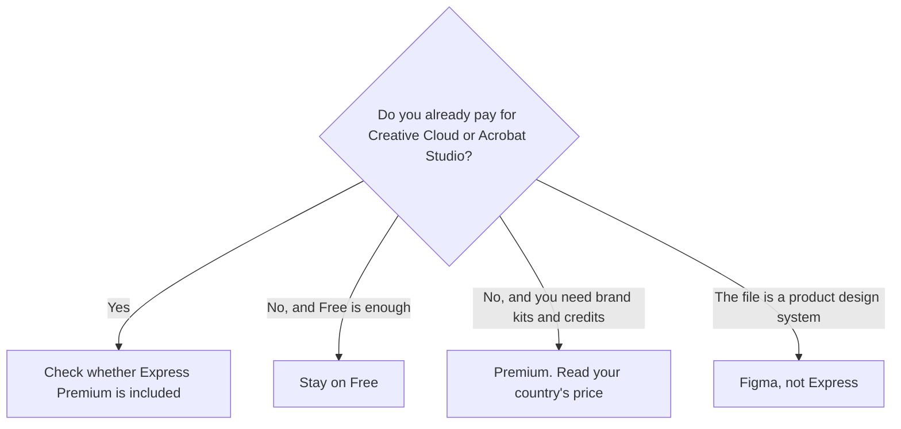

**[Adobe Express](/tools/adobe-express/) is Adobe's quick-design app for social posts, flyers, short video, and pages, with [Firefly](/tools/adobe-firefly/) generative tools inside it.** The decision is often not "Express versus a blank canvas." It is whether you already own Premium through another Adobe plan.

Adobe's US plan notes, checked October 16, 2026, list Premium at $9.99 a month, with premium templates, Adobe Stock access under Adobe's limits, brand kits, 100 GB of storage, and 250 generative credits a month. The October 24, 2026 Express help article confirms Premium as a standalone subscription and says it is included with Creative Cloud Standard, Creative Cloud Pro, and Acrobat Studio. The public pricing page is a dynamic storefront and did not return dollar cards to this check. Read the price in your country's Adobe account before you subscribe. We did not score templates against Canva.

The Firefly side of the credit is [Adobe Firefly review](/blog/adobe-firefly-review-2026/). The template competitor is [Canva Magic Studio review](/blog/canva-magic-studio-review-2026/).

## What the plans are for

| Plan | Price we will quote | What Adobe's materials describe |
|---|---|---|
| Free | $0 | Core templates and editing. Limited free daily AI generations, on the October 16 US notes |
| Premium | $9.99/month on the US pages checked October 16 | Premium features, brand kits, Stock under Adobe's limits, 250 generative credits a month |
| Teams and Enterprise | Sales or the business cards | Admin Console, more storage, company control of assets. Enterprise custom Firefly models are an Enterprise feature on Adobe's FAQ |
| K-12 Education | $0 for eligible schools | Premium tools with safe search and admin controls, on Adobe's education FAQ |

The invoice is [Adobe Express pricing explained](/blog/adobe-express-pricing-explained-2026/).

Monthly Premium can be canceled. Adobe's plan notes say annual prepaid plans are non-refundable after 14 days. That sentence is the one to read before you take a year up front. Generative features spend credits. Standard edits do not all spend them. Adobe's commercial-use FAQ says outputs from generative features may be used commercially unless Adobe marks a beta feature as personal-use only. "Designed to be commercially safe," in Adobe's wording, refers to how Firefly models were trained, including licensed Stock and public-domain content. It is not a promise about a specific image you generate.

## Where it fits

Express is the tool for a person who needs a finished social graphic or a one-page flyer today, and who wants Adobe's fonts, Stock, and Firefly in that file. It is also the handoff when a designer builds in Photoshop or Illustrator and a marketer resizes the result. Adobe's FAQ says Photoshop or Illustrator files can stay linked, and that full brand setup is on the web, then available on other devices.

It is the wrong tool for a multiplayer product-design file. That is [Figma](/tools/figma/), reviewed in the [Figma review](/blog/figma-review-2026/). It is a weak reason to pay $9.99 if [Canva](/tools/canva/) is already where the brand kit lives. Two template subscriptions is how small teams double the design bill. Firefly Pro, at $19.99 in the Firefly review, includes Express Premium plus Photoshop on web and mobile and a larger credit pool. If you were about to buy Express and a separate Firefly plan, price Firefly Pro first.

Students and teachers should check the free path before Premium. Adobe's education FAQ says eligible schools can get Express Premium at no cost, with safe search, and that a .edu login is the first check. Individual students are not automatically that license.

## Who should pay

**Stay on Free** for occasional posts that do not need premium assets. **Pay for Premium** when resize, brand kits, or the credit allotment is the weekly job, and no other Adobe plan already includes it. **Use the education license** when the school offers it. **Skip Express** for interface design and for a second template tool you will not open.

## FAQ

### Is Adobe Express free?

Yes. Free covers core editing. Premium features, including ones Adobe marks with a premium icon, need a paid plan or an included license.

### Is Premium included with Creative Cloud?

Adobe's help article says Express Premium is included with Creative Cloud Standard, Creative Cloud Pro, and Acrobat Studio. Check the plan you already pay for before you buy a standalone seat.

### How many Firefly credits does Premium include?

250 a month, on the US plan notes we checked October 16, 2026. Credits are shared with Firefly's rules. Confirm the allotment on the pricing page in your country.

## Last verified

October 24, 2026, for the Express Premium help article (what is included with other Adobe plans). The $9.99 price and the 250-credit figure are from Adobe's US pages checked October 16, 2026. Regional storefronts differ.

**Sources:** [Adobe Express pricing](https://www.adobe.com/express/pricing), [Adobe Express Premium](https://helpx.adobe.com/express/web/adobe-express-subscription/premium.html), [Generative credits FAQ](https://helpx.adobe.com/creative-cloud/apps/generative-ai/generative-credits-faq.html).

[Adobe Express](/tools/adobe-express/) is in the [design directory](/tools/category/design/). Directory pages may use affiliate links. A purchase through them may earn us a commission at no extra cost to you.
