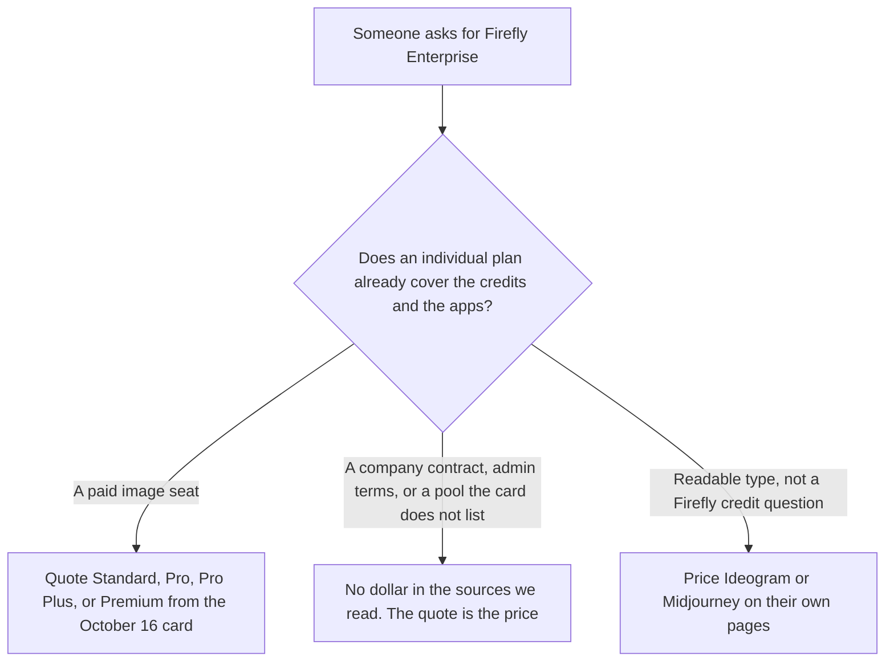

**This page does not quote an Adobe Firefly Enterprise price, because the sources we could read do not print one.** The individual ladder, from the directory card checked October 16, 2026, stops at Firefly Premium: $199.99 a month for 50,000 credits. Standard is $9.99 for 2,000 credits, Pro is $19.99 for 4,000, and Pro Plus is $49.99 for 10,000. That ladder is [Adobe Firefly pricing explained](/blog/adobe-firefly-pricing-explained-2026/). This page is the company contract people ask for when Premium is not the question.

On October 24, 2026, the plans page at adobe.com/products/firefly/plans.html named compare fragments for individual, education, and business plans, and the rendered text we received did not include a business seat price. A fetch of the business compare fragment returned HTTP 401. The October 16 directory card does not list an Enterprise dollar either. A sales quote is the price. This page will not estimate one from Premium.

The product page is [Adobe Firefly review](/blog/adobe-firefly-review-2026/). A stills comparison is [Midjourney vs Adobe Firefly](/blog/midjourney-vs-adobe-firefly-2026/). A label that has to be readable is [Midjourney vs Ideogram for product shots](/blog/midjourney-vs-ideogram-for-product-shots-2026/).

Individual prices below are US list prices from the October 16 directory record. Published October 24, 2026. We did not score images. We did not receive an enterprise quote. Adobe sometimes runs first-year discounts. The directory does not record a standing discount amount.

## What we can quote, and what we cannot

| Plan | Price this site can cite | Credits on that record | Why it is or is not Enterprise |
|---|---|---|---|
| Free | $0 | Limited daily generations | A trial of the app |
| Standard | $9.99 a month | 2,000 | The first paid individual pool |
| Pro | $19.99 a month | 4,000 | Adds Express Premium and Photoshop on web and mobile, on that card |
| Pro Plus | $49.99 a month | 10,000 | A larger individual pool |
| Premium | $199.99 a month | 50,000 | The highest individual dollar on the October 16 card |
| Business or Enterprise | Not printed in the sources read for this page | Not printed | Ask Adobe. Do not call Premium the enterprise plan |

On the October 16 card, paid plans include unlimited standard image and vector generations. Credits pay for premium work: video, audio, partner models, and the premium image models that card names. The base article records Generate Video at 20 credits a second at 540p, 50 at 720p, and 100 at 1080p, from Adobe's rate card as the directory captured it. Those rates belong to that individual credit story. They are not an enterprise rate this page is allowed to reuse as a contract price. Credits do not roll over, on that same record.

Pro, Pro Plus, and Premium include Adobe Express Premium and Photoshop on the web and mobile. Buying a sales contract to get Photoshop on the web is a reason to read the Pro line first, at $19.99. If the company needs terms the individual cards do not name, the individual cards are the wrong quote, and the missing business dollar stays missing until Adobe prints it or sends a quote.

## What a neighboring plan does, and does not, tell you

**A GPU clock with a published company rule.** [Midjourney](/tools/midjourney/) Basic is $10 a month or $8 billed annually on the October 16 card. Pro is $60 or $48, and Mega is $120 or $96. Stealth is Pro or Mega, and the card says companies with over $1 million in gross revenue need Pro or Mega. That revenue line is Midjourney's. It is not a Firefly enterprise price. The invoice is [Midjourney pricing explained](/blog/midjourney-pricing-explained-2026/).

**Readable type, with Enterprise marked custom.** [Ideogram](/tools/ideogram/) Plus is $20 a month or $15 billed yearly. The Ideogram pricing article records Enterprise as custom, which is a word on their card, not a dollar, and not a Firefly dollar. The invoice is [Ideogram pricing explained](/blog/ideogram-pricing-explained-2026/).

**A layout seat in the same company family.** [Adobe Express](/tools/adobe-express/) is a different product. This page does not restate an Express dollar. Firefly Pro's inclusion of Express Premium, on the October 16 card, is an individual Firefly line. It is not proof that a Firefly enterprise contract costs the same as Express.

## What not to assume

Do not print an Enterprise or Business Firefly price. Do not treat Premium at $199.99 as "the enterprise plan." Do not multiply 50,000 credits into a company pool. Do not convert a non-USD checkout, or a first-year promo the directory did not record, into a list price. Do not move Midjourney's revenue rule onto Adobe.

## FAQ

### How much is Adobe Firefly Enterprise?

The sources read for this page do not say. The October 16 directory card ends at Premium, $199.99 a month for 50,000 credits. The October 24 plans page named a business compare, and the fragment returned HTTP 401, so this page has no business seat price to quote. A quote from Adobe is the price.

### Does Premium include enterprise admin controls?

The October 16 card describes Premium as the large individual credit pool, with Express Premium and Photoshop on web and mobile, the same apps Pro and Pro Plus include. It does not describe Premium as an enterprise agreement. If you need terms that card does not list, ask Adobe, and keep Premium's $199.99 in the individual column.

### Are the video credit rates an enterprise rate?

They are the rates the directory recorded from Adobe's credit FAQ, and the base pricing article uses them for the individual plans. This page does not apply them to a contract we could not read. Confirm any enterprise rate card on the quote.

### Does this page replace the main Firefly pricing article?

No. That article is Free through Premium, and what a credit buys. This article is the company question: the highest individual dollar we can still cite, and the business price we will not invent.

## Last verified

October 16, 2026 for the individual Firefly, Midjourney, and Ideogram prices, via the posts cited above. October 24, 2026 for the Firefly plans page, which did not render a business dollar, and for the business compare fragment, which returned HTTP 401. Published October 24, 2026. No enterprise quote was received.

**Sources:** [Adobe Firefly plans](https://www.adobe.com/products/firefly/plans.html), [Generative credits FAQ](https://helpx.adobe.com/creative-cloud/apps/generative-ai/generative-credits-faq.html), [Adobe Firefly](https://firefly.adobe.com).

*Published by Andrew for [AI Tools Optimizer](https://aitoolsoptimizer.com).*

[Adobe Firefly](/tools/adobe-firefly/) is in the [image generation directory](/tools/category/image-generation/). Directory pages may use affiliate links. A purchase through them may earn us a commission at no extra cost to you.
