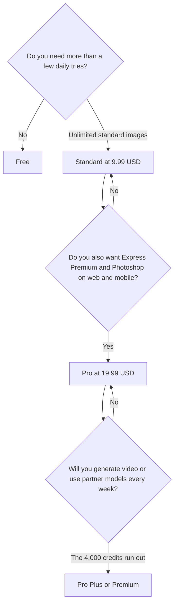

**Firefly pricing is a credit pool for premium work, on top of unlimited standard image and vector generations once you pay.** Standard is $9.99 a month for 2,000 credits. Pro is $19.99 for 4,000. Pro Plus is $49.99 for 10,000. Premium is $199.99 for 50,000. Free is a limited number of daily generations. The credits are not the images, on a paid plan. The credits are video, audio, partner models, and the premium image models the card names.

The product page is [Adobe Firefly review](/blog/adobe-firefly-review-2026/). The stills comparison is [Midjourney vs Adobe Firefly](/blog/midjourney-vs-adobe-firefly-2026/). The three-way with the other meters is [FLUX vs Ideogram vs Firefly](/blog/flux-vs-ideogram-vs-firefly-2026/).

Prices are US list prices from the directory page checked October 16, 2026. Published October 24, 2026. We did not score images. Adobe sometimes runs first-year discounts. The directory does not record a standing discount amount, so the checkout price wins.

## The ladder

| Plan | Monthly price | Credits | What the credits are not |
|---|---|---|---|
| Free | $0 | Limited daily generations, refreshed each day | A paid credit pool |
| Standard | $9.99 | 2,000 | A video plan. Standard images on paid plans do not spend these |
| Pro | $19.99 | 4,000 | The same idea, plus Express Premium and Photoshop on web and mobile |
| Pro Plus | $49.99 | 10,000 | A reason to skip Pro if you only needed those apps |
| Premium | $199.99 | 50,000 | A quality tier. It is a larger credit pool |

Pro, Pro Plus, and Premium include Adobe Express Premium and Photoshop on the web and mobile. Standard is the Firefly app and the credit pool. If you bought Pro only for a larger pool and you will not open those apps, you paid $10 a month for 2,000 extra credits. That may still be the right math. It is a different reason than "I need Photoshop."

Credits reset each month. The directory says they do not roll over. A quiet month is not a bank.

## What a credit buys

From Adobe's rate card, as recorded on the directory page: Generate Video is 20 credits per second at 540p, 50 per second at 720p, and 100 per second at 1080p, at 24 fps. Firefly Image 5 is 10 credits a generation. Generate Music is 20 credits a minute. Custom model training is 500 credits, then 20 credits a generation. Partner models spend credits. Standard image and vector generations on paid plans do not.

A 5-second 1080p clip is 500 credits on that card. Standard's 2,000 credits are four of those clips, before retries. The same plan's standard stills are not counted in that 2,000. Price the thing you will actually render. Test video at 540p. The beginners' walkthrough of this arithmetic is in [AI image generators, a beginners' guide](/blog/ai-image-generators-beginners-guide/).

If Premium users run out, the directory says video generations are queued and processed in the background. That is a queue, not a second free pool. Creative Cloud Pro includes 4,000 premium credits a month, on the same page. If you already pay for that Creative Cloud plan, read it before you buy Firefly Premium for the credits alone.

Failed generations are typically refunded, on the directory's pros list. "Typically" is Adobe's behavior as recorded, not a promise this page can enforce.

## Firefly next to a different meter

[Midjourney](/tools/midjourney/) has no free plan. Basic is $10 a month, or $8 billed annually, for Fast GPU hours. Standard at $30, or $24 annually, adds unlimited Relax images. You buy Midjourney for a look and a GPU clock. You buy Firefly when the asset should sit in Adobe's apps and the standard stills should stop metering. The clock is [Midjourney pricing explained](/blog/midjourney-pricing-explained-2026/). Companies over $1,000,000 in gross revenue have a Midjourney plan rule. Firefly's commercial guidance is on Adobe's card: features without a beta label can be used commercially, and the directory says beta outputs are not indemnified for eligible business customers. Read the label on the feature you used.

[Ideogram](/tools/ideogram/) Plus is $20 a month, or $15 billed yearly, for 2,400 credits. That credit is an Ideogram generation credit, not a Firefly credit. Text-heavy graphics are the reason to cross over. The card is [Ideogram pricing explained](/blog/ideogram-pricing-explained-2026/).

[FLUX](/tools/flux/) has no seat. FLUX 3 Klein starts at $0.008 an image at 768×768. One Firefly credit is not $0.008. The card is [FLUX pricing explained](/blog/flux-pricing-explained-2026/).

[Adobe Express](/tools/adobe-express/) is the lighter Adobe surface. This page does not restack its price on top of Firefly Pro, because Pro already includes Express Premium. Check whether you are paying for Express twice.

## FAQ

### Is Firefly free?

Yes, with a limited number of daily generations that refresh. Standard at $9.99 is the first paid pool, and it is the plan that unlocks unlimited standard image and vector generations.

### Do standard images use credits?

Not on paid plans, on this directory card. Credits are for premium features: video, audio, partner models, and premium image models such as Image 5 and Image 4 Ultra. If the model picker says premium, it spends credits.

### Do credits roll over?

No. Unused credits reset to the plan allocation. Do not buy Premium in a busy month and expect the leftover to survive.

### Is Premium twenty times more capable?

Premium is 50,000 credits against Standard's 2,000, which is 25 times the pool, at about 20 times the price. It is not a quality score. If your work is standard stills, Standard is the plan. Premium is for people who will spend the credits on video and partner models.

## Last verified

October 16, 2026 for Firefly, Midjourney, Ideogram, and FLUX prices named above. Published October 24, 2026.

**Sources:** [Adobe Firefly plans](https://www.adobe.com/products/firefly/plans.html), [Generative credits FAQ](https://helpx.adobe.com/creative-cloud/apps/generative-ai/generative-credits-faq.html), [Midjourney plans](https://docs.midjourney.com/hc/en-us/articles/27870484040333-Comparing-Midjourney-Plans).

*Published by Andrew for [AI Tools Optimizer](https://aitoolsoptimizer.com).*

[Adobe Firefly](/tools/adobe-firefly/) is in the [image generation directory](/tools/category/image-generation/). Directory pages may use affiliate links. A purchase through them may earn us a commission at no extra cost to you.
