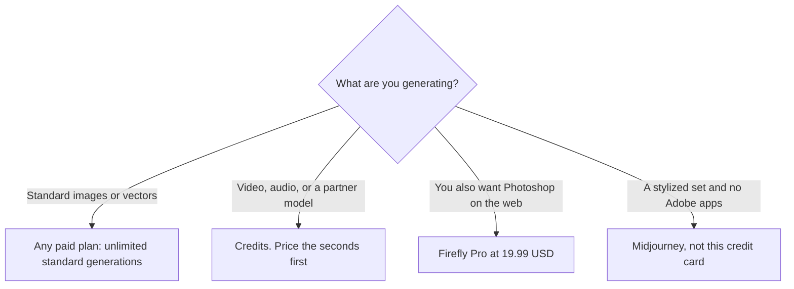

**Adobe Firefly's paid plans include unlimited standard image and vector generations. Credits are for the premium work: video, audio, partner models, and the higher image models.** Standard is $9.99/month with 2,000 credits. Pro is $19.99 and adds Photoshop on the web and mobile, plus Express Premium. A 1080p video second costs 100 credits on Adobe's rate card, so Standard's pool is 20 seconds at that setting.

Prices are US list prices from Adobe's plan comparison and credits FAQ, checked October 16, 2026. Adobe sometimes runs first-year discounts. Tax and regional prices differ. We did not score image taste against Midjourney. The math below uses Adobe's published rates.

Where Firefly sits among other generators is [Midjourney alternatives](/blog/midjourney-alternatives-2026/) and [best AI image generators](/blog/best-ai-image-generators-2026/). Prompt basics are in the [beginner's guide](/blog/ai-image-generators-beginners-guide/).

## The plans

| Plan | Price / month | Credits / month | Apps included | What the credits are for |
|---|---|---|---|---|
| Free | $0 | A limited daily refresh | Firefly | A capped taste of generations |
| Standard | $9.99 | 2,000 | Firefly | Premium features. Standard images and vectors do not spend credits |
| Pro | $19.99 | 4,000 | Firefly, Express Premium, Photoshop web and mobile | The same split, with a larger pool |
| Pro Plus | $49.99 | 10,000 | Same apps as Pro | More premium work |
| Premium | $199.99 | 50,000 | Same apps as Pro | The pool for heavier video. If it runs out, video can queue |

Credits reset each month. Unused credits do not roll over. Failed generations are typically refunded. Beta features can be used commercially unless the product says otherwise, and Adobe says beta outputs are not indemnified for eligible business customers. Non-beta generative features are the ones Adobe presents as commercially usable. Read the current license if the asset is going into an ad. This article is not legal advice.

## What 2,000 credits buy, using Adobe's rate card

Adobe's credits FAQ lists Generate Video at 20 credits per second at 540p, 50 per second at 720p, and 100 per second at 1080p, at 24 fps. Generate Music is 20 credits per minute. Firefly Image 5 is 10 credits per generation. Custom-model training is 500 credits, then 20 per generation. Those rates are the planning numbers. They can change, and partner models spend premium credits too.

| Premium job | Rate we used | Standard, 2,000 credits | Pro, 4,000 credits |
|---|---|---|---|
| Generate Video at 540p | 20 / second | 100 seconds | 200 seconds |
| Generate Video at 720p | 50 / second | 40 seconds | 80 seconds |
| Generate Video at 1080p | 100 / second | 20 seconds | 40 seconds |
| Generate Music | 20 / minute | 100 minutes | 200 minutes |
| Firefly Image 5 | 10 / image | 200 images | 400 images |

Standard images that Adobe classifies as standard do not appear in that table, because they do not spend the pool. A designer who lives in stills can stay on Standard and treat credits as the video and partner-model budget. A social team that wants 1080p clips will empty Standard in a few shots. Test at 540p, then render the keeper at 1080p. A 4-second 1080p test is 400 credits, which is a fifth of Standard.

Premium's 50,000 credits are 500 seconds of 1080p at the same rate, which is a little over eight minutes before retakes. That is still not a long-form edit. Firefly is a shot tool. A timeline belongs in Premiere, where Generative Extend uses the same credit idea, or in an editor such as [Descript](/tools/descript/) if the footage is someone talking.

Partner models from companies Adobe lists, including Google, OpenAI, and ElevenLabs, sit in the Firefly app and spend credits. The convenience is one login. The cost is that a "Firefly" render may be a partner model at a premium rate. Check the model name before you assume the unlimited-image rule applies.

## Firefly, Express, and Creative Cloud

[Adobe Express](/tools/adobe-express/) Premium is $9.99/month and includes 250 generative credits, plus the template library. Firefly Pro at $19.99 includes Express Premium and Photoshop on web and mobile, with 4,000 credits. If you were about to buy Express Premium and a Firefly plan, Pro is the one to price first.

Creative Cloud Pro includes 4,000 premium credits a month on the note we stored, which matches Firefly Pro's pool and is a reason not to add a separate Firefly seat if the Creative Cloud plan already grants it. Confirm the credit line on your Cloud plan before you subscribe twice. K-12 schools can get Express for Education with premium features at no cost. That is an education license, not the Firefly Premium video pool.

## When a different generator is the right bill

| Constraint | Better fit | Entry price |
|---|---|---|
| You want a paid artistic default and you do not need Photoshop | [Midjourney](/tools/midjourney/) | Basic $10/month, or $8/month annual. No free plan |
| Words inside the image must be spelled correctly | [Ideogram](/tools/ideogram/) | Free is 30 credits a week. Plus is $15/month yearly |
| You want to iterate in a chat | [ChatGPT Images](/tools/dall-e/) | Included with ChatGPT. Plus is $20/month |
| You want a token plan and personal models | [Leonardo.Ai](/tools/leonardo-ai/) | Essential is $12/month. See the [Leonardo review](/blog/leonardo-ai-review-2026/) |
| You want a free browser test with no card | [Krea](/tools/krea/) | 100 compute units a day. See [free Midjourney alternatives](/blog/best-free-midjourney-alternatives-no-discord-2026/) |

Firefly wins when the file has to move into Photoshop, Express, or Premiere, and when Adobe's training-data position matters to the client. Adobe says its Firefly models were trained on licensed content such as Adobe Stock and on public-domain content. That is a vendor statement about training data, not a warranty we are adding. Partner models inside the same app are other companies' models. Name the model in the delivery notes if the client asked for Firefly specifically.

## A first paid month

1. Use the free daily generations to learn the picker. Note which models are marked premium.
2. Make the stills you need on a paid plan and watch whether the credit balance moves. If it does not, you are in the unlimited standard path.
3. Render one second of video at 540p and at 1080p. Confirm the drop matches the rate card closely enough to budget.
4. Stay on Standard if the stills are the job. Move to Pro if you also want Photoshop on the web and a 4,000-credit pool.
5. Do not buy Premium until a real month of 1080p seconds exceeds Pro.

## FAQ

### Is Adobe Firefly free?

Yes, with a limited number of daily generations that refresh. Paid plans start at $9.99/month. Unlimited standard image and vector generations are a paid-plan feature.

### How many credits does Firefly video use?

Adobe's rate card lists 20 credits per second at 540p, 50 at 720p, and 100 at 1080p. On those rates, Standard's 2,000 credits are 20 seconds at 1080p.

### Can I use Firefly images commercially?

Adobe says outputs from generative features can be used commercially unless a feature is marked as a beta that is personal-use only. For eligible business customers, beta outputs are not indemnified. Check the label on the feature you used.

## Last verified

October 16, 2026. Recheck [Firefly plans](https://www.adobe.com/products/firefly/plans.html) and the [generative credits FAQ](https://helpx.adobe.com/creative-cloud/apps/generative-ai/generative-credits-faq.html) before you budget a video month. Rates move.

The [Adobe Firefly](/tools/adobe-firefly/) directory page may include an affiliate link. A purchase through it may earn us a commission at no extra cost to you.
