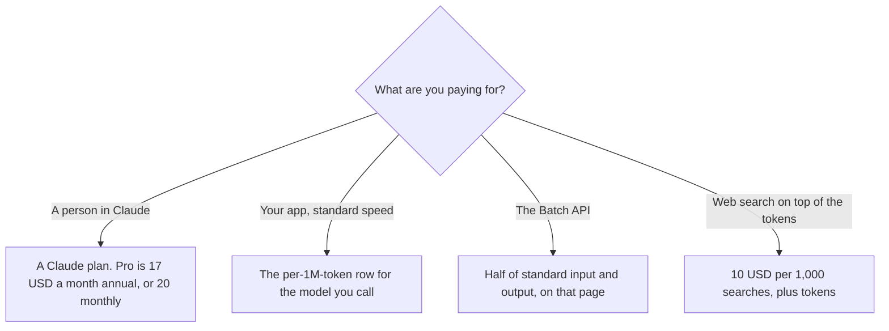

**The Anthropic API bills tokens and a few tool meters. It does not bill a Claude seat.** On the Claude Platform pricing page fetched October 24, 2026, at platform.claude.com/docs/en/about-claude/pricing, base prices per million tokens include Claude Fable 5.1 at $10 input and $50 output, Claude Opus 5.5 at $4 and $20, and Claude Sonnet 5.5 at $2 and $10. Claude Haiku 5.5 is $0.10 input and $0.50 output for prompts up to 100,000 tokens. The page says all prices are USD. The product link for the chat side of the company is [Claude](/tools/claude/).

A Claude subscription is the other product. Pro is $17 a month billed annually, $200 up front, or $20 monthly, on claude.com/pricing the same day. The seat ladder is [Claude pricing explained](/blog/claude-pricing-explained-2026/). A neighboring token bill is [OpenAI API pricing explained](/blog/openai-api-pricing-explained-2026/). The idea of a key in front of a product is [what an API for AI tools is](/blog/what-is-an-api-for-ai-tools-2026/).

Published October 24, 2026. We did not run a bill. Prices below are the ones on that platform page. The directory has no separate Anthropic API card.

## How to read one row

| Model, standard | Input, per 1M tokens | Output, per 1M tokens | Cache hit, per 1M tokens | Batch input / output, per 1M tokens |
|---|---|---|---|---|
| Claude Fable 5.1 | $10 | $50 | $0.25 | $5 / $25 |
| Claude Opus 5.5 | $4 | $20 | $0.20 | $2 / $10 |
| Claude Sonnet 5.5 | $2 | $10 | $0.10 | $1 / $5 |
| Claude Haiku 5.5, prompts up to 100,000 tokens | $0.10 | $0.50 | $0.01 | $0.05 / $0.25 |

Haiku 5.5 above 100,000 prompt tokens is a second price on that page: $0.50 input and $2.50 output per million tokens. The cache hit on that long row is $0.05. Batch for that long row is $0.25 input and $1.25 output. Do not apply the $0.10 input price after the prompt has crossed 100,000 tokens.

Cache writes are not the hit price. On the same table, a 5-minute cache write is $12.50 per million for Fable 5.1, $5 for Opus 5.5, $2.50 for Sonnet 5.5, and $0.125 for short Haiku 5.5. A 1-hour write is $20, $8, $4, and $0.20 on those four cells. The first write is not a hit. Quote the column you will actually use.

The page says the Batch API is a 50 percent discount on input and output tokens, and the batch cells above match that halving. It also says fast mode is not available with the Batch API. Fast mode for Opus 5.5 is $8 input and $40 output per million tokens, across the full context window, including requests over 200,000 input tokens. Fast mode for Opus 5 and Opus 4.8 is $10 and $50, and the page marks that pair as a research preview. Cache and data-residency multipliers stack on fast mode, on that page. A forecast that uses the $4 Opus 5.5 input price for a fast-mode call is the wrong column.

## Meters that are not the token row

**Web search**, on that page, is $10 per 1,000 searches, plus standard token costs for search-generated content. Each search counts as one use, regardless of how many results come back. The page says an error during web search is not billed. Web fetch, on the same page, has no additional charge beyond tokens.

**Code execution** is free when the request includes the web search or web fetch tool versions the page names. Without those tools, the page bills execution time at a 5-minute minimum, with 1,550 free hours per organization each month, then $0.05 per hour per container. If files are included, the page says execution time is billed even when the tool is not called, because files are preloaded. A token forecast that ignores this meter is incomplete for that workload.

**A Claude seat** can include platform credits, and those credits are not the rates in the table. The October 24 Claude pricing page lists monthly API credits as none on Free and Pro, $100 on Max 5x, and $200 on Max 20x. Team lists up to $500 a month in pooled API credits, marked as the Claude Platform. Spend past the credit is still this meter. The Team seat article is [Claude Team pricing explained](/blog/claude-team-pricing-explained-2026/).

**A neighboring API.** [DeepSeek](/tools/deepseek/) Flash off-peak is $0.15 per million input tokens on a cache miss on the October 16 directory card. That is DeepSeek's meter. The invoice is [DeepSeek pricing explained](/blog/deepseek-pricing-explained-2026/).

The platform page also says Claude 4.7 and later models, and Claude Mythos Preview, use a newer tokenizer that produces approximately 30 percent more tokens for the same text, with the exact increase depending on the content. Sonnet 4.6 and earlier use the previous tokenizer. Do not multiply a word count by an old rule of thumb and call it this bill.

Partner clouds, including Amazon Bedrock and Google Cloud, are a different invoice. The page points at those providers for their prices. This article does not copy them.

## What not to assume

Do not add a Pro seat and an API forecast and call the sum "Claude." Do not price a call with only the input column. Output, cache writes, and cache hits are different cells. Do not treat a cache hit as the price of the first request. Do not apply Haiku's short-prompt price to a long prompt. Do not assume fast mode is the standard Opus 5.5 row.

## FAQ

### How much is the Anthropic API?

There is no single price. On October 24, 2026, standard Claude Haiku 5.5 was $0.10 per million input tokens and $0.50 per million output tokens for prompts up to 100,000 tokens. Sonnet 5.5 was $2 and $10. Opus 5.5 was $4 and $20. Fable 5.1 was $10 and $50. Your model, your prompt length, and your speed decide the row.

### Does Claude Pro include the API?

Pro is a seat. The platform page is a meter. Max lists monthly API credits on the October 24 Claude pricing page. Those credits are a balance. They are not a second copy of the per-million rates. A person who has Pro and an API key can still have two relationships.

### What is the Batch API discount?

The page says 50 percent off input and output tokens. Opus 5.5 batch is $2 input and $10 output per million tokens on that table, against $4 and $20 standard. You get the batch cell when the request is actually batch. Fast mode is not available with batch, on that page.

### Are Bedrock prices the same numbers?

The platform page treats partner-operated clouds as the cloud provider's invoice and tells you to read those pricing pages. Do not paste this table into a Bedrock forecast. Use the provider's page for the endpoint you will call.

## Last verified

October 24, 2026, from https://platform.claude.com/docs/en/about-claude/pricing. Claude seat and API-credit figures are from claude.com/pricing the same day. DeepSeek's comparison uses the October 16 directory card. Published October 24, 2026.

**Sources:** [Claude Platform pricing](https://platform.claude.com/docs/en/about-claude/pricing), [Claude pricing](https://claude.com/pricing), [OpenAI API pricing](https://developers.openai.com/api/docs/pricing), [DeepSeek API pricing](https://api-docs.deepseek.com/quick_start/pricing).

*Published by Andrew for [AI Tools Optimizer](https://aitoolsoptimizer.com).*

[Claude](/tools/claude/) is in the [chatbots and assistants directory](/tools/category/chatbots-assistants/). Directory pages may use affiliate links. A purchase through them may earn us a commission at no extra cost to you.
