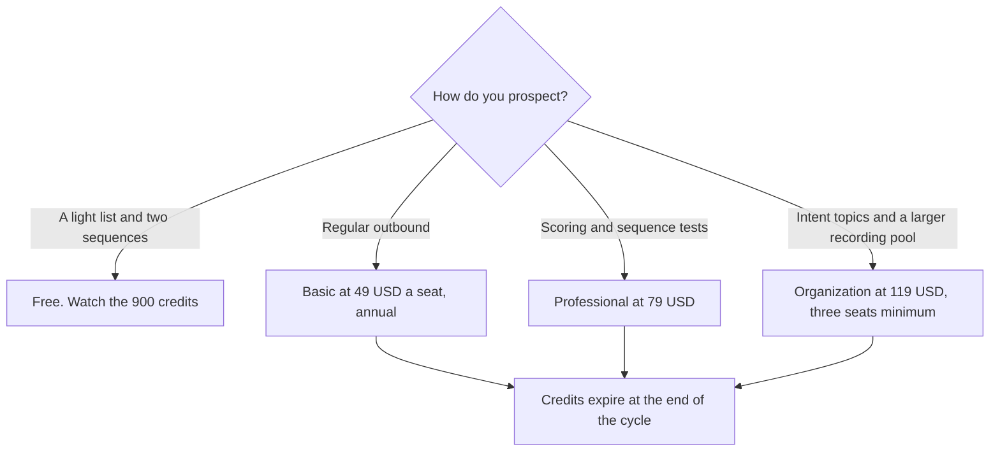

**Apollo.io Basic is $49 per seat per month billed annually. Professional is $79. Organization is $119, with a three-seat minimum.** Free includes 900 credits per seat per year. Paid credits are granted up front each year and do not roll over. Apollo labeled the card we recorded as introductory pricing that may change. Monthly billing costs more. The directory says annual billing saves 24 percent, and it does not print the monthly dollar, so this page does not either.

The adjacent invoices are [Clay pricing explained](/blog/clay-pricing-explained-2026/) and [Instantly pricing explained](/blog/instantly-pricing-explained-2026/). Where this database sits in a demand program is [best AI tools for demand gen](/blog/best-ai-tools-for-demand-gen-2026/). The sales shelf is [best AI tools for sales teams](/blog/best-ai-tools-for-sales-teams-2026/).

Prices are US list prices excluding tax from Apollo's pricing page as recorded in the directory on October 16, 2026. A live fetch of that page returned HTTP 401 on October 24, 2026, so the table stays on the directory record. Published October 24, 2026. We did not score contact accuracy or reply rates.

## The annual seats

| Plan | Per seat, billed annually | Credits | What the card highlights |
|---|---|---|---|
| Free | $0 | 900 per seat per year, granted monthly | 2 sequences, AI research, 5 AI chats, 150 call-recording minutes, Gmail only for sending |
| Basic | $49 | 30,000 per seat per year, up front | Unlimited sequences, deliverability suite, CRM integrations, 5 workflows |
| Professional | $79 | 48,000 per seat per year, up front | AI lead scoring, A/Z testing, 4,000 recording minutes |
| Organization | $119, minimum 3 seats | 72,000 per seat per year, up front | 12 intent topics, unlimited meeting events, 8,000 recording minutes |

All seats on one account must be on the same plan. A mixed team cannot put one rep on Basic and another on Professional. Buy the row the heaviest user needs, or split accounts only if you have a reason you can administer. There is no refund for unused time when you downgrade mid-cycle, on the directory card. Read that before you trial-hop.

## Credits, add-ons, and the trial

Credits pay for actions such as revealing emails and phone numbers, warmup, mailboxes, and AI-researched data. They are pooled across the team. Plan credits and add-on credits expire at the end of the billing cycle. Unused credits are not a savings. They are gone.

**Inbound** is an add-on: Essentials at $119 or Max at $639 per team per month, billed annually, on the card. **Advanced Dialer** is $119 per team per month, billed annually. A Power Dialer, Parallel Dialer, and local presence numbers sit on that dialer add-on. Do not assume they are inside Basic because the core product has a US dialer. The core dialer uses credits. Recording minutes are capped by plan: 150 on Free and Basic, 4,000 on Professional, 8,000 on Organization.

Basic and Professional offer a 14-day trial with credits and access to most features. Afterward you can upgrade or drop to Free. Extra credits can be bought from settings and renew each cycle until you remove them.

International dialing, taxes, and any introductory change are checkout questions. The card said prices exclude taxes and that the introductory numbers may change. If the button in your account disagrees with this table, the button is the price.

## When a different tool is the bill

**Clay Launch starts at $167 a month billed annually** when the work is a waterfall of providers and a table you design. Clay's free tier is 500 actions and 100 data credits a month. Apollo is the database-plus-sequences seat. Clay is the workflow when one vendor's record is not enough. Use both only if someone owns the credit math.

**Instantly Growth is $47 a month** for an outreach-only plan with 5,000 emails and 1,000 contacts, on the directory card. Buy Instantly when the sending infrastructure is the problem and the data already lives somewhere else. Buying Apollo and Instantly and Clay on day one is three meters.

**HubSpot** has a free CRM. Starter was listed at $7 or $10 a seat a month as a limited-time offer when the directory was checked, up to 65 percent off. Professional and Enterprise were not given as a single sticker on that card. HubSpot Credits were listed at $10 per 1,000. Confirm the current promo before you compare it with Apollo's $49. The tool page is [HubSpot](/tools/hubspot/). Gong, for conversation intelligence, is custom. The tool page is [Gong](/tools/gong/). This page does not invent a Gong price.

A sequence the model drafts still needs a human edit. The discovery questions before a meeting are [how to create a sales discovery script with AI](/blog/how-to-create-a-sales-discovery-script-with-ai-2026/). A first email that invents a fact about the account is [a hallucination](/blog/what-is-ai-hallucination-2026/).

## FAQ

### Is Apollo.io free?

Yes. Free has no time limit on the card: 900 credits per seat per year, granted monthly, two sequences, and Gmail sending. Paid plans add Microsoft and other mailbox providers, unlimited sequences, and the larger credit grants.

### Do credits roll over?

No. Unused plan credits and unused add-on credits expire at the end of the billing cycle. A quiet month does not fund a busy month.

### Why is Organization a three-seat minimum?

That minimum is on the recorded card, at $119 per seat billed annually. A two-person team that wants intent topics should ask sales whether the minimum still applies, and otherwise stay on Professional until the third seat is real.

### Does annual billing always save 24 percent?

That is what Apollo said on the card we recorded, about the introductory annual price versus monthly. We do not print a monthly dollar the directory did not record. Compare the two numbers in your checkout.

## Last verified

October 16, 2026, from apollo.io/pricing as recorded in the directory. Live fetch on October 24, 2026 returned HTTP 401. Apollo called the recorded figures introductory. Published October 24, 2026.

**Sources:** [Apollo.io pricing](https://www.apollo.io/pricing), [Clay pricing](https://www.clay.com/pricing), [Instantly pricing](https://instantly.ai/pricing).

*Published by Andrew for [AI Tools Optimizer](https://aitoolsoptimizer.com).*

[Apollo.io](/tools/apollo-io/) is in the [sales directory](/tools/category/sales/). Directory pages may use affiliate links. A purchase through them may earn us a commission at no extra cost to you.
