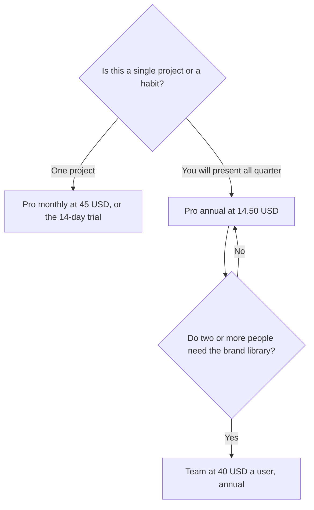

**Beautiful.ai pricing is a seat, not a credit pack.** Pro is $14.50 a month billed annually for an individual. The same Pro seat is $45 a month if you pay month to month. Team is $40 a user a month billed annually, or $50 billed monthly, for teams of 2–20. Enterprise is custom. There is no permanent free plan.

Every paid seat includes unlimited AI content generation, 300+ Smart Slide layouts, and PowerPoint import and export. That unlimited line is the thing to compare with Gamma and Plus AI, which meter credits.

Prices are US list prices excluding tax, from Beautiful.ai's pricing page as recorded October 16, 2026. Published here October 24, 2026. The product review is [Beautiful.ai review](/blog/beautiful-ai-review-2026/). The three-way on format is [Gamma vs Beautiful.ai vs Plus AI](/blog/gamma-vs-beautiful-ai-vs-plus-ai-2026/).

## The ladder

| Plan | Price | Who it is for |
|---|---|---|
| Trial | 14 days of Pro or Team | A real deck, then a decision |
| Student | A free year with a valid .edu email | Students. Confirm the email requirement at signup |
| Pro, annual | $14.50/month billed annually | An individual who will keep the tool |
| Pro, monthly | $45/month | One project, or a month you may cancel |
| Team, annual | $40/user/month billed annually | 2–20 people, shared libraries, brand controls |
| Team, monthly | $50/user/month | The same team tools without an annual commit |
| Enterprise | Custom | SSO, advanced controls, onboarding |

The monthly-to-annual gap is large: $45 versus $14.50. Annual is the price of a tool you kept. Monthly is the price of a tool you might close. Start on the trial. Move to monthly if the trial was too short to finish the deck. Move to annual after a second deck ships.

## What the seat includes, and what it does not

The October 16 page ties unlimited AI generation to the paid seat. You are not buying a 1,000-credit month. You are buying the editor and the generation that comes with it. The outline is still your job. Smart Slides rearrange a point. They do not supply a client fact you never wrote down.

PowerPoint import and export is the practical difference with [Gamma](/tools/gamma/). Gamma Plus is $9 a seat a month and produces cards. If the working file has to be PowerPoint, Beautiful.ai's export is the line to test during the trial. Gamma's credit math is [Gamma pricing explained](/blog/gamma-pricing-explained-2026/).

[Plus AI](/tools/plus-ai/) is the other file-native option: it works inside Google Slides and PowerPoint. Basic is $10 a user a month billed annually, with 1,500 credits. Beautiful.ai is the better quote when you want Beautiful.ai's layout system and an unlimited generation line. Plus AI is the better quote when the client already lives in a Slides file and you must edit there. The review is [Plus AI review](/blog/plus-ai-review-2026/).

Team is a brand-control plan, not a volume discount on Pro. At $40 a user on annual billing, two people are $80 a month before you have asked whether both of them present. One Pro seat at $14.50 plus a shared export can be enough for a two-person shop. Buy Team when the library and the permissions are the reason, which is what the page says the plan is for.

## The trial, the student year, and the neighbors

Use the 14-day trial on a deck you would have made anyway. A lorem deck does not tell you whether Smart Slides fit your content. If you are a student with a .edu email, the free year is the plan to confirm before anyone pays $45.

[Canva](/tools/canva/) Pro is $18 a month, or $180 a year, for one person. It is a design suite with a limited AI allowance on Free and a larger one on Pro. Use it when the work is social posts and brand kits as well as slides. The presentation shelf is [best AI presentation makers](/blog/best-ai-presentation-makers/).

[Pitch](/tools/pitch/) is the collaborative deck tool. Plus is $10 a seat a month billed yearly, with 500 AI credits a seat. Free covers up to 5 members and 100 one-time AI credits. Pitch is the quote when the team needs comments and a shared workspace more than Smart Slides.

A consultant choosing among these for client work should read [best AI tools for consultants](/blog/best-ai-tools-for-consultants-2026/). The deck is one job in that stack.

## FAQ

### How much is Beautiful.ai Pro?

$14.50 a month billed annually, or $45 a month with monthly billing. There is a 14-day trial. There is no permanent free plan on the page we checked.

### How much is Beautiful.ai Team?

$40 per user per month billed annually, or $50 billed monthly, for teams of 2–20, with shared libraries and brand controls. Enterprise is custom.

### Does Beautiful.ai charge credits for AI?

The pricing page recorded October 16, 2026 says every seat includes unlimited AI content generation. Gamma and Plus AI use monthly credits. Confirm the current card if a renewal quote says otherwise.

### Is there a student plan?

The directory page records a free year for students with a valid .edu email. Use that check at signup. It is not the same thing as the 14-day Pro trial.

## Last verified

October 16, 2026. Published October 24, 2026.

**Sources:** [Beautiful.ai pricing](https://www.beautiful.ai/pricing), [Beautiful.ai](https://www.beautiful.ai/).

*Published by Andrew for [AI Tools Optimizer](https://aitoolsoptimizer.com).*

[Beautiful.ai](/tools/beautiful-ai/) is in the [presentations directory](/tools/category/presentations/). Directory pages may use affiliate links. A purchase through them may earn us a commission at no extra cost to you.
