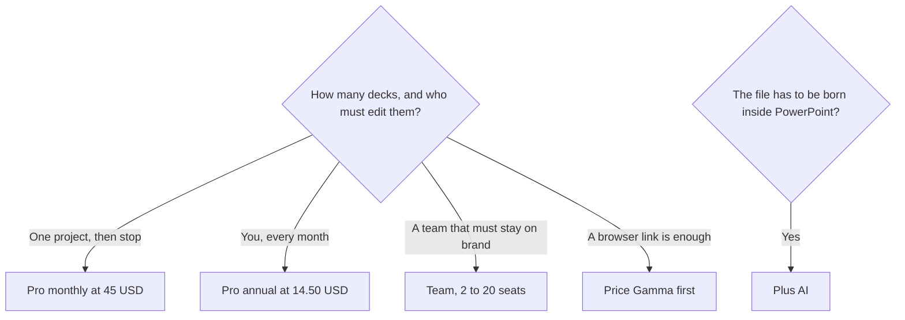

**[Beautiful.ai](/tools/beautiful-ai/) builds decks on Smart Slides that realign as you add content.** There is no permanent free plan. Pro is $14.50 a month billed annually, or $45 billed monthly. Team is $40 per user per month billed annually, or $50 monthly, for teams of 2 to 20. Enterprise is custom. Every seat includes unlimited AI content generation, 300+ Smart Slide layouts, and PowerPoint import and export.

Prices are US dollars from Beautiful.ai's pricing page, recorded October 16, 2026. A 14-day trial covers Pro or Team. Students with a valid .edu email can get a free year. Tax and regional checkout can differ. We did not score slide design against a human designer.

Choose among the field in [best AI presentation makers](/blog/best-ai-presentation-makers/). If the deliverable can be a Gamma link, read the [Gamma review](/blog/gamma-review-2026/) and [Gamma vs Canva](/blog/gamma-vs-canva-presentations/).

## The monthly price is a different product decision

Annual Pro is $14.50 × 12 = $174 for the year. Monthly Pro is $45 × 12 = $540 if you stay on it for a year. The monthly plan is the one Beautiful.ai describes for a one-off project you will cancel. It is a reasonable two-month experiment ($90) and an expensive habit.

| Plan | Price | Who it is for |
|---|---|---|
| Pro annual | $14.50/month | One person who presents often |
| Pro monthly | $45/month | A short project. Cancel when it ends |
| Team annual | $40/user/month | 2 to 20 people, shared libraries, locked brand themes |
| Team monthly | $50/user/month | The same team, without the annual commitment |
| Enterprise | Custom | SAML SSO and onboarding |
| Education | Free year | A valid .edu email |

The invoice is [Beautiful.ai pricing explained](/blog/beautiful-ai-pricing-explained-2026/).

Unlimited AI generation on every paid seat is the unusual line. [Gamma](/tools/gamma/) and [Plus AI](/tools/plus-ai/) meter credits. Beautiful.ai's pricing page, as we recorded it, does not. The constraint is the Smart Slide, not a credit counter. If you need a layout the template system will not hold, the unlimited AI does not buy you a blank canvas.

## What Smart Slides change about the work

You start from a prompt, a pasted outline, or source files and links. You edit a slide-by-slide outline before the deck is generated, pick a theme and an image style, then generate. After that you swap layouts. Charts are data-linked. The writing assistant and translation are included. You can present, record a voice-over, share a link with permissions, and see which slides people viewed.

PowerPoint import and editable PowerPoint export, plus PDF export, are on paid plans. "Editable export" still deserves a test with your real template. A file that opens in PowerPoint can still look different from a deck that was built there. If the company standard is a native Google Slides or PowerPoint master, [Plus AI](/tools/plus-ai/) writes into those apps. Plus AI Basic is $10 per user per month billed annually after a 7-day trial.

Team adds a shared asset library and locked themes so a new hire cannot drift the brand. That is the reason to pay $40 per user instead of buying separate Pro seats. Two people on Team annual are $80 a month. Two people on Pro annual are $29. The extra $51 a month is the shared system, not more AI.

The app is on the web. There is no desktop editor in the materials we used.

## Fit score

| Need | Pro monthly $45 | Pro annual $14.50 | Team |
|---|---|---|---|
| A deck this month, then cancel | Fits the stated use | A year you may not need | Oversized |
| Weekly client decks | Expensive if it lasts | Fits | Fits if several people edit |
| Unlimited AI generation | Listed | Listed | Listed |
| Locked brand theme | No | No | Yes |
| SSO | No | No | Enterprise |
| Stay inside PowerPoint the whole time | Export after | Export after | Export after |

The score is "does the pricing page include this," not "did a designer prefer the slide."

## FAQ

### How much does Beautiful.ai cost?

Pro is $14.50 per month billed annually or $45 month to month. Team is $40 per user per month annually or $50 monthly. Enterprise is custom.

### Is there a free plan?

No permanent free plan. There is a 14-day trial of Pro or Team, and a free year for students with a valid .edu email.

### Can I export PowerPoint?

Paid plans include PowerPoint import, editable PowerPoint export, and PDF export. Open the export in the template your client actually uses before you commit to a year.

### Does AI cost extra credits?

Beautiful.ai lists unlimited AI content generation on every seat. Confirm the live page if that line changes.

## Last verified

October 16, 2026.

**Sources:** [Beautiful.ai pricing](https://www.beautiful.ai/pricing), [Beautiful.ai](https://www.beautiful.ai).

[Beautiful.ai](/tools/beautiful-ai/) is in the [presentations directory](/tools/category/presentations/). Directory pages may use affiliate links. A purchase through them can earn us a commission at no extra cost to you.
