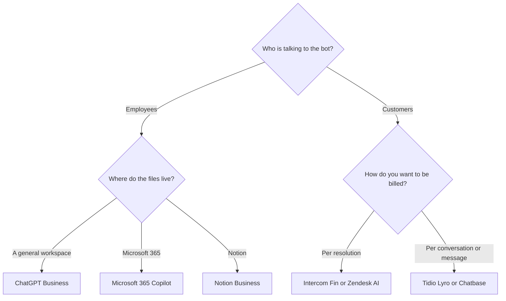

**A business chatbot is either an internal assistant with an admin, or a support agent that talks to customers.** Those are different bills. [ChatGPT](/tools/chatgpt/) Business and [Microsoft Copilot](/tools/microsoft-copilot/) sit with employees. [Intercom Fin](/tools/intercom-fin/), [Zendesk](/tools/zendesk-ai/), [Tidio](/tools/tidio/), and [Chatbase](/tools/chatbase/) sit on the help channel and charge for resolutions, conversations, or message credits.

Prices are US list prices checked October 16, 2026. Some are promotional and can revert. We did not measure resolution rates. A low per-outcome price is expensive if the outcome fires on conversations a human still has to redo. Fit labels describe the meter the vendor sells.

Consumer assistants are compared in [ChatGPT vs Gemini vs Claude](/blog/chatgpt-vs-gemini-vs-claude-2026/). Writing, specifically, is [ChatGPT vs Claude for writing](/blog/chatgpt-vs-claude-for-writing-2026/).

## Two shelves

| You need | Start here | The meter |
|---|---|---|
| A shared assistant, 2 or more people, training off by default | [ChatGPT](/tools/chatgpt/) Business | $20/user/month billed annually, or $25 monthly |
| Copilot inside Word, Excel, Outlook, and Teams | [Microsoft Copilot](/tools/microsoft-copilot/) | Microsoft 365 Copilot Business from $18/user/month paid yearly, shown as reduced from $21 |
| An assistant in a Notion workspace | [Notion AI](/tools/notion-ai/) | Business is $20/seat/month for Agent and meeting notes |
| A support agent priced per resolution | [Intercom Fin](/tools/intercom-fin/) | $49/month includes 50 outcomes, then $0.99 each |
| AI agents on a help desk you may already run | [Zendesk](/tools/zendesk-ai/) | Suite Team is $55/agent/month paid yearly. AI agent usage is billed per automated resolution |
| Live chat plus an AI agent, smaller team | [Tidio](/tools/tidio/) | Lyro from $32.50/month for 50 conversations. Starter is $24.17/month annual for the help desk |
| A bot trained on your docs, deployed to the site or WhatsApp | [Chatbase](/tools/chatbase/) | Hobby is $32/month billed yearly for 700 message credits |

Internal tools also appear under [chatbots and assistants](/tools/category/chatbots-assistants/). Support products are in [customer support](/tools/category/customer-support/).

## Internal assistants

**ChatGPT Business** is $20 per user per month billed annually, or $25 monthly, for two or more users. It adds admin controls and SAML SSO. OpenAI says business data is not used for training by default. That default is the reason to leave a personal Plus seat when the chats include customer data, contracts, or unreleased numbers. Plus at $20 is a consumer plan. It is the wrong plan for a company that needs the admin and the training posture. The personal tier choice is [ChatGPT Go vs Plus vs Pro](/blog/chatgpt-go-vs-plus-vs-pro-2026/).

**Claude Team** covers 2 to 150 people with central billing and more usage than Pro. We did not record a current USD price per seat in this directory check, so it is not in the price table. Confirm it on Anthropic's pricing page. Claude Pro at $20/month, or $17/month billed annually, remains the individual plan. Enterprise is the SSO and audit tier. Use Team when the writers and analysts already prefer Claude and you need an admin. The writing comparison explains when that preference is rational.

**Microsoft 365 Copilot Business** starts at $18 per user per month paid yearly in the promotional price we saw, against a $21 list. Bundles exist: Business Standard with Copilot from $23.50, and Business Premium with Copilot at $32, per user per month paid yearly. Individuals are on a different card. Microsoft 365 Personal is $9.99/month, Family is $12.99/month with AI for the subscription owner only, and Premium is $19.99/month. Buy the business SKU when the assistant has to live in the Office apps a team already shares. A free Copilot account with a Microsoft login is not that SKU.

**Notion AI** on the Business plan is $20 per seat per month and includes Notion Agent, AI meeting notes, and search across connected apps. Custom Agents that run on a schedule are an extra $10 per 1,000 credits after a trial. Buy this when the company's knowledge is already in Notion. The review is [Notion AI](/blog/notion-ai-review-2026/).

## Customer-facing agents

**Intercom Fin** charges $0.99 per outcome. An outcome is a resolution the customer accepts, or a procedure that ends in a handoff, using Intercom's definitions. The base plan is $49 a month and includes 50 outcomes. Intercom's own example: 5 resolutions in a month still cost $49, because you have not left the included bucket. One hundred resolutions cost the base plus overage. Fin runs in Intercom and on Salesforce, Zendesk, Freshdesk, HubSpot, and others, across chat, email, voice, social, and Slack. Pause it in Deploy if you need the charges to stop.

Fifty included outcomes is a pilot, not a contact center. Multiply $0.99 by the resolutions you expect above 50 before you compare Fin with a per-seat help desk.

**Zendesk** paid yearly: Support Team is $19 per agent per month for ticketing. Suite Team is $55 and is where AI agents, a knowledge base, and omnichannel routing start. Suite Professional is $115. Copilot, the assistant for your human agents, is a $50 per agent per month add-on paid yearly. AI agent usage is billed per automated resolution. We did not record a per-resolution dollar amount, so it is not in this table. Annual billing saves up to 20% at the rates Zendesk published. There is a trial, not a permanent free plan.

**Tidio** Starter is $24.17/month billed annually, with 100 billable conversations and 50 one-off Lyro conversations. Growth starts at $49.17/month annually. Lyro as its own product starts at $32.50/month for 50 Lyro conversations, and it can sit on Zendesk or Salesforce. Annual billing on the help-desk plans is described as two months free. There is a 7-day trial. We did not see a permanent free plan.

**Chatbase** trains an agent on your sources and deploys it to site chat, WhatsApp, email, Slack, and voice on higher plans. Billed yearly, Hobby is $32/month for 700 message credits, Standard is $120 for 4,000, and Pro is $400 for 15,000. Monthly billing is $40, $150, and $500. Extra credits are $40 per 1,000. Removing "Powered by Chatbase" is an add-on at $1,188 a year. There is a 7-day trial, not a free plan. A 700-credit hobby tier is a single site with a modest volume. Count a week of real traffic before you call Standard unnecessary.

## A rollout that does not start with the customer

1. Put internal questions on ChatGPT Business, Copilot, or Notion, wherever the files already are. One of those, not all three.
2. Collect the 20 questions customers actually ask. Write the approved answer for each.
3. Point a support agent at that material only. Fin, Lyro, Zendesk, or Chatbase. One.
4. Read every conversation for a week. If the agent invents a policy, the source document is wrong or missing.
5. Then look at the meter. Outcomes, automated resolutions, Lyro conversations, or Chatbase credits. Buy the tier that matches the week, with headroom, using the vendor's unit.

An unattended agent that can also spend money or change account records is a different project. The setup order for that is [how to create an AI agent without coding](/blog/how-to-create-an-ai-agent-without-coding/).

## FAQ

### What is the best AI chatbot for a small business?

For the team's own questions, ChatGPT Business at $20/user/month annual is the published default with a training stance OpenAI states. For customers, Tidio Lyro from $32.50/month or Chatbase Hobby at $32/month yearly is the smaller meter. Fin's $49 base is the better fit when you want to pay per resolution and you already know the volume.

### Is ChatGPT Plus a business plan?

No. Plus is $20/month for one person. Business is $20/user/month on annual billing, requires at least two users, and is the plan OpenAI describes as not training on business data by default.

### Do support chatbots charge when they fail?

Fin charges for outcomes it defines as resolutions or successful procedure handoffs, not for every message. Zendesk bills AI agent usage per automated resolution. Chatbase spends a message credit when the agent responds. Read the definition on the invoice, because a "resolution" and a "reply" are not the same unit.

## Last verified

October 16, 2026. Promotional Copilot pricing and outcome rates move. Recheck the vendor page before you sign an annual help-desk contract.

**Sources:** [ChatGPT pricing](https://openai.com/chatgpt/pricing/), [Microsoft 365 Copilot](https://www.microsoft.com/microsoft-365/copilot), [Intercom Fin pricing](https://fin.ai/pricing), [Zendesk pricing](https://www.zendesk.com/pricing/), [Tidio pricing](https://www.tidio.com/pricing/), [Chatbase pricing](https://www.chatbase.co/pricing), [Claude pricing](https://claude.com/pricing), [Notion pricing](https://www.notion.com/pricing).

Directory pages may include affiliate links. A purchase through them may earn us a commission at no extra cost to you.
