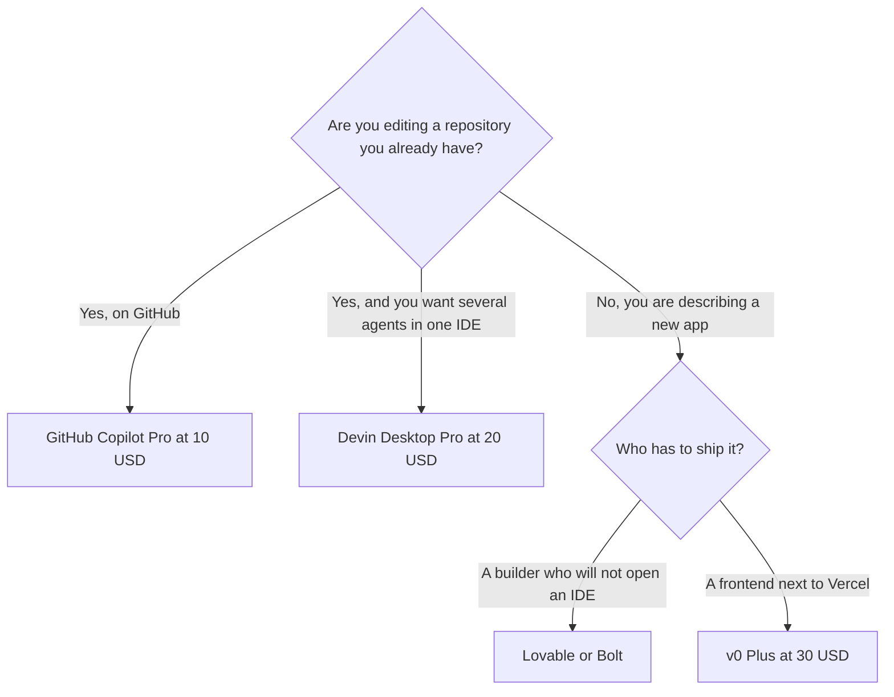

**If you already know you want an editor agent, a terminal agent, or ChatGPT's coding agent, use the three-way comparison and stop.** This page is the rest of the shelf: GitHub-native completions, a multi-agent IDE, prompt-to-app builders, and a student-priced chat that also codes. Most people need one of these, not a stack.

The head-to-head for [Cursor](/tools/cursor/), [Claude Code](/tools/claude-code/), and [Codex](/tools/openai-codex/) is [Cursor vs Claude Code vs Codex](/blog/cursor-vs-claude-code-vs-codex-2026/). Prices here are US list prices checked October 16, 2026. Replit's paid prices did not load, so they are not quoted. We did not run a benchmark. "Strong" means the product is sold for that job.

## Start from where the code has to live

| The code lives | Start here | Price that matters |
|---|---|---|
| In GitHub, inside the editor you already use | [GitHub Copilot](/tools/github-copilot/) | Free: 2,000 completions/month, no card. Pro is $10/user/month |
| In an IDE that should host several vendors' agents | [Devin Desktop](/tools/devin-desktop/) | Pro is $20/month. This is the product that was Windsurf |
| As a new app from a prompt, shared with non-developers | [Lovable](/tools/lovable/) or [Bolt](/tools/bolt-new/) | Both start at $25/month |
| As UI generated next to a Vercel deploy | [v0](/tools/v0/) | Plus is $30/user/month |
| As a hosted app with a database, price unconfirmed | [Replit](/tools/replit/) | Starter is free. Core and Pro prices: see the pricing page |
| In a terminal, on a student budget | [Mistral Vibe](/tools/mistral-vibe/) | Free. Verified students: Pro at $5.99/month for up to 12 months |
| In Cursor, Claude Code, or Codex | Leave this page | The comparison linked above |

The category hub is [coding tools](/tools/category/coding/). Prompt-to-app products are compared in [Lovable vs Bolt vs Replit](/blog/lovable-vs-bolt-vs-replit/).

## GitHub Copilot, when the forge is GitHub

Copilot Free is 2,000 completions a month, with models such as Haiku 4.5 and GPT-5 mini, and no credit card. Verified students can get the Copilot Student plan. We did not record that plan's limits here. Confirm them on GitHub before you tell a class it is "the paid plan for free."

Pro is $10/user/month and includes a cloud agent, code review, model selection, third-party agents including Claude Code and Codex, and $15 in monthly credits. Pro+ is $39/month with $70 in credits and premium models such as Opus. Max is $100/month with $200 in credits. Business is $19/user/month with IP indemnity and 1,900 credits per user. Enterprise is $39/user/month.

Buy Pro when completions and a GitHub cloud agent are the missing piece and you do not want a new editor. Buy Business when a company needs the indemnity and admin controls. If you wanted an AI-native editor, that desire is the Cursor conversation, not a higher Copilot tier. Cursor's own prices are in the three-way post. A short on-ramp for Claude's agent is [Claude Code for beginners](/blog/claude-code-for-beginners-2026/).

## Devin Desktop, when one IDE should call several agents

Cognition launched Devin Desktop as the next generation of Windsurf on June 2, 2026. It keeps Windsurf and VS Code extension compatibility. Free includes a light agent quota, limited models, and unlimited Tab completions. Pro is $20/month. Max is $200/month. Teams is $80/month plus $40/month per full developer seat, up to 200 users.

The reason to open it, beside Copilot, is the Agent Client Protocol. At launch it could run Codex, Claude Agent, OpenCode, and other ACP agents from the same desktop, with a command center for local and cloud agents. Use it when the problem is "one place to supervise agents," not "the cheapest completion." A $20 Pro seat plus a separate Claude or ChatGPT subscription can double-pay for the model. Check whether the agent you want is included before you stack bills. The subscription rule is [which AI subscription is worth paying for](/blog/which-ai-subscription-is-worth-paying-for/).

## Builders, when there is no repository yet

These products make an app from a description. They are a weak fit for a large existing codebase.

| | Free | Entry paid | How usage is counted |
|---|---|---|---|
| [Lovable](/tools/lovable/) | 5 build credits/day, up to 30 a month, plus 20 Cloud credits | Pro from $25/month, or $250/year, for 100 credits | A landing page with images is about 1.7 credits in Lovable's examples. Unlimited members share the pool |
| [Bolt](/tools/bolt-new/) | 1 million tokens/month, 300,000 daily cap, Bolt branding | Pro from $25/month for 10 million tokens, no daily cap, custom domains | Paid tokens roll over for one extra month. Teams is $30/member/month |
| [v0](/tools/v0/) | $5 one-time credits for new users, 7 messages/day | Plus is $30/user/month with $30 of monthly credits | ChatGPT Plus or Pro can cover eligible OpenAI responses. A v0 credit balance is still required |
| [Replit](/tools/replit/) | Daily Agent credits, one published app that comes down after 30 days, with a badge | Core and Pro: price not confirmed in our check | Full build, external connectors, and badge removal require Core or above |

Lovable does not charge per seat. Bolt's free plan puts branding on the site, and paid plans remove it. v0's old $20 Premium plan is being sunset and is not sold to new users. Replit is the one to open when you want hosting and a database in the same product and you are willing to read a live price we could not confirm.

If the thing you are building is an internal workflow rather than an app, leave this section. That job is [how to create an AI agent without coding](/blog/how-to-create-an-ai-agent-without-coding/).

## A cheap assistant that also writes code

[Mistral Vibe](/tools/mistral-vibe/), formerly Le Chat, has a free tier with limited chat and Vibe for code in the terminal. Pro is $14.99/month excluding tax. Verified students at accredited higher-education institutions can get Pro for $5.99/month for up to 12 months. Team is $24.99/user/month. Enterprise can be deployed privately.

Vibe is a reasonable student subscription when the job is chat plus light terminal coding. It is not a substitute for Copilot's GitHub cloud agent or for Claude Code on a large repo. Students comparing study tools, not IDEs, should read [best AI tools for students](/blog/best-ai-tools-for-students-2026/).

## What not to stack

- Copilot Pro and Cursor, unless one of them is only the autocomplete and you have felt the gap for a week.
- Lovable and Bolt and v0 for the same landing page. Finish in the builder you already started.
- A $100 Max tier, on Copilot or Devin, before the $10 or $20 plan has actually run out.
- Replit Core at a price you have not seen. Load the pricing page in your region first.

## FAQ

### What is the best AI coding assistant in 2026?

For a GitHub workflow, Copilot Pro at $10/user/month is the default in this article. For an AI-native editor or a terminal agent, use the Cursor, Claude Code, and Codex comparison instead of this page. For a new app described in a prompt, start with Lovable or Bolt's free tier.

### Is GitHub Copilot free?

Yes. Free includes 2,000 completions a month and does not require a card. The cloud agent and the $15 monthly credit sit on Pro at $10.

### Did Windsurf shut down?

Windsurf became Devin Desktop on June 2, 2026. The IDE foundation remains, with an agent command center and Devin Local. Pro is $20/month.

## Last verified

October 16, 2026. Recheck [GitHub Copilot plans](https://github.com/features/copilot/plans), [Devin Desktop](https://devin.ai), [Lovable pricing](https://lovable.dev/pricing), [Bolt pricing](https://bolt.new/pricing), [v0 pricing](https://v0.app/pricing), [Replit pricing](https://replit.com/pricing), and [Mistral Vibe](https://mistral.ai/products/vibe/) before you buy.

Directory pages may include affiliate links. A purchase through them may earn us a commission at no extra cost to you.
