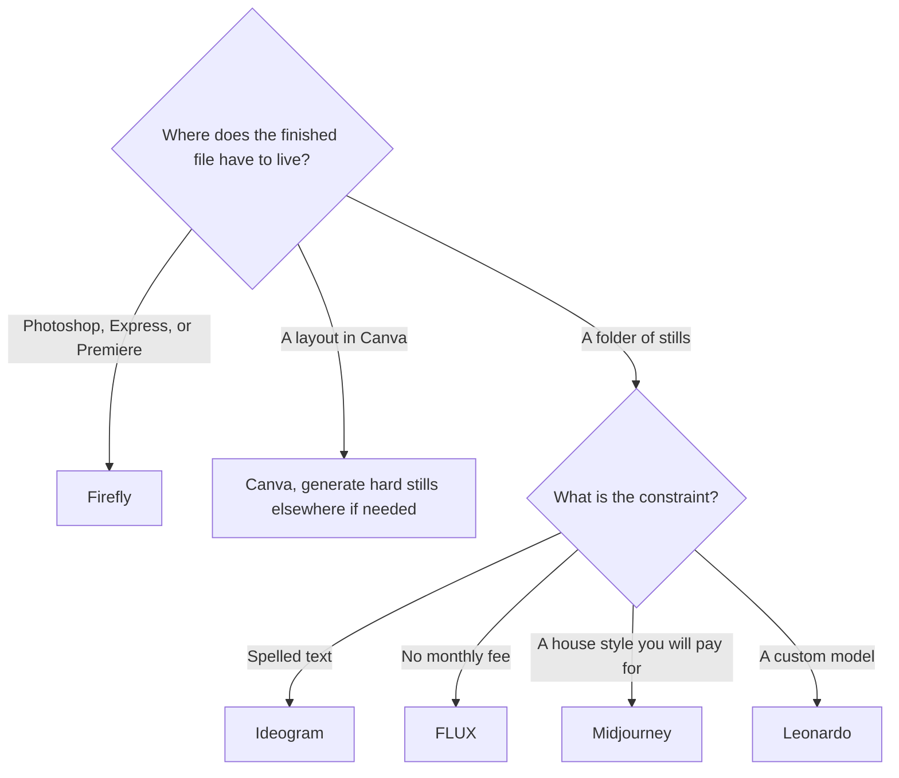

**Pick an image generator by the invoice and the license, then by the look.** A production month is a stack of stills with a commercial-use question, a retake rate, and a place the file has to live. [Adobe Firefly](/tools/adobe-firefly/) is the Adobe path. [Ideogram](/tools/ideogram/) is the path when the words must be spelled right. [FLUX](/tools/flux/) is the path when you want a receipt per image. [Midjourney](/tools/midjourney/) is the paid artistic default. [ChatGPT Images](/tools/dall-e/) is the path when the revision happens in a conversation.

This is not the prompt tutorial. That is [AI image generators: a beginner's guide](/blog/ai-image-generators-beginners-guide/). It is also not the "I am leaving Midjourney" page. That is [Midjourney alternatives](/blog/midjourney-alternatives-2026/). Prices are US list prices checked October 16, 2026. We did not run a taste test, and there is no quality score below.

## Buy by the constraint that shows up on a job ticket

| The ticket says | Pay this | Entry USD | The meter |
|---|---|---|---|
| "Use our Adobe workflow, and standard stills are the volume" | [Firefly](/tools/adobe-firefly/) Standard, or Pro if you need Photoshop on the web | $9.99 or $19.99 / month | Unlimited standard images on paid plans. Credits are for video, audio, and partner models |
| "The headline has to be readable" | [Ideogram](/tools/ideogram/) Plus | $20/month, or $15/month on a $180 year | 2,400 credits a month. Free is 30 a week |
| "Ten pictures, no subscription" | [FLUX](/tools/flux/) | From $0.008 per FLUX 3 Klein image at 768×768 | 1 credit = $0.01. No seat fee |
| "Art direction, and we will pay monthly" | [Midjourney](/tools/midjourney/) Basic | $10/month, or $8/month annual | Fast GPU time. No free plan |
| "Train a look, then share it" | [Leonardo.Ai](/tools/leonardo-ai/) | Essential $12/month. Premium $30 | Fast tokens. See the [Leonardo review](/blog/leonardo-ai-review-2026/) |
| "Several models, start without a card" | [Krea](/tools/krea/) | Free: 100 units/day, no card. Basic $5/month yearly | Compute units. Commercial license on paid plans |
| "Change the hat in the same thread" | [ChatGPT](/tools/chatgpt/) images | Free is limited. Plus is $20/month | Included with the chat plan, not a separate image invoice |
| "It has to be a post, not a raw file" | [Canva](/tools/canva/) | Free, or Pro at $180/year | An AI allowance inside the editor. See [Canva Magic Studio](/blog/canva-magic-studio-review-2026/) |

The directory is [image generation](/tools/category/image-generation/).

## A 40-image month, priced with published rates

Assume 40 delivered stills and a 50% retake rate, so 60 generations. This is a planning sketch. Your retake rate is the one to measure.

**FLUX 3 Klein at 768×768.** Sixty images at $0.008 is $0.48. At 4K the rate we stored is $0.036, and 60 × $0.036 = $2.16. Hosted FLUX is the small bill when the count stays in the dozens and you do not need a subscription's extra tools. It becomes a large bill only when volume or a pricier model says so. There is no "unlimited" evening.

**Ideogram Plus.** 2,400 credits a month at $15 on the yearly plan. We do not have a credits-per-image rate that applies to every model and every edit. Edits and upscales spend credits. If a straight generation is roughly a credit, 60 images fit easily and the $15 is buying headroom and private generation, not 60 pictures. If your workflow upscales every frame, measure one set before you call Plus plenty. Free's 30 credits a week is 120 a month only if you use all four weeks. That can cover a light social calendar and will not cover a launch week you stacked in two days. Monthly paid credits do not roll over.

**Firefly Standard at $9.99.** Standard image and vector generations on a paid plan do not spend credits. Sixty standard stills are inside the subscription. The 2,000 credits remain for premium models and video. Firefly Image 5 is 10 credits on the rate card, so those are not "standard." Read the model name. A full credit walkthrough is the [Firefly review](/blog/adobe-firefly-review-2026/). If the 40 images are actually 40 seconds of 1080p video, Standard's pool is the wrong mental model: 1080p is 100 credits a second, and 2,000 credits are 20 seconds.

**Midjourney Basic at $10, or $8 annual.** You are buying Fast time, not a per-image receipt. There is no free tier to absorb the retakes. Basic is enough when the team has agreed the look is worth a subscription and the Fast hours cover the month. Stealth and the higher tiers are a different purchase. The plan notes are the [Midjourney review](/blog/midjourney-review-2026/).

**ChatGPT Plus at $20.** The images are a feature of the assistant, with higher limits than Free. There is no public "40 images" line we can quote. If the team already pays for Plus for writing, the stills may be included and a second generator is optional. If the team does not, $20 is a chatbot purchase. Do not add it only for pictures until Free's image cap has actually blocked a job. DALL·E 2 and DALL·E 3 left the API on May 12, 2026. Chat images are the newer GPT Image models.

**Krea Basic at $5/month yearly.** 5,000 compute units, sketched by Krea as about 64 Nano Banana 2 images. Sixty generations can fit that sketch and leave almost nothing. A retake-heavy month wants Pro, at $21/month yearly for 20,000 units, or a measurement of your real model. The commercial license is on paid plans, not on the 100-unit free day.

**Leonardo Essential at $12.** 8,500 fast tokens, and we do not convert that into 60 images without a rate. Premium at $30 adds unlimited relaxed generation for select models, which is the production feature if you can wait. Details are in the Leonardo review.

## License, seats, and the file's next stop

A low generation price is not a commercial license.

- Firefly's non-beta generative features are what Adobe presents as commercially usable. Beta outputs are treated more narrowly, and Adobe says they are not indemnified for eligible business customers.
- Krea's commercial license is on paid plans.
- Pika's image and video free tier is a different product, and its commercial license starts on Creator. If the asset is a clip, read [free AI video generators](/blog/best-free-ai-video-generators-no-watermark-2026/) before you reuse a still rule.
- Ideogram Plus adds private generation. Free does not, on the plan notes we have.
- Midjourney's Stealth mode is a higher tier than Basic. If a client requires privacy, Basic is the wrong quote.
- ChatGPT Business, at $20/user/month annual, is the workspace with the training default OpenAI states. A personal Plus seat is a different posture for client briefs.
- Canva Pro is one person. A second designer is Business at $250/person/year, or they use their own seat.

Seats multiply. Five Ideogram Team users are $20/user/month on yearly billing, with a two-user minimum and 3,600 credits per user. Five Firefly Pro seats are about $100/month. Five people sharing one FLUX account spend credits, not seats. Match the bill to how the team actually works.

## What to skip in a production stack

- Three subscriptions that all make "a nice picture." One generator, plus Canva or Express if someone has to lay type.
- Premium Firefly at $199.99 because video might happen. Standard or Pro covers stills. Video seconds are a measured upgrade.
- A beginner's prompt course as a substitute for the license line. The prompting guide is useful on day one. The invoice is this page.
- Any quality ranking you see quoted without a method. We do not have one.

A simple symbol sketch versus a Firefly file inside Adobe is [Midjourney vs Adobe Firefly for brand icons](/blog/midjourney-vs-adobe-firefly-for-brand-icons-2026/). A set of stylized ad variants on Fast GPU time versus a Leonardo token plan is [Midjourney vs Leonardo for ad variants](/blog/midjourney-vs-leonardo-for-ad-variants-2026/).

## FAQ

### What is the best AI image generator in 2026?

For a team inside Adobe, Firefly Standard at $9.99/month. For type in the image, Ideogram. For a handful of hosted images and no subscription, FLUX from $0.008. For a paid artistic default, Midjourney Basic. There is no single winner across those tickets.

### Is there a free option that is safe to start on?

Krea's free plan states 100 compute units a day and no credit card. Ideogram, Leonardo, Firefly, Canva, and ChatGPT also have free generations. Commercial use is a separate question and usually starts on a paid tier. The card filter is [free Midjourney alternatives](/blog/best-free-midjourney-alternatives-no-discord-2026/).

### How do I compare credits across tools?

You do not, directly. Convert each tool with its own rate, using one real asset. A Firefly credit, an Ideogram credit, a Leonardo token, and a Krea compute unit are different units.

## Last verified

October 16, 2026. Recheck the vendor pricing page before you put a year on a card. Regional prices and first-year Adobe discounts change the total.

**Sources:** [Adobe Firefly plans](https://www.adobe.com/products/firefly/plans.html), [Adobe generative credits FAQ](https://helpx.adobe.com/creative-cloud/apps/generative-ai/generative-credits-faq.html), [Ideogram pricing](https://ideogram.ai/pricing), [FLUX pricing](https://bfl.ai/pricing), [Midjourney](https://www.midjourney.com), [Leonardo pricing](https://leonardo.ai/pricing/), [Krea pricing](https://www.krea.ai/pricing), [ChatGPT pricing](https://chatgpt.com/pricing/), [Canva pricing](https://www.canva.com/pricing/).

Directory pages may include affiliate links. A purchase through them may earn us a commission at no extra cost to you.
