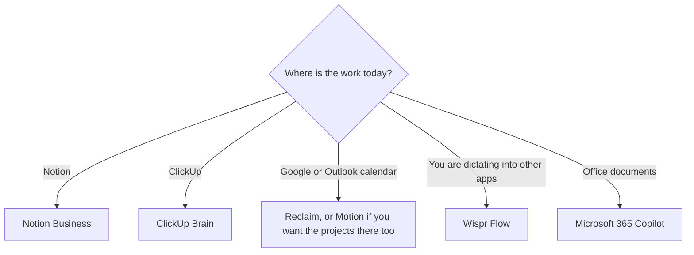

**Pay for the productivity tool that already holds the work.** If the pages are in Notion, the AI purchase is Notion. If the tasks are in ClickUp, it is ClickUp Brain. If the problem is a calendar that will not defend a block of time, it is Reclaim or Motion. A second chatbot does not fix a calendar.

Prices are US list prices checked October 16, 2026. Motion's annual discount is stated as a percent, not as a second list price, so this page does not invent the yearly dollar total. Fit labels describe the job the vendor sells. They are not a productivity score.

Meeting bots are a different category. Use [best AI meeting notetakers](/blog/best-ai-meeting-notetakers/) for Otter, Fireflies, Fathom, and [Granola](/tools/granola/). The general assistant decision is [which AI subscription is worth paying for](/blog/which-ai-subscription-is-worth-paying-for/).

## One bottleneck, one tool

| The hour you are losing | Tool | Free | First paid price |
|---|---|---|---|
| Notes and projects already in Notion | [Notion AI](/tools/notion-ai/) | A trial of AI on the Free plan | Business is $20/seat/month for Agent, meeting notes, and connected search |
| Tasks already in ClickUp | [ClickUp Brain](/tools/clickup-brain/) | Free Forever can try Brain². Ongoing use is paid | Brain² from $9/user/month, on top of a ClickUp plan |
| A calendar that should place the work | [Reclaim](/tools/reclaim-ai/) | Lite, free, no card, 5 AI agents | Starter is $10/seat/month. Business is $15. Yearly billing saves 20% |
| A planner that also holds projects, and no free plan | [Motion](/tools/motion/) | A trial you can cancel. No free plan | Pro AI is $19/seat/month. Motion says annual billing saves 33% |
| Typing is the slow part | [Wispr Flow](/tools/wispr-flow/) | A weekly word cap | Pro is $15/month or $144/year |
| Sentences, in every text box | [Grammarly](/tools/grammarly/) | Free correctness | Pro is $12/member/month annual |
| Word, Excel, and Outlook | [Microsoft Copilot](/tools/microsoft-copilot/) | Free with limits on a Microsoft account | Microsoft 365 Personal is $9.99/month. Copilot Business from $18/user/month yearly |

The category hub is [productivity and notes](/tools/category/productivity-notes/).

## Docs and tasks

**Notion.** Plus is listed at $10 per seat per month. Business at $20 per seat per month is the AI tier: Notion Agent, AI meeting notes without a bot joining the call, and search across connected apps. Custom Agents that run while you are away cost $10 per 1,000 credits after a trial, on Business and Enterprise. A ten-person Business workspace is $200 a month at the list seat price, before those credits. If you only chat with an agent inside a page, you are on the seat price. The review is [Notion AI](/blog/notion-ai-review-2026/).

**ClickUp.** The workspace and the AI are separate lines. Unlimited is $7 per user per month billed yearly, or $10 monthly. Business is $12 yearly or $19 monthly. Brain² starts at $9 per user per month, with unlimited Brain² conversations and 1,500 AI Super Credits. Everything AI is $28 per user per month and adds a notetaker, AI fields, automations, and Super Agents. Regular Brain² chat does not spend Super Credits. ClickUp says workspace data is not used to train third-party models. A user on Unlimited plus Brain² is $7 + $9 = $16 per user per month on the yearly workspace rate, before monthly-billed workspace prices. Confirm both lines at checkout. The review is [ClickUp Brain](/blog/clickup-brain-review-2026/).

Do not migrate to Notion or ClickUp so you can buy the AI. Move the work only if you were going to move it anyway. The AI on an empty workspace has nothing to search.

An executive assistant drafting a pre-meeting brief from facts they already have, and not a commitment the executive did not make, is [best AI tools for executive assistants](/blog/best-ai-tools-for-executive-assistants-2026/). OKRs that already live on the Notion page, versus a quarter you format in chat first, are [Notion AI vs ChatGPT for OKRs](/blog/notion-ai-vs-chatgpt-for-okrs-2026/).

## Calendars

**Reclaim** works on Google Calendar and Outlook. Lite is free, with no card, and includes 5 AI agents, Focus Time, scheduling links, and a short list of integrations. Starter is $10 per seat per month with 10 agents per seat. Business is $15 per seat per month with 100 agents per seat. Everyone gets a 14-day Business trial, then Lite if you do not upgrade. Yearly billing saves 20%. At that rate, Business is $12 per seat per month across the year, which is $144 a year, if the 20% applies to the $15 list. Confirm the yearly total. Reclaim is the right buy when the calendar you have is fine and the missing piece is protected time.

**Motion** is a project and calendar product. Pro AI is $19 per seat per month with 7,500 AI credits. Business AI is $29 per seat per month with 15,000 credits. Extra credits are listed at 25 cents per 100 on Pro AI and 19 cents per 100 on Business AI. There is no free plan. Motion says annual billing saves 33%. We are not printing a derived yearly price as if Motion published it. There is a trial. Use Motion when you want the tasks, the docs, and the calendar in one app and you will leave the current task manager. Use Reclaim when you will not.

## Dictation, writing, and Office

**Wispr Flow** types in other apps. Free is limited: 2,000 words a week on Mac and Windows, with a higher maximum in the plan notes, and a smaller mobile cap. Pro is $15 per user per month or $144 a year ($12 a month). Eligible students with a .edu address can claim Pro features at no charge on Mac, Windows, and iOS. Where that route does not apply, student pricing is listed at $7.50/month or $72/year. Growth, at $23/user/month, is the SSO tier. Dictation is worth paying for when you already know you speak faster than you type. It is not a notes app.

**Grammarly** Pro is the writing layer if the problem is tone and rewrites in the browser. The worth-it test is [is Grammarly Pro worth it](/blog/is-grammarly-pro-worth-it-2026/). It stacks cleanly with a calendar tool. It stacks poorly with three chatbots.

**Microsoft 365** is the productivity suite when the files are Office documents. Personal at $9.99/month is an individual plan. Copilot Business from $18/user/month paid yearly, shown as reduced from $21, is the team plan. Family at $12.99/month does not share the AI features with the other five people. Business chat options are in [best AI chatbots for business](/blog/best-ai-chatbots-for-business-2026/).

**Granola** is a meeting notepad with a free Basic plan and Business at $14/user/month. It belongs in the meeting roundup, linked above. Mentioning it here is only so a "productivity" search does not skip the notebook you already wanted.

## A stack that stays under two bills

| Person | Bill 1 | Bill 2 | Leave unpaid |
|---|---|---|---|
| A Notion user who lives in Google Calendar | Notion Business, $20/seat | Reclaim Starter, $10/seat, only if Lite's 5 agents are not enough | Motion, ClickUp, a second chatbot |
| A ClickUp team | Unlimited plus Brain² | Nothing else until Super Agents are a real weekly job | Notion AI |
| Someone whose work is email and Word | Microsoft 365 | Grammarly only if Office's proofing is the gap | A project app they will not open |
| A founder who talks drafts | Wispr Flow Pro, $12/month annual | The docs tool they already pay for | A third assistant |

Automations that push work between these apps are [how to automate work with Zapier and Make](/blog/how-to-automate-work-with-zapier-and-make/). An agent that "runs the company" is the no-code agent guide, and it is a later step.

## FAQ

### What is the best AI productivity tool in 2026?

The one that sits on the system you already use. Notion Business at $20/seat/month, ClickUp Brain² from $9/user/month, or Reclaim's free Lite plan are the three defaults in this guide. Motion is the default only if you want to replace the task manager and the calendar together.

### Is there a free AI productivity stack?

Notion's Free plan includes an AI trial. Reclaim Lite is free without a card. Wispr Flow has a weekly word cap. ClickUp's Free Forever plan can try Brain², and ongoing Brain² access is paid. That set covers a light week. Pay when the trial or the cap blocks a task you repeat.

### Should I buy Motion and Reclaim?

No. They both want the calendar. Reclaim has the free plan and works beside your current tools. Motion is the fuller system and has no free plan. Pick one after the trial, not both.

## Last verified

October 16, 2026. Recheck [Notion pricing](https://www.notion.com/pricing), [ClickUp Brain](https://clickup.com/brain), [Motion pricing](https://www.usemotion.com/pricing), [Reclaim pricing](https://reclaim.ai/pricing), and [Wispr Flow pricing](https://wisprflow.ai/pricing) before you roll a seat out to a team.

Directory pages may include affiliate links. A purchase through them may earn us a commission at no extra cost to you.
