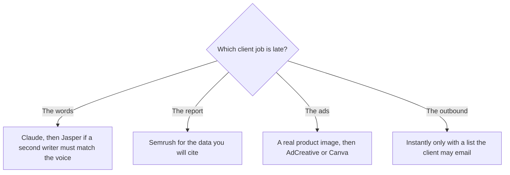

**An agency should buy the tool that survives a second client, and keep everything else on a plan you can cancel when the retainer ends.** The failure mode is one login shared across brands, or a $59 seat multiplied by every contractor who opened the demo. This page is one tool per client job. The in-house marketing calendar is [best AI tools for marketers](/blog/best-ai-tools-for-marketers-2026/). A contractor billing a single deliverable is [best AI tools for freelancers](/blog/best-ai-tools-for-freelancers-2026/).

Two people inside that client job are not the agency stack. The account manager who keeps the recap, the scope check, and the next ask honest is [best AI tools for agency account managers](/blog/best-ai-tools-for-agency-account-managers-2026/). The producer who cuts footage they have the right to use, and writes the client note from an approved brief, is [best AI tools for agency producers](/blog/best-ai-tools-for-agency-producers-2026/).

Prices are US list prices excluding tax from directory pages checked October 16, 2026, except Instantly and Writesonic figures taken from pricing pages read October 24, 2026 for the reviews linked below. Published October 24, 2026. Nothing here is a campaign score.

## The client job, with a price

| Client job | Start here | First paid step | The agency limit |
|---|---|---|---|
| A draft a strategist will edit | [Claude](/tools/claude/) or [ChatGPT](/tools/chatgpt/) | Claude Pro $20/month or $17 annual. ChatGPT Plus $20 | One seat does not become a brand vault |
| A voice that must stay put across writers | [Jasper](/tools/jasper/) | Pro $59/seat/month yearly, or $69 monthly | Two Brand Voices, five Knowledge assets, three Audiences on Pro |
| Search data you will put in a report | [Semrush](/tools/semrush/) | SEO plan $117.33/month yearly, or $139 monthly | Free is one project and 10 reports a day |
| Ad sizes from a product image | [AdCreative.ai](/tools/adcreative-ai/) | Starter $39/month, or $20 billed yearly | Credits spend on download |
| Everyday client graphics | [Canva](/tools/canva/) | Pro $18/month or $180/year. Free is a real editor | A brand kit per client needs a plan that allows it |
| A leave-behind deck | [Gamma](/tools/gamma/) | Plus $9/seat/month | Credits, and the client may still want PowerPoint |
| A presenter video | [HeyGen](/tools/heygen/) | Creator $29/month | Business at $149 if the client needs SCORM |
| Cold email for a client who has a lawful list | [Instantly](/tools/instantly/) | Outreach Growth $47/month, or $37.60 yearly | 5,000 emails and 1,000 contacts on that card |
| A list built from several providers | [Clay](/tools/clay/) | Launch $167/month billed annually | Actions and data credits |
| Moving a lead from the form to the CRM | [Zapier](/tools/zapier/) | Professional $19.99/month annually, 750 tasks | Tasks multiply with every client Zap |

## Voice and drafts, per brand

Most first drafts do not need Jasper. Claude or ChatGPT will produce a pass from a brief, the offer, and the facts that cannot move. The method is [how to write a blog post with Claude](/blog/how-to-write-a-blog-post-with-claude-2026/). Move to Jasper when two people write for the same client and the voice has to be stored. Pro's two Brand Voices mean a third client voice is a Business quote, not a setting you should assume exists. Agencies that put every client in one voice "for now" ship the wrong tone. The three-way with the other writing platforms is [Jasper vs Copy.ai vs Writesonic](/blog/jasper-vs-copy-ai-vs-writesonic-2026/).

[Copy.ai](/tools/copy-ai/) Chat at $24 a month annually for five seats is the shared chat, and its workflow plans start at $1,000 a month. An agency does not wander into Growth because a demo said "GTM." [Writesonic](/tools/writesonic/) Starter at $79 a month on the annual view is the quote when a client wants AI-answer tracking. One project on that card means a second brand is another plan. Count brands before you count articles.

## Reporting, ads, and the deck

Semrush is the research suite you can cite. The free tier demonstrates the product. The SEO plan is the small-team entry. Semrush One, which adds AI-search tracking, starts at $165.17 a month on annual billing, the figure recorded with Semrush's other plan prices on October 16, 2026. Buy it when that chart is a client deliverable.

Make or photograph the product before you generate ad sizes. The steps are [how to generate product photos with AI](/blog/how-to-generate-product-photos-with-ai-2026/). AdCreative.ai spends credits on download. Canva Pro is the resize and the brand kit. [Adobe Express](/tools/adobe-express/) Premium at $9.99 a month is the alternative when the client is already in Adobe. Gamma Plus at $9 is the fastest leave-behind. A client with a locked PowerPoint template may still need a human to place the slides. The deck category is [best AI presentation makers](/blog/best-ai-presentation-makers/).

HeyGen Creator at $29 covers a spokesperson video without an enterprise contract. If the client is an L&D team that needs SCORM, the training comparison is [Synthesia vs HeyGen for training](/blog/synthesia-vs-heygen-for-training-2026/). Do not buy a $149 Business plan for a social clip.

## Outreach and the glue

Instantly's $47 outreach Growth plan caps contacts and sends, and it does not charge per seat on the card we read. The credits tab is a different $47. The invoice decoder is [Instantly pricing explained](/blog/instantly-pricing-explained-2026/). The client's permission to email the list is the client's. Clay is the build when the list itself is the work. HubSpot's free CRM is often where the rows land. [HubSpot](/tools/hubspot/) Starter has been shown at $7 or $10 a seat on a promotion. Confirm the live offer.

Zapier Professional at $19.99 a month annually connects the form to the CRM. Make Core from $9 a month annually is the alternative when the scenario is branchy. The comparison is [Zapier vs Make vs n8n](/blog/zapier-vs-make-vs-n8n/). One Zap per client, named, beats a shared Zap that posts the wrong lead to the wrong Slack.

## A small agency stack

Two writers and a designer, three retainer clients: Claude or ChatGPT for drafts, Canva Pro, and Semrush when reporting is in the statement of work. Add Jasper when the second writer is drifting, and watch the two-voice cap. Add Instantly only for the client whose list and permission you can name. Add HeyGen when a video is in the scope. That is the sequence. A platform demo that sells "the whole agency OS" is how a five-person shop pays for seats nobody opens on Thursday.

## FAQ

### What AI tool should an agency buy first?

The assistant the strategists will edit, and Canva if you deliver visuals. Add Semrush when a report needs data. Add a brand-voice tool when a second person is writing in a client's voice and a shared doc is failing.

### Can one Jasper seat cover every client?

Pro includes two Brand Voices. A third client voice is a higher plan or a disciplined doc outside the tool. Sharing one voice across clients is how the wrong phrases ship.

### Do agencies need an avatar tool?

When the deliverable is a presenter video. HeyGen Creator at $29 is the self-serve start. Footage the client already shot is [Descript](/tools/descript/) or [CapCut](/tools/capcut/), not an avatar.

### How should we bill AI tools back to clients?

Name the tool in the scope when it is specific to that client, such as a sequencer or a Semrush project. Keep a shared drafting seat inside your overhead. A client should not be surprised by a tool that emails their market.

## Last verified

October 16, 2026 for most plan prices. October 24, 2026 for Instantly's outreach card and Writesonic's annual Starter price. Published October 24, 2026.

**Sources:** [Jasper pricing](https://www.jasper.ai/pricing), [Semrush pricing](https://www.semrush.com/pricing/), [Canva pricing](https://www.canva.com/pricing/), [Instantly pricing](https://instantly.ai/pricing), [HeyGen pricing](https://www.heygen.com/pricing).

*Published by Andrew for [AI Tools Optimizer](https://aitoolsoptimizer.com).*

These tools sit in the [marketing directory](/tools/category/marketing-seo/), the [design directory](/tools/category/design/), and the [sales directory](/tools/category/sales/). Directory pages may use affiliate links. A purchase through them may earn us a commission at no extra cost to you.
