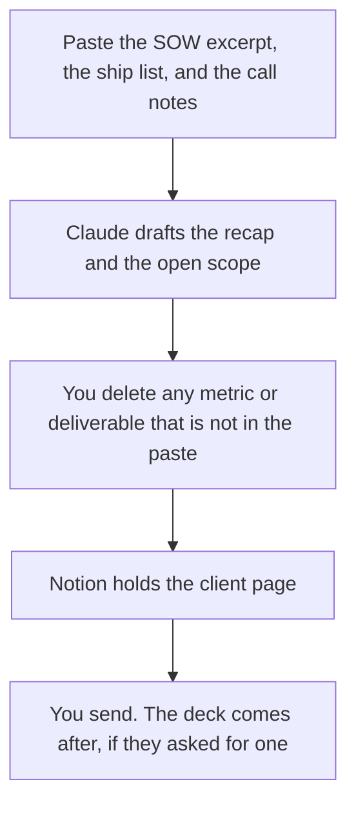

**An agency account manager should use AI to keep three client artifacts honest: a recap of what shipped, a scope check against the statement of work, and the ask for the next cycle.** The model can organize notes you paste. It cannot invent performance, hours, or a deliverable the team did not make. If a metric is not in the export, the recap says the owner will add it. A client email that rounds a weak week into a win is a relationship problem the tool will not fix.

The production shelf, which is a different job, is [best AI tools for agencies](/blog/best-ai-tools-for-agencies-2026/). A quarterly customer meeting, if you are the vendor's success team rather than the agency, is [how to write a QBR deck with AI](/blog/how-to-write-a-qbr-deck-with-ai-2026/). A short internal note is [how to write a status update with AI](/blog/how-to-write-a-status-update-with-ai-2026/).

Prices are US list prices excluding tax from directory pages checked October 16, 2026. Published October 24, 2026. We did not score client retention.

## The account job

| The job | Start here | First paid step | The limit |
|---|---|---|---|
| Draft the recap from notes and an export | [Claude](/tools/claude/) | Pro is $20 a month, or $17 billed annually | It may not upgrade a missed deliverable into a shipped one |
| The client page and the scope | [Notion AI](/tools/notion-ai/) | Business is $20 a seat a month | A chat is not the SOW |
| The call, if the client allowed notes | [Fathom](/tools/fathom/) | Premium is $16 a month billed annually | Free lists unlimited recordings. Consent still applies |
| A leave-behind after the words are frozen | [Gamma](/tools/gamma/) | Plus is $9 a seat a month | A theme does not add results |
| Tasks, if the agency already lives there | [ClickUp Brain](/tools/clickup-brain/) | Brain² is $9 a user a month, plus a ClickUp plan | It will not close a task the team skipped |

A line that says "engagement is up" without a source is [a hallucination](/blog/what-is-ai-hallucination-2026/) in a client's inbox. The check is [how to fact-check AI writing](/blog/how-to-fact-check-ai-writing-2026/).

## What to pay for, per seat you can defend

**The recap.** Claude Pro, with last month's email and the SOW excerpt in a Project so the scope language does not drift. ChatGPT Plus at $20 is the alternative if the agency already keeps client briefs there. Business is $20 a user a month billed annually, minimum two users, when several managers share confidential client work. The container is [Claude Projects vs ChatGPT Projects](/blog/claude-projects-vs-chatgpt-projects-2026/). The review is [Claude review](/blog/claude-review-2026/).

**The system of record.** Notion Business. One page per client: scope, owners, the last recap, the open change requests. Plus is $10 a seat a month and is not the full AI tier on the card. The invoice is [Notion AI pricing explained](/blog/notion-ai-pricing-explained-2026/). That habit is [what a system of record for AI is](/blog/what-is-a-system-of-record-for-ai-2026/).

**The meeting.** Fathom Premium at $16 a month billed annually, or the free plan if unlimited recordings on that card cover you. Do not send a bot the client did not accept. A no-bot option for a sensitive call is [Granola](/tools/granola/) Business at $14 a user a month. The interview-room version of that choice is [Otter vs Granola for interviews](/blog/otter-vs-granola-for-interviews-2026/). Client calls are closer to the consent rule than to a sales pitch.

**The readout.** Gamma Plus at $9 after the recap is true. A year is $108 a seat. Do not let a new business pitch sneak into a status meeting. The pitch workflow is [Gamma vs Plus AI for pitch decks](/blog/gamma-vs-plus-ai-for-pitch-decks-2026/).

**The board, if tasks already live in ClickUp.** Brain² at $9 a user a month. ClickUp Unlimited is $7 a user a month billed yearly, and Business is $12 billed yearly, on the card. Ask "which launch tasks are still open," and then look at the tasks. The comparison is [Notion AI vs ClickUp Brain](/blog/notion-ai-vs-clickup-brain-2026/).

A prompt that holds the line:

"Draft a client recap. Sections: what shipped, what slipped, what is in scope, what would be a change order, the ask. Use only my notes. If a metric, an hour total, or a deliverable is missing, write Missing. Do not invent results or praise."

The person who sends the email is [what human-in-the-loop AI is](/blog/what-is-human-in-the-loop-ai-2026/).

## What not to automate

Do not let a model write the change order amount. Finance or the principal owns price. Do not paste one client's strategy into another client's Project. Do not generate a case study from the recap without the client's permission. That workflow, when you have permission, is [how to write a case study with AI](/blog/how-to-write-a-case-study-with-ai-2026/).

## FAQ

### Is this the same stack as the creative team?

No. Designers and media buyers have their own tools on the agencies page linked above. Account managers live in the recap, the scope, and the calendar. Buying a video tool does not write the Monday email.

### How many client pages can Notion hold?

Enough that the limit you will hit first is discipline, not the plan's page count, which this directory does not treat as the constraint. The constraint is whether each page has an owner and a date. A pile of chat exports is not a book of record.

### Can AI listen to every client call?

Only when that client has agreed. If they have not, take notes. A surprise bot is a trust problem that costs more than the Fathom seat.

### What if the week went badly?

Say what slipped, from the notes, and name the next date. A recap that hides a miss will show up in the next invoice conversation with less trust. The model is useful because it will include the slip if you paste it. Paste it.

## Last verified

October 16, 2026 for Claude, Notion, Fathom, Gamma, ClickUp, and Granola. Published October 24, 2026.

**Sources:** [Claude pricing](https://claude.com/pricing), [Notion pricing](https://www.notion.com/pricing), [Fathom pricing](https://www.fathom.ai/pricing).

*Published by Andrew for [AI Tools Optimizer](https://aitoolsoptimizer.com).*

[Notion AI](/tools/notion-ai/) is in the [productivity and notes directory](/tools/category/productivity-notes/). Directory pages may use affiliate links. A purchase through them may earn us a commission at no extra cost to you.
