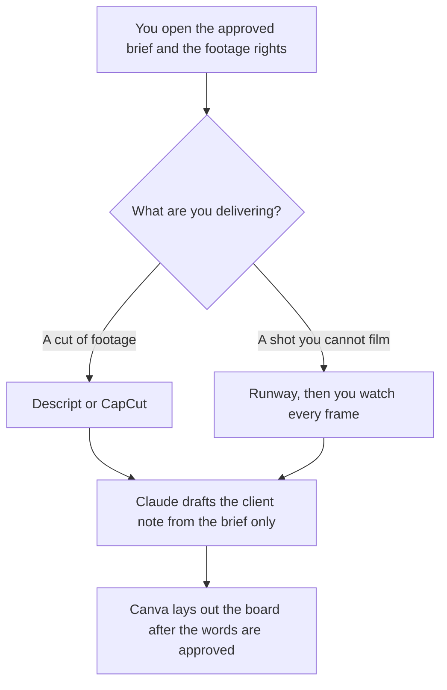

**An agency producer should use AI to cut footage they have the right to use, to draft a generated shot only after a person will watch every frame, and to write the client note from the brief that was already approved.** The seats that multiply when a second client arrives are the agency's buying problem: [best AI tools for agencies](/blog/best-ai-tools-for-agencies-2026/). This page is the person who has to deliver the file. A shared login across brands is still the agency page's failure mode. Do not start one here.

The generator choice for a product motion is [Runway vs Luma for product demos](/blog/runway-vs-luma-for-product-demos-2026/). The edit invoices are [Descript pricing explained](/blog/descript-pricing-explained-2026/) and [CapCut pricing explained](/blog/capcut-pricing-explained-2026/).

Prices are US list prices excluding tax from directory pages checked October 16, 2026. Runway's Standard price also matches the pricing page read October 24, 2026. Published October 24, 2026. We did not score reels.

## The producer's week

| The job | Start here | First paid step | The limit |
|---|---|---|---|
| A cut from footage or a transcript you can publish | [Descript](/tools/descript/) | Hobbyist is $16 a person a month billed annually, or $24 monthly | 10 media hours and 400 AI credits on that card. The words match the audio |
| A vertical cut on a phone timeline | [CapCut](/tools/capcut/) | Pro is $19.99 a month, or $179.99 a year | Checkout can differ by region. A caption matches the words |
| A generated shot when you cannot film the step | [Runway](/tools/runway/) | Standard is $12 a month billed annually, or $15 monthly, after 125 one-time credits | You watch every frame. A fake button comes out |
| The client note from the approved brief | [Claude](/tools/claude/) | Pro is $20 a month, or $17 billed annually | The note may not add a deliverable |
| A board or a one-pager after the words are frozen | [Canva](/tools/canva/) | Pro is $18 a month or $180 a year for one person | Real type. No generated client logo |

The agency roundup owns Jasper, the SEO seat, and the question of one login per brand. Use it when you are buying for the shop. Use this page when the render is due. A producer who starts a second brand voice in a personal chat has made a second source of truth. Point the note at the brief.

## What you are paying for

**Descript Hobbyist at $16** annually is the transcript editor: 10 media hours and 400 AI credits, with 1080p export without a watermark on that pricing article. Creator at $24 annually is the step when 10 hours is the cap you hit. The review path is the pricing article.

**CapCut Pro** is the timeline when the deliverable is a short social cut. Free covers a basic edit. Do not convert CapCut credits into Runway seconds. They are different meters.

**Runway Standard at $12** is the generator when the shot cannot be filmed and the free 125 credits are spent. Luma Plus at $30 is the other pool, with no free plan on the October 24 card. Pick one for the job. The comparison is the demo article above.

**Claude Pro** writes the note: what shipped, what is in review, and the date you pasted. It does not promise a round of revisions the brief did not include. The review is [Claude review](/blog/claude-review-2026/).

**Canva Pro** is the board. Business is $25 a person a month or $250 a year if the shop needs that tier. One producer does not need a Business seat for a single board. The invoice is [Canva Magic Studio pricing explained](/blog/canva-magic-studio-pricing-explained-2026/).

A prompt that holds the line:

"Write a client note from the brief and the list of files I pasted. Do not add a deliverable, a date, or a metric. If a file on the brief is not in my list, write Missing and stop."

## What not to automate

Do not generate a client's product you were not given. Do not dub a customer's voice. Do not send the note before the cut is the cut you watched. The factual check is [how to fact-check AI writing](/blog/how-to-fact-check-ai-writing-2026/).

## FAQ

### How is this different from the agency roundup?

That page is the shop: seats that survive a second client, and the bills that multiply. This page is the producer's file: the cut, the shot, and the note. A producer at a one-client shop can ignore the seat math until the second client shows up. They cannot ignore the rights on the footage.

### Can I stay on free plans?

Descript Free is 60 media minutes. CapCut Free can teach the timeline. Runway Free is 125 one-time credits. Claude Free can draft one note. The paid step is the one that repeats every delivery: Hobbyist, Pro, or Standard. Buy it when the free cap is why the file is late.

### Who approves the generated shot?

You do, frame by frame, against the product you were given. Then the client approves it against the brief. A shot that invents a feature is a revision you caused. Delete it before the note says it shipped.

### What if the brief and the cut disagree?

The brief wins until a person changes the brief. The note says what is missing. It does not quietly shrink the scope.

## Last verified

October 16, 2026 for Descript, CapCut, Claude, and Canva. October 24, 2026 for Runway Standard at $12 a month billed annually, which matches the October 16 directory. Published October 24, 2026.

**Sources:** [Descript pricing](https://www.descript.com/pricing), [CapCut pricing](https://www.capcut.com/pricing), [Runway pricing](https://runwayml.com/pricing), [Claude pricing](https://claude.com/pricing), [Canva pricing](https://www.canva.com/pricing/).

*Published by Andrew for [AI Tools Optimizer](https://aitoolsoptimizer.com).*

[Descript](/tools/descript/) is in the [video directory](/tools/category/video/). Directory pages may use affiliate links. A purchase through them may earn us a commission at no extra cost to you.
