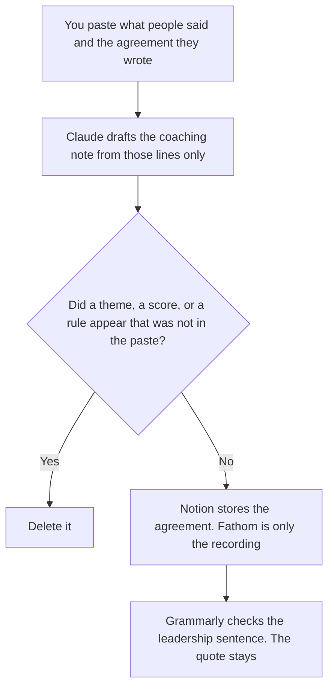

**An agile coach should use AI to draft a coaching note from what people actually said, keep the working agreement the team already wrote, and send a sentence to leadership that does not add a maturity score.** The model does not invent a theme, a health score, or a new ceremony. The sprint agenda, the retro, and the board are [best AI tools for scrum masters](/blog/best-ai-tools-for-scrum-masters-2026/). The decision, the audience, and the ask of a change are [best AI tools for change managers](/blog/best-ai-tools-for-change-managers-2026/). This page is the coaching note and the agreement.

The cross-team dependencies and the steering deck are [best AI tools for program managers](/blog/best-ai-tools-for-program-managers-2026/). A coach can point at that deck. The coach does not close a dependency in the note.

Claude's prices are the October 24, 2026 read of claude.com/pricing recorded in [Claude pricing explained](/blog/claude-pricing-explained-2026/). Notion and Grammarly prices are from directory pages checked October 16, 2026. Fathom's prices are the October 24 pricing-page read in [Fathom pricing explained](/blog/fathom-pricing-explained-2026/). A live fetch of Grammarly's plans URL returned HTTP 401 on October 24. Published October 24, 2026. We did not score teams. A transcript is not a maturity model.

## The coaching week

| The job | Start here | First paid step | The limit |
|---|---|---|---|
| The note, from what people said in the session | [Claude](/tools/claude/) | Pro is $17 a month billed annually, or $20 monthly | No theme that nobody said |
| The working agreement the team already wrote | [Notion AI](/tools/notion-ai/) | Business is $20 a seat a month | Plus at $10 is not the full AI tier. A rule you did not paste stays out |
| A recording of a long coaching session | [Fathom](/tools/fathom/) | Free lists unlimited recordings and transcripts | Business, at $25 annual, is CRM field sync. A coaching session is not a deal |
| The sentence that goes to leadership | [Grammarly](/tools/grammarly/) | Pro is $12 a member a month billed annually, or $30 monthly | It may not add a score or soften a quote |

A note that says the team is "at a forming stage" has added a maturity label. If you did not write the label, the line says Label not set. A retro theme counts only if someone said it. A working agreement line the team did not accept stays out. Fathom Free is the recording when you need the transcript and you do not need CRM. Team, at $15 a user a month billed annually or $19 monthly, with a two-user minimum, is comments, folders, and keyword alerts. Business is the wrong seat for a coaching session unless you are actually syncing CRM fields. That invoice is [Fathom Business pricing explained](/blog/fathom-business-pricing-explained-2026/).

The scrum master runs one team's ceremonies. The coach may sit in that retro and still does not own the board. Do not buy a board tool on this page and call it coaching. The sprint shelf already names the board.

## What you are paying for

**Claude Pro** holds the quotes so a later note does not promote one comment into a team trait. The review is [Claude review](/blog/claude-review-2026/).

**Notion Business** is the agreement: the rule, the date the team accepted it, and the owner. The invoice is [Notion AI pricing explained](/blog/notion-ai-pricing-explained-2026/).

**Fathom Free** is the recording. Premium, at $16 annually or $20 monthly, is one person's action items. Action items still have to be things people said. The review is [Fathom review](/blog/fathom-review-2026/).

**Grammarly Pro** is the leadership sentence. The October 16 card says Pro is $12 a member a month billed annually or $30 monthly. The invoice is [Grammarly pricing explained](/blog/grammarly-pricing-explained-2026/).

A prompt that holds the line:

"Draft the coaching note only from the lines I pasted. Draft the agreement only from the rules the team accepted. If a label is missing, write Label not set. Do not add a maturity score. Do not add a ceremony."

## What not to automate

Do not publish a team health score. Do not add a working agreement the room did not accept. Do not send a leadership sentence that turns one quote into a trend. The coach owns the note. The team owns the agreement. The scrum master owns the sprint.

## FAQ

### How is this different from a scrum master's stack?

That page is one team's ceremonies: the agenda, the retro, and the board. This page is the coach's note across a session, the agreement the team wrote, and the sentence to leadership. A coach can attend the retro. The coach does not turn the board into a maturity chart. Link the sprint page when the fact belongs to the sprint. Do not merge the files.

### How is this different from a change manager?

The change manager writes one update per audience from a decision a person already made. The coach writes what was said, and keeps an agreement. A change decision can be pasted into the note if leadership needs it. The coach does not invent the decision, and the change manager does not invent the team's rule.

### How is this different from a program manager?

The program page is dependencies, a status note, and a steering deck. The coach does not close a dependency and does not build that deck on this page. A sentence to leadership can point at the deck. It cannot add a delivery score the program manager did not write.

### Who may share the note?

The coach, after they have removed every line nobody said. Label not set stays unset. A rule the team did not accept stays out of the agreement. A formatted paragraph is not a team health result.

## Last verified

October 24, 2026 for Claude and for Fathom's pricing page, via the posts cited above. October 16, 2026 for Notion and Grammarly. Published October 24, 2026. Grammarly's plans URL returned HTTP 401 on October 24. No team was scored.

**Sources:** [Claude pricing](https://claude.com/pricing), [Notion pricing](https://www.notion.com/pricing), [Fathom pricing](https://www.fathom.ai/pricing), [Grammarly pricing](https://www.grammarly.com/plans).

*Published by Andrew for [AI Tools Optimizer](https://aitoolsoptimizer.com).*

[Fathom](/tools/fathom/) is in the [meetings directory](/tools/category/meetings-transcription/). Directory pages may use affiliate links. A purchase through them may earn us a commission at no extra cost to you.
