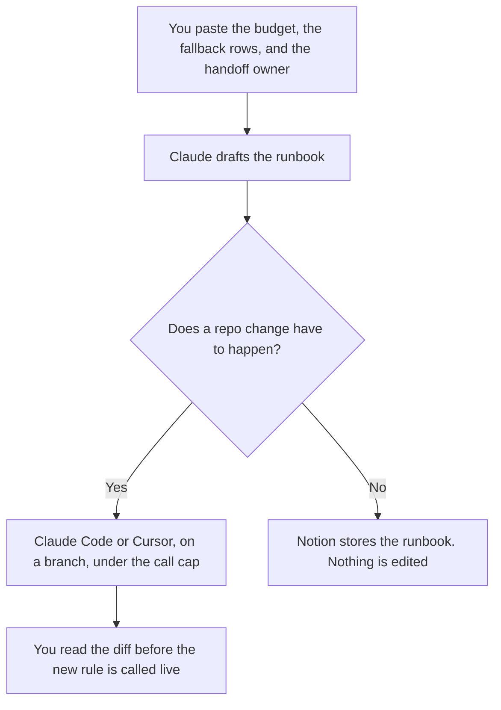

**An AI ops engineer should use AI to draft the runbook from rules they already wrote, format the fallback matrix from rows they already named, and supervise a change that stops at the tool-call budget they set.** The model does not pick the fallback during an outage, and it does not raise its own budget. Incident response on the production system is a sibling job: [best AI tools for SRE teams](/blog/best-ai-tools-for-sre-teams-2026/). The shared contract other teams consume is [best AI tools for platform PMs](/blog/best-ai-tools-for-platform-pms-2026/).

The count that stops an agent is [what an AI tool call budget is](/blog/what-is-ai-tool-call-budget-2026/). The table that names the next model is [what an AI model fallback matrix is](/blog/what-is-ai-model-fallback-matrix-2026/). The moment a person must take the work is [what an AI agent handoff protocol is](/blog/what-is-ai-agent-handoff-protocol-2026/).

Claude's prices, including Claude Code on paid plans, are from claude.com/pricing on October 24, 2026. Cursor and Notion prices are from directory pages checked October 16, 2026. Published October 24, 2026. We did not score agents.

## The AI ops week

| The job | Start here | First paid step | The limit |
|---|---|---|---|
| The policy, the pin, and the fallback rows | [Claude](/tools/claude/) | Pro is $17 a month billed annually, or $20 monthly | No row the owner did not write |
| A supervised change in the repo | [Claude Code](/tools/claude-code/) | Included with Pro. No free Claude Code on the October 24 table | Shared usage with chat. You still set a call budget |
| A diff you read hunk by hunk | [Cursor](/tools/cursor/) | Plus is $8 a month, or $80 a year | You review it. The model does not merge |
| The runbook page | [Notion AI](/tools/notion-ai/) | Business is $20 a seat a month | Plus at $10 is not the full AI tier |

SRE pages own the incident. Platform PM pages own the contract other teams call. AI ops owns the controls around the agent: what stays pinned, which model may run second, how many tool calls are allowed, and who receives the work when the agent stops. A pin, which is one of those controls, is [what AI context pinning is](/blog/what-is-ai-context-pinning-2026/). A stored tool output, which is another, is [what an AI tool result cache is](/blog/what-is-ai-tool-result-cache-2026/).

## What you are paying for

**Claude Pro** holds the runbook in a Project so this week uses the same headings as last week. Team standard seats are $20 a seat a month billed annually, or $25 monthly, for 2 to 150 people, when the runbook is a company document. The review is [Claude review](/blog/claude-review-2026/). The Team invoice is [Claude Team pricing explained](/blog/claude-team-pricing-explained-2026/).

**Claude Code** is the supervised edit. The October 24 table lists it on Pro and not on Free. It shares the plan's usage. The review is [Claude Code review](/blog/claude-code-review-2026/).

**Cursor Plus** is the editor when you want the diff in front of you. Free exists with limited usage on the October 16 card. The ladder is [Cursor pricing explained](/blog/cursor-pricing-explained-2026/).

**Notion Business** holds the matrix and the handoff list. The invoice is [Notion AI pricing explained](/blog/notion-ai-pricing-explained-2026/).

A prompt that holds the line:

"Draft the runbook from the budget, the fallback rows, and the handoff owner I pasted. If a cell is blank, write Missing. Do not add a model. Do not raise the budget."

## What not to automate

Do not let an agent fill a blank fallback with a cheaper model. Do not cache a send or a delete because the last call was slow. Do not paste a customer payload into the prompt so the example looks real. The gate in front of the model, if you are writing one, is [what an AI policy enforcement layer is](/blog/what-is-ai-policy-enforcement-layer-2026/).

## FAQ

### How is this different from the SRE page?

SRE work is the incident on the system you run: the timeline, the rollback, the on-call note. AI ops work is the control plane of the agent: budgets, pins, caches, and handoffs. One person can do both. The documents stay separate so a model outage is not written up as a product incident, or the reverse, by accident.

### How is this different from the platform PM page?

Platform PMs own the contract other teams consume: deprecation, toggles, migrations. AI ops owns how the agent is allowed to behave while that work happens. A deprecation note can mention a model. The fallback matrix still has an owner, and it is the row, not the roadmap.

### Do I need both Claude Code and Cursor?

You need the seat that matches the change. Claude Code fits a supervised command sequence. Cursor fits a diff in the editor. Running both on the same branch at once produces a change nobody can explain. Pick one for the move.

### Who may raise the tool-call budget?

The owner of the task. The agent's claim that it is almost done is not a raise. A new number is a new line a person writes, and the runbook records it.

## Last verified

October 24, 2026 for Claude and for Claude Code on the plan table. October 16, 2026 for Cursor and Notion. Published October 24, 2026.

**Sources:** [Claude pricing](https://claude.com/pricing), [Claude Code](https://claude.com/product/claude-code), [Cursor pricing](https://cursor.com/help/account-and-billing/pricing), [Notion pricing](https://www.notion.com/pricing).

*Published by Andrew for [AI Tools Optimizer](https://aitoolsoptimizer.com).*

[Claude Code](/tools/claude-code/) is in the [coding directory](/tools/category/coding/). Directory pages may use affiliate links. A purchase through them may earn us a commission at no extra cost to you.
