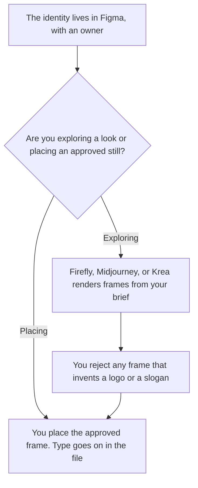

**A brand designer should use AI to explore a look inside a system file you already own, then place the still you accept.** The brand team page is the voice and the handoff. Design ops is the intake and the library. The general designer page splits UI, stills, and everyday files. This page is the identity work: the logo system, the campaign still, and the frame where type stays yours. We did not score taste.

The team shelf is [best AI tools for brand teams](/blog/best-ai-tools-for-brand-teams-2026/). The system around requests is [best AI tools for design ops](/blog/best-ai-tools-for-design-ops-2026/). The broader file split is [best AI tools for designers](/blog/best-ai-tools-for-designers-2026/). The written rules are [how to create a style guide with AI](/blog/how-to-create-a-style-guide-with-ai-2026/).

Prices are US list prices excluding tax from directory pages checked October 16, 2026. Published October 24, 2026. We did not run a visual test. A generated mark is not a trademark opinion.

## The brand-design job

| The job | Start here | First paid step | The limit |
|---|---|---|---|
| The identity file, components, and handoff | [Figma](/tools/figma/) | Professional Full seat is $16 a month billed annually, with 3,000 AI credits | A social template is a different file |
| A campaign still with Adobe's commercial-use guidance | [Adobe Firefly](/tools/adobe-firefly/) | Standard is $9.99 a month, 2,000 credits | Credit cost depends on the feature. Read the rate card |
| Look exploration, when public images are acceptable | [Midjourney](/tools/midjourney/) | Basic is $10 a month, or $8 billed annually | Stealth is Pro at $60, or $48 billed annually. No free plan |
| A smaller exploration meter | [Krea](/tools/krea/) | Basic is $9 a month, or $5 billed yearly, 5,000 units | Move the chosen frame into the system file |
| Adapting an approved system to a social size | [Canva](/tools/canva/) | Pro is $18 a month or $180 a year, one person | Pro is not a shared identity system |

The words the still must follow are [how to create a brand voice with AI](/blog/how-to-create-a-brand-voice-with-ai-2026/). A storyboard of frames, before a film, is [Midjourney vs Leonardo for storyboards](/blog/midjourney-vs-leonardo-for-storyboards-2026/). A logo that has to render as readable type is [Midjourney vs Ideogram for logos](/blog/midjourney-vs-ideogram-for-logos-2026/).

## What you are paying for

**Figma Professional** is the system. Starter is free, with 150 AI credits a day up to 500 a month. The identity file is the record. A generated board that never lands in that file is a mood, not a brand. The review is [Figma review](/blog/figma-review-2026/).

**Firefly Standard at $9.99** is the stills row when you want the credit pack and Adobe's recorded claim that outputs can be used commercially unless a feature is marked as a personal-use beta. That is Adobe's wording on the directory card, not a clearance from this site. Pro at $19.99 includes 4,000 credits and Express Premium. The ladder is [Adobe Firefly pricing explained](/blog/adobe-firefly-pricing-explained-2026/).

**Midjourney Basic** is the exploration row when the gallery rules fit the work. Companies with more than $1,000,000 in gross annual revenue need Pro or Mega for commercial use, on that card. Do not explore an unreleased identity on a public plan. The ladder is [Midjourney pricing explained](/blog/midjourney-pricing-explained-2026/).

**Krea Basic** is the cheap look pass. Free is 100 compute units a day. The invoice is [Krea pricing explained](/blog/krea-pricing-explained-2026/).

**Canva Pro** resizes an approved layout. It does not hold the identity for a second designer. Business is $250 a person a year when the team must share paid assets under an admin. The seat rule is [Canva pricing explained](/blog/canva-pricing-explained-2026/). Express, when the still should be Firefly inside a template, is [Adobe Express pricing explained](/blog/adobe-express-pricing-explained-2026/).

A one-time generated logo package is [Looka](/tools/looka/) at $35 for the Basic Logo Package, and you pay to download. It is a starting file, not a system. The invoice is [Looka pricing explained](/blog/looka-pricing-explained-2026/).

A prompt that holds the line:

"Explore three stills from the color, type notes, and subject I pasted. Do not draw a logo, a wordmark, or a slogan. Do not add a product claim. Leave space for type. If a constraint is missing, make a quieter image, not a busier one."

## What not to automate

Do not generate the logo and ship it. Do not let a campaign still invent a tagline. Do not treat a Canva Brand Kit as the source of truth if Figma is the system, or the reverse, unless one owner picks one file. Magnific's upscaler is a real tool, and the USD price was not on the directory card. The reason is [Magnific pricing explained](/blog/magnific-pricing-explained-2026/). Leave it out of a US forecast until you read USD on the page.

## FAQ

### How is this different from the brand-team page?

Brand teams on this site apply a voice and hand off a file the company can edit. Brand designers own the visual system and the stills that have to match it. A copy tool is their page. Figma and a generator are this one.

### How is this different from design ops?

Design ops keeps intake, libraries, and templates from drifting. Brand design makes the identity those templates have to follow. If the pain is the request queue, use the design-ops page. If the pain is the mark and the campaign frame, use this one.

### Which generator should we standardize on?

We did not score looks. Standardize the system file first. Use Firefly when the commercial-use note on Adobe's card is the requirement you need. Use Midjourney when you accept its plan rules, including Stealth and the revenue line. Use Krea for a cheap pass. Put the winner in Figma.

### Can AI set the brand colors?

It can show options inside constraints you named. The palette you publish is a decision, with contrast you checked and an owner. A generated palette with no one responsible is a second brand.

## Last verified

October 16, 2026 for Figma, Adobe Firefly, Midjourney, Krea, Canva, and Looka. Published October 24, 2026.

**Sources:** [Figma pricing](https://www.figma.com/pricing/), [Firefly plans](https://www.adobe.com/products/firefly/plans.html), [Midjourney plans](https://docs.midjourney.com/hc/en-us/articles/27870484040333-Comparing-Midjourney-Plans), [Krea pricing](https://www.krea.ai/pricing), [Canva pricing](https://www.canva.com/pricing/).

*Published by Andrew for [AI Tools Optimizer](https://aitoolsoptimizer.com).*

[Figma](/tools/figma/) is in the [design directory](/tools/category/design/). Directory pages may use affiliate links. A purchase through them may earn us a commission at no extra cost to you.
