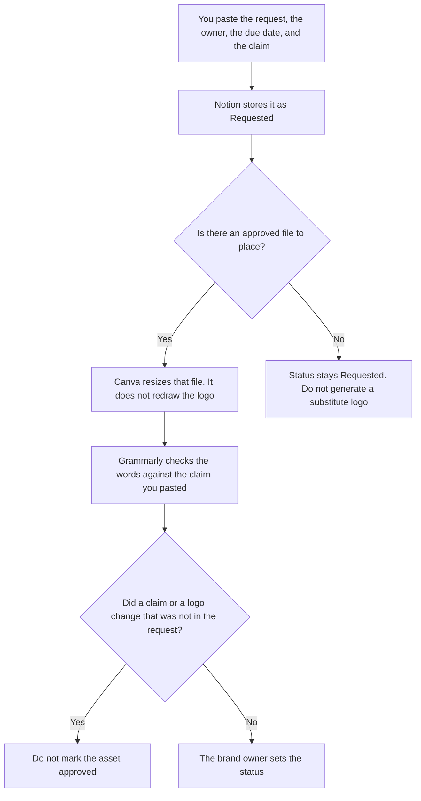

**Brand ops should use AI to track a creative request, mark an asset's status from a list you already use, and check a file against a guide a person already wrote.** The model does not invent the logo, the claim, or the voice. The voice, the type, and the handoff file are [best AI tools for brand teams](/blog/best-ai-tools-for-brand-teams-2026/). The design system work is [best AI tools for design ops](/blog/best-ai-tools-for-design-ops-2026/).

The writing rules, once you have them, are [how to create a brand voice with AI](/blog/how-to-create-a-brand-voice-with-ai-2026/). This page is the queue that asks for the work. It is not the voice itself.

Notion, Canva, Grammarly, and Zapier prices are from directory pages checked October 16, 2026. A live fetch of Zapier's pricing page returned HTTP 401 on October 24, 2026, in the agent-budget article, so the Zapier figure stays on the directory record. Published October 24, 2026. We did not score brand consistency.

## The ops week

| The job | Start here | First paid step | The limit |
|---|---|---|---|
| The request and the asset status | [Notion AI](/tools/notion-ai/) | Business is $20 a seat a month | Plus at $10 is not the full AI tier |
| A resize of a file you already approved | [Canva](/tools/canva/) | Pro is $18 a month, or $180 a year | No new claim on the layout |
| A pass on words that must match the guide | [Grammarly](/tools/grammarly/) | Pro is $12 a member a month billed annually, or $30 monthly | Compare the claim before and after |
| A notice when a status a person set is due | [Zapier](/tools/zapier/) | Professional is $19.99 a month billed annually, 750 tasks | The Zap does not approve an asset |

Status values are the ones you already use: Requested, In progress, Approved, Killed. The model does not add "brand safe" as a status. If the claim is missing, the row says Claim not set. A due date the requester did not give stays blank. Zapier reminds the owner of a date you stored. It does not move the status.

Canva's free plan exists on the October 16 card. Pro at $18 a month, or $180 a year, is the paid seat for one person. A brand kit you have not uploaded is not in the file. Do not ask the layout to "match the brand" from memory.

## What you are paying for

**Notion Business** is the queue: request, owner, due date, claim, status, file link. The invoice is [Notion AI pricing explained](/blog/notion-ai-pricing-explained-2026/).

**Canva Pro** is the production seat for a file you already approved. The directory is [Canva](/tools/canva/). An image model is a different decision, on the brand-team page. This page does not start a new campaign look.

**Grammarly Pro** is the wording pass. Reject a suggestion that softens a claim the guide marked as required. The invoice is [Grammarly pricing explained](/blog/grammarly-pricing-explained-2026/).

**Zapier Professional** is the reminder, on the October 16 card. Team at $69 a month billed annually is the shared-connection row if more than one person owns the Zap. The ladder is [Zapier pricing explained](/blog/zapier-pricing-explained-2026/).

A prompt that holds the line:

"Draft the asset status note from the request, the owner, the due date, and the claim I pasted. Leave the status as Requested. If the claim is missing, write Claim not set. Do not add a slogan. Do not mark approved."

## What not to automate

Do not generate a logo because the request said "logo." Do not let a Zap publish an asset because the due date arrived. Do not treat a resize as a new approval. The brand owner sets the status. Requested stays requested.

## FAQ

### How is this different from the brand-team page?

That page is the voice, the visual system, and the file you hand off. This page is the queue: who asked, when it is due, and whether the file is still Requested. The same team may own both. The templates stay different so a status note does not become a new brand voice.

### How is this different from design ops?

Design ops covers the system designers work in: components, libraries, the way a file is named. Brand ops covers the request that asked for a brand file, and the status of that asset. A component library can be the place the file lives. It is not the request queue. If you do not have a guide yet, the claim cell says Claim not set. Do not borrow a component name and call it a claim.

### Do I need Canva to run the queue?

No. The queue is Notion. Canva is the step when an approved file needs a size you already use. Pro at $18 a month is the October 16 one-person price. A request with no approved file does not get a generated stand-in.

### Who may mark an asset approved?

The brand owner named on the row. A tidy layout is not an approval. A Grammarly score is not an approval. This page does not use one. Claim not set stays until a person writes the claim.

## Last verified

October 16, 2026 for Notion, Canva, Grammarly, and Zapier. Published October 24, 2026. Zapier's pricing page returned HTTP 401 on October 24, as recorded in the agent-budget article.

**Sources:** [Notion pricing](https://www.notion.com/pricing), [Canva pricing](https://www.canva.com/pricing/), [Grammarly pricing](https://www.grammarly.com/plans), [Zapier pricing guide](https://zapier.com/blog/zapier-pricing/).

*Published by Andrew for [AI Tools Optimizer](https://aitoolsoptimizer.com).*

[Canva](/tools/canva/) is in the [design directory](/tools/category/design/). Directory pages may use affiliate links. A purchase through them may earn us a commission at no extra cost to you.
