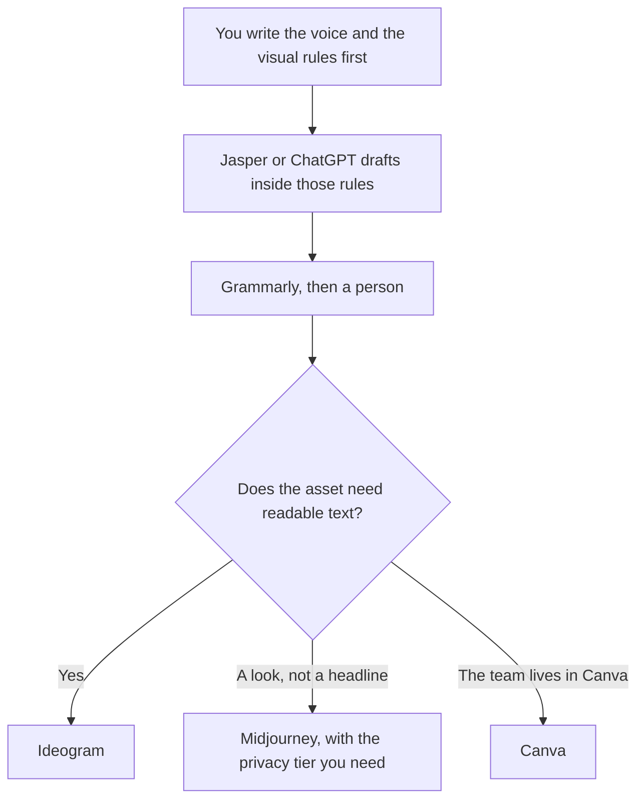

**A brand team should use AI to apply a voice and a visual system you already wrote down, then export a file the rest of the company can edit.** The model can draft in that voice. It cannot invent the voice, the logo, or a claim about the product. This page is one tool per job. The marketer's shelf is [best AI tools for marketers](/blog/best-ai-tools-for-marketers-2026/). The designer's shelf is [best AI tools for designers](/blog/best-ai-tools-for-designers-2026/).

The writing rules are [how to create a brand voice with AI](/blog/how-to-create-a-brand-voice-with-ai-2026/). The broader style sheet is [how to create a style guide with AI](/blog/how-to-create-a-style-guide-with-ai-2026/). The image pair, when the words have to render, is [Midjourney vs Ideogram](/blog/midjourney-vs-ideogram-2026/). The person who tracks the request and the asset status, and does not invent the logo, is [best AI tools for brand ops](/blog/best-ai-tools-for-brand-ops-2026/).

Prices are US list prices excluding tax from directory pages checked October 16, 2026. Published October 24, 2026. We did not score brand consistency.

## The brand job

| The job | Start here | First paid step | The limit |
|---|---|---|---|
| A voice system with a cap you can see | [Jasper](/tools/jasper/) | Pro is $69 a seat a month, or $59 billed yearly. 2 Brand Voices | Business is custom if you need more voices |
| Drafts without a marketing suite | [ChatGPT](/tools/chatgpt/) | Plus is $20. Business is $20 a user a month billed annually, minimum two | You paste the style sheet. It does not store two voices as a system |
| Layouts the team already lives in | [Canva](/tools/canva/) | Pro is $18 a month or $180 a year for one person | Business is $25 a person a month or $250 a year |
| Words inside the image | [Ideogram](/tools/ideogram/) | Plus is $20 a month, or $15 billed yearly | Free images are not private |
| A stylized image, no required text | [Midjourney](/tools/midjourney/) | Basic is $10, or $8 annually. Standard is $30, or $24 | No free plan. Stealth is Pro or Mega |
| The line edit | [Grammarly](/tools/grammarly/) | Pro is $12 a member a month billed annually | It will not know the banned words unless you look |
| A logo package | [Looka](/tools/looka/) | Premium logo package is $72 once. Brand Kit is $96 a year | Free to design. You pay when you export |

## How the seats fit

**Voice.** Jasper Pro includes two Brand Voices, five Knowledge assets, and three Audiences, plus a 7-day trial. One seat on the yearly rate is 12 × $59 = $708. Five seats are 5 × $708 = $3,540 a year. An agency with a voice per client will hit the cap and need a Business quote. There is no public Business dollar. The card is [Jasper pricing explained](/blog/jasper-pricing-explained-2026/). The general-chat alternative is [Jasper vs ChatGPT for marketing](/blog/jasper-vs-chatgpt-for-marketing-2026/).

**Layouts.** Canva Pro at $180 a year is the one-person design seat. Business at $250 a person a year is the admin seat. Paid plans get a larger monthly AI allowance, Pro 10× and Business 20× Canva Free, on the directory card. The suite comparison is [Figma AI vs Canva Magic Studio](/blog/figma-ai-vs-canva-magic-studio-2026/). [Figma](/tools/figma/) Professional Full is $16 a month with 3,000 AI credits when the source of truth is the design system, not a social template.

**Images.** Ideogram Plus yearly is $180, with private generation. Midjourney Standard annual is $288 and adds unlimited Relax images. Companies with over $1,000,000 in gross annual revenue need Midjourney Pro or Mega for commercial use, on the recorded terms. Stealth, for private images, starts at Pro ($60, or $48 annually). [Adobe Firefly](/tools/adobe-firefly/) Standard is $9.99 a month with 2,000 credits if the team is already in Adobe. The Firefly three-way is [Flux vs Ideogram vs Firefly](/blog/flux-vs-ideogram-vs-firefly-2026/).

**A logo, once.** Looka's Basic package is $35 for one low-res PNG. Premium is $72 for the vector files. Brand Kit is $96 a year. Do not start a rebrand in a chat window and skip the file formats you will need next year.

**Decks that must look like the brand.** [Gamma](/tools/gamma/) Plus is $9 a seat a month after the template rules exist. The editor pair is [Gamma vs Beautiful.ai](/blog/gamma-vs-beautiful-ai-2026/).

The person who approves a public line is [what human-in-the-loop AI is](/blog/what-is-human-in-the-loop-ai-2026/). A claim the product cannot do is [a hallucination](/blog/what-is-ai-hallucination-2026/) with your logo on it. The check is [how to fact-check AI writing](/blog/how-to-fact-check-ai-writing-2026/).

## What not to automate

Do not let a model rename the product, pick a new color system, or publish a campaign from a prompt that says "make it premium." Do not train a voice on customer calls you do not have rights to use. The newsletter, once the voice is real, is [how to create a newsletter with AI](/blog/how-to-create-a-newsletter-with-ai-2026/).

## FAQ

### What should a one-person brand team buy first?

The style sheet, written by you. Then ChatGPT Plus or the chat you have, Canva Free or Pro, and Ideogram Free if the work is posters. Add Jasper when two voices and a knowledge cap are the system you will maintain. Add Midjourney when you need the look and you have read the commercial rule.

### Is Canva enough for a design system?

It is enough for templates the marketing team will use. A component library engineers implement is closer to Figma Professional. The designer's shelf, linked above, is the longer answer. This page does not merge those jobs.

### Can AI keep every channel on-brand?

It can draft from a voice you stored. Someone still reviews the homepage, the ad, and the help center, because those pages have different facts. A shared voice does not make a help-center article a slogan.

### What about video spots?

That meter is [Runway vs Kling for ads](/blog/runway-vs-kling-for-ads-2026/). Brand still owns the claim and the type. The video tool does not.

## Last verified

October 16, 2026 for Jasper, ChatGPT, Canva, Ideogram, Midjourney, Grammarly, Looka, Adobe Firefly, Figma, and Gamma prices named above. Jasper Business has no public dollar. Published October 24, 2026.

**Sources:** [Jasper pricing](https://www.jasper.ai/pricing), [Canva](https://www.canva.com), [Ideogram](https://ideogram.ai).

*Published by Andrew for [AI Tools Optimizer](https://aitoolsoptimizer.com).*

[Canva](/tools/canva/) is in the [design directory](/tools/category/design/). Directory pages may use affiliate links. A purchase through them may earn us a commission at no extra cost to you.
