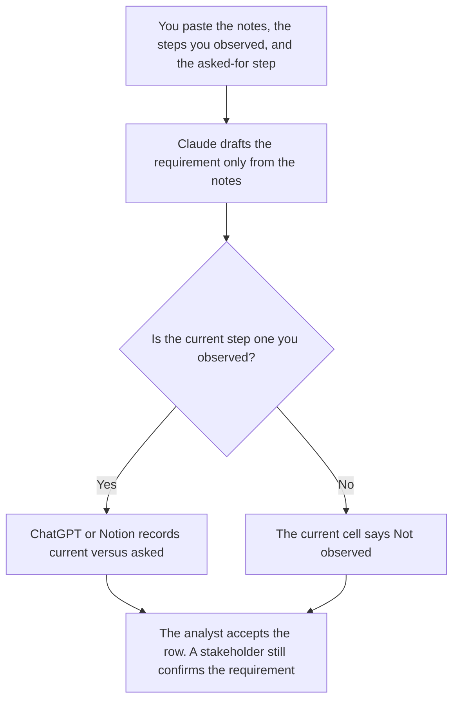

**A business analyst should use AI to draft a requirement from notes they already wrote, list an as-is process only from steps they observed, and keep a gap table that stays blank when a step was not seen.** The model does not invent a requirement, a system, or a benefit. The chart, the CSV, and the warehouse notebook are [best AI tools for data analysts](/blog/best-ai-tools-for-data-analysts-2026/). The spec a product manager owns is [best AI tools for product managers](/blog/best-ai-tools-for-product-managers-2026/). This page is the requirement, the as-is, and the gap.

The lines that say how you will tell a requirement is met are [how to write an AI acceptance criteria set with AI](/blog/how-to-write-an-ai-acceptance-criteria-set-with-ai-2026/). A cited policy page, when the requirement depends on one, is [Perplexity vs ChatGPT for policy research](/blog/perplexity-vs-chatgpt-for-policy-research-2026/).

Claude's prices are the October 24, 2026 read of claude.com/pricing recorded in [Claude pricing explained](/blog/claude-pricing-explained-2026/). Notion is the October 16 directory card. Perplexity's Pro price is the figure in [Perplexity pricing explained](/blog/perplexity-pricing-explained-2026/). ChatGPT's Plus price is the October 24 plan-page figure recorded in [ChatGPT pricing explained](/blog/chatgpt-pricing-explained-2026/). Published October 24, 2026. We did not score processes. A tidy table is not a requirement someone stated.

## The analyst's three artifacts

| The job | Start here | First paid step | The limit |
|---|---|---|---|
| The requirement, from interview notes you wrote | [Claude](/tools/claude/) | Pro is $17 a month billed annually, or $20 monthly | No requirement that was not in the notes |
| The page stakeholders will comment on | [Notion AI](/tools/notion-ai/) | Business is $20 a seat a month | Plus at $10 is not the full AI tier |
| A policy page you still have to open | [Perplexity](/tools/perplexity/) | Pro is $17 a month billed annually | The note names the URL and the date. It is not the requirement |
| One gap table from a paste | [ChatGPT](/tools/chatgpt/) | Plus is $20 a month | A blank cell stays blank |

A requirement that says the team "needs a dashboard" has added a system. If the notes do not name it, the line says System not named. An as-is step you did not watch stays Not observed. The model does not interview a coworker you did not quote. A policy citation you did not open stays off the requirement. Perplexity can point at the page. The page is the source. The requirement is still a sentence a person stated.

The data-analyst page starts from a file or a warehouse and writes a sentence under a chart. This page starts from words: what someone asked, and what you saw. A number in the gap table has to be a number you pasted. Do not ask either tool to remember last quarter.

## What you are paying for

**Claude Pro** holds the requirement wording so a later draft does not widen it. The review is [Claude review](/blog/claude-review-2026/).

**Notion Business** is the page: requirement, source note, as-is, asked-for, and the blank. The invoice is [Notion AI pricing explained](/blog/notion-ai-pricing-explained-2026/).

**Perplexity Pro** is the external page, with a date you write down. Enterprise Pro on that pricing article starts at $40 a seat. That is an admin seat, not a better reading of your interview. The invoice is [Perplexity pricing explained](/blog/perplexity-pricing-explained-2026/).

**ChatGPT Plus** is one gap table from a paste. Go is $8 a month on the October 24 plan page. Plus is the seat for a saved table. The review is [ChatGPT review](/blog/chatgpt-review-2026/).

A prompt that holds the line:

"Draft the requirement only from the notes I pasted. Draft the as-is only from the steps I marked observed. If a current step is missing, write Not observed. Do not add a system. Do not add a benefit."

## What not to automate

Do not let a model close a gap by proposing a tool. Do not turn a policy link into a company requirement. Do not mark a stakeholder as confirmed because the sentence sounds like something they would say. The analyst owns the draft. The stakeholder confirms the requirement. A product manager owns the spec.

## FAQ

### How is this different from a data analyst's stack?

That page is a CSV, a notebook on a warehouse, or a sentence under a chart you made. This page is a requirement someone stated, steps you observed, and a gap table. A chart can support a gap only if you paste the figure. The business analyst does not invent the total. The data analyst does not invent the requirement.

### How is this different from a product manager's spec?

The product page is the spec, the prototype, and the meeting. This page is the requirement and the as-is before that spec, or beside it. If they disagree, a person decides which sentence is the requirement. The model does not merge them into a third system.

### How is this different from acceptance criteria?

The criteria set is the pass and fail for a behavior you already required. This page is how that behavior got onto the page: notes, observation, and a blank when you did not see the step. Criteria can point at a requirement. They do not replace Not observed with a pass.

### Who may call a requirement confirmed?

The stakeholder who stated it, after they see the sentence. Not observed stays blank. System not named stays unnamed. A formatted table is not confirmation.

## Last verified

October 24, 2026 for Claude and for ChatGPT's plan page, via the posts cited above. Perplexity's Pro price is the figure in the pricing article cited above. October 16, 2026 for Notion. Published October 24, 2026.

**Sources:** [Claude pricing](https://claude.com/pricing), [Notion pricing](https://www.notion.com/pricing), [Perplexity pricing](https://www.perplexity.ai/pro), [ChatGPT and Codex pricing](https://learn.chatgpt.com/docs/pricing).

*Published by Andrew for [AI Tools Optimizer](https://aitoolsoptimizer.com).*

[Notion AI](/tools/notion-ai/) is in the [productivity and notes directory](/tools/category/productivity-notes/). Directory pages may use affiliate links. A purchase through them may earn us a commission at no extra cost to you.
