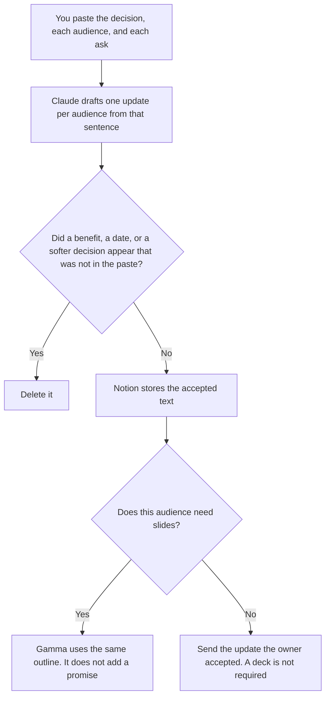

**A change manager should use AI to format one update per audience from a decision a person already made, a short deck from that same outline, and a clarity pass that does not soften the ask.** The model does not choose the decision, invent a benefit, or decide that a group is ready. The cross-team plan around dependencies is [best AI tools for program managers](/blog/best-ai-tools-for-program-managers-2026/). The email for one change is [how to write a change management email with AI](/blog/how-to-write-a-change-management-email-with-ai-2026/).

The audience split is [ChatGPT vs Claude for stakeholder updates](/blog/chatgpt-vs-claude-for-stakeholder-updates-2026/). The decision record is [ChatGPT vs Claude for decision memos](/blog/chatgpt-vs-claude-for-decision-memos-2026/).

Claude's prices are from claude.com/pricing on October 24, 2026. Notion, Gamma, and Grammarly prices are from directory pages checked October 16, 2026. Published October 24, 2026. We did not score adoption.

## The change week

| The job | Start here | First paid step | The limit |
|---|---|---|---|
| The update, one decision sentence, several audiences | [Claude](/tools/claude/) | Pro is $17 a month billed annually, or $20 monthly | No benefit you did not write |
| The audience list and the accepted text | [Notion AI](/tools/notion-ai/) | Business is $20 a seat a month | Plus at $10 is not the full AI tier |
| A short deck from the outline | [Gamma](/tools/gamma/) | Plus is $9 a seat a month, or $108 a year | No metric that was not in the outline |
| A clarity pass that must not touch the ask | [Grammarly](/tools/grammarly/) | Pro is $12 a member a month billed annually, or $30 monthly | Compare the ask before and after |

An update that calls the change "small" when the decision did not say small has amended the decision. If an audience has no ask, the line says Ask not set. It does not propose one. Two audiences do not get two decisions. They get the same decision sentence and the ask you wrote for each.

## What you are paying for

**Claude Pro** holds the decision sentence so a manager update and a frontline update do not drift. Team standard seats are $20 a seat a month billed annually, or $25 monthly, when the note is a company record, as recorded in [Claude Team pricing explained](/blog/claude-team-pricing-explained-2026/). The review is [Claude review](/blog/claude-review-2026/).

**Notion Business** is the list: audience, ask, date accepted, link to the decision. The invoice is [Notion AI pricing explained](/blog/notion-ai-pricing-explained-2026/).

**Gamma Plus** is the deck from the outline, with 1,000 credits a month on the October 16 card. Pro at $18 a seat is the credit step, not a better decision. If the deck must live in a Canva brand file, that is a different tool. The pairing is [Gamma vs Canva for sales decks](/blog/gamma-vs-canva-for-sales-decks-2026/). The invoice is [Gamma pricing explained](/blog/gamma-pricing-explained-2026/).

**Grammarly Pro** is the last pass. Reject a suggestion that softens the decision. The old Business name is not a current list price. The article is [Grammarly Business pricing explained](/blog/grammarly-business-pricing-explained-2026/).

A prompt that holds the line:

"Draft the change update for the audience I named, from the decision and the ask I pasted. If the ask is missing, write Ask not set. Do not add a benefit. Do not soften the decision. Do not invent a date."

## What not to automate

Do not ask how to make people feel ready. Do not paste a private objection so the note sounds human. Do not send a deck that adds a metric the decision did not include. The decision owner accepts the sentence. The change manager sends the audience file they were given. A calm paragraph is not a decision.

## FAQ

### How is this different from the program manager page?

The program manager tracks dependencies and a steering note across teams. The change manager tells each audience what changed and what is asked of them. A steering deck can quote the decision. It does not replace the ask. If the ask is missing, both pages should say so.

### How is this different from the change-management email?

That page is one email: the date, then the ask. This page is the set: several audiences, one decision sentence, an optional deck, and the file the next sender copies. Write the email from the accepted update. Do not let the email invent a second decision.

### Do I need Gamma?

Only when this audience needs slides and you are generating them from the outline. Many changes are a note in Notion and a message. Plus at $9 a seat is the first paid Gamma step on the October 16 card. A deck that adds a promise is the deck you delete.

### Who may send the update?

The decision owner, or the person that owner names for that audience. A formatted draft is not a send. A model that says the tone is reassuring has not checked the decision sentence.

## Last verified

October 24, 2026 for Claude. October 16, 2026 for Notion, Gamma, and Grammarly. Published October 24, 2026.

**Sources:** [Claude pricing](https://claude.com/pricing), [Notion pricing](https://www.notion.com/pricing), [Gamma pricing](https://gamma.app/pricing), [Grammarly pricing](https://www.grammarly.com/plans).

*Published by Andrew for [AI Tools Optimizer](https://aitoolsoptimizer.com).*

[Claude](/tools/claude/) is in the [chatbots and assistants directory](/tools/category/chatbots-assistants/). Directory pages may use affiliate links. A purchase through them may earn us a commission at no extra cost to you.
