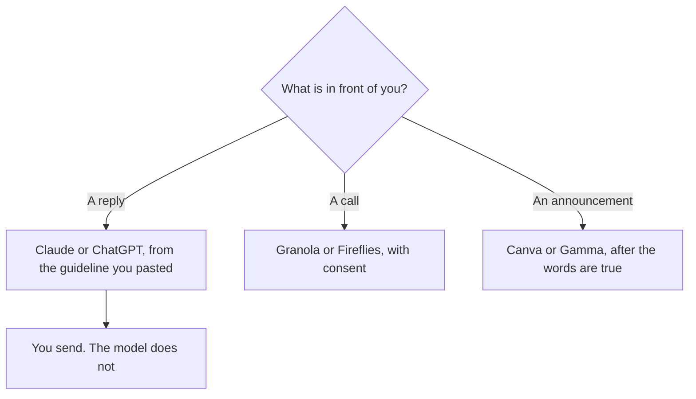

**A community manager should buy the tool that matches the artifact they already touch: the reply, the call recap, or the announcement.** An agent that posts to the community without a person reading it is not a community tool. It is a way to ship a promise nobody meant. This page is the week. The broader marketing stack is [best AI tools for marketers](/blog/best-ai-tools-for-marketers-2026/). The content team next door is [best AI tools for content teams](/blog/best-ai-tools-for-content-teams-2026/).

Prices are US list prices excluding tax from directory pages checked October 16, 2026, with Perplexity's annual price from the October 24 explainer. Published October 24, 2026. We did not measure engagement.

## The week's three jobs

| Job | Start here | First paid step | The limit |
|---|---|---|---|
| A reply, a welcome, a weekly note | [ChatGPT](/tools/chatgpt/) or [Claude](/tools/claude/) | Plus or Pro is $20. Claude Pro is also $17 billed annually | You paste the policy. You send |
| The page the community guidelines live on | [Notion AI](/tools/notion-ai/) | Business is $20 a seat. Plus at $10 is not the full AI tier | One home for the rules |
| A visual for an announcement | [Canva](/tools/canva/) | Pro is $18 a month, or $180 a year | Templates are not a brand system by themselves |
| A short deck for an event or an AMA | [Gamma](/tools/gamma/) | Plus is $9 a seat a month, or $108 a year | A deck is not the community itself |
| The proofread | [Grammarly](/tools/grammarly/) | $12 a member a month billed annually, or $30 monthly | It will not know the inside joke |
| The community call | [Granola](/tools/granola/) or [Fireflies](/tools/fireflies-ai/) | Granola Business is $14 a user. Fireflies Pro is $10 a user annually | Consent first. One bot |

## The reply

Most community time is a reply that has to be warm and accurate. [Claude](/tools/claude/) fits a long thread or a guideline you will revise in a Project. [ChatGPT](/tools/chatgpt/) Plus fits when the same seat also makes a small image or holds a custom GPT of your macros. Go at $8 is the lighter ChatGPT step. Free is enough to learn which one you edit less. The writing split is [ChatGPT vs Claude for writing](/blog/chatgpt-vs-claude-for-writing-2026/). The email-shaped version of a reply is [how to write customer emails with AI](/blog/how-to-write-customer-emails-with-ai-2026/).

[Grammarly](/tools/grammarly/) is the pass in the box where you already type. It will not invent the moderation decision. A ban, a warning, and a refund stay with the person, under the guideline you pasted. The comparison is [Grammarly vs ChatGPT for editing](/blog/grammarly-vs-chatgpt-for-editing-2026/). The voice, so five moderators do not sound like five brands, is [how to create a brand voice with AI](/blog/how-to-create-a-brand-voice-with-ai-2026/).

Put the guidelines in [Notion AI](/tools/notion-ai/) if that is the home people will open. A rule that lives in a chatbot will be paraphrased differently every week. The build is [how to build an internal wiki with AI](/blog/how-to-build-an-internal-wiki-with-ai-2026/). The card is [Notion AI pricing explained](/blog/notion-ai-pricing-explained-2026/).

## The call and the announcement

[Granola](/tools/granola/) fits a manager who already types. Business at $14 keeps history past Basic's 30 days. [Fireflies](/tools/fireflies-ai/) fits a calendar bot. Pro annual is $10. Monthly is $18. Tell members the call is recorded. The notes workflow is [how to summarize meetings with AI](/blog/how-to-summarize-meetings-with-ai-2026/). The agenda before you hit record is [how to create meeting agendas with AI](/blog/how-to-create-meeting-agendas-with-ai-2026/). The field guide is [Fireflies alternatives](/blog/fireflies-alternatives-2026/).

[Canva](/tools/canva/) Pro at $18 a month, or $180 a year, is the visual seat for a person who is not a designer. The review is [Canva Magic Studio review](/blog/canva-magic-studio-review-2026/). [Gamma](/tools/gamma/) Plus at $9 is the fast deck. Pro at $18 adds the larger credit pool and API access, on the pricing explainer. Do not buy Ultra to get an API key. The card is [Gamma pricing explained](/blog/gamma-pricing-explained-2026/). The format choice is [Gamma vs Beautiful.ai vs Plus AI](/blog/gamma-vs-beautiful-ai-vs-plus-ai-2026/).

A recap video is optional. [OpusClip](/tools/opusclip/) Starter is $15 a month when a long call should become clips. [CapCut](/tools/capcut/) Pro is $19.99 a month, or $179.99 a year, when you want the timeline. Neither one is the reply. The video shelf, if the community is also a channel, is [best AI tools for YouTubers](/blog/best-ai-tools-for-youtubers-2026/).

When a member asks a question that needs a source, [Perplexity](/tools/perplexity/) Pro at $17 a month billed annually is the cited lookup. Open the link before you repeat it in the community. The habit is [Perplexity vs Elicit for research](/blog/perplexity-vs-elicit-for-research-2026/). Elicit is for papers, not for your guidelines.

## FAQ

### What should a community manager pay for first?

The place the week breaks. Replies: Claude or ChatGPT. Guidelines nobody can find: Notion. Off-brand visuals: Canva. Calls you cannot remember: Granola or Fireflies. One seat. Add a second when the first is in use.

### Can AI post for me?

It can draft. A person posts. A wrong rule, a joke that lands badly, or a promise about a product will sit in the community after you have closed the laptop. The control is [what human-in-the-loop AI is](/blog/what-is-human-in-the-loop-ai-2026/).

### Do I need a marketing platform like Jasper?

Not to answer members. [Jasper](/tools/jasper/) Pro at $59 a seat billed yearly is a brand system for a marketing team. Buy it when several people publish campaigns and the voice note keeps drifting. The comparison is [Jasper vs ChatGPT for marketing](/blog/jasper-vs-chatgpt-for-marketing-2026/).

### How do I plan the month?

A calendar of what you will actually say, not fifty generated posts. The workflow is [how to build an AI content calendar](/blog/how-to-build-an-ai-content-calendar-2026/). Member questions that repeat become [FAQ pages](/blog/how-to-create-faq-pages-with-ai-2026/), not a longer chatbot.

## Last verified

October 16, 2026 for ChatGPT, Claude, Notion, Canva, Grammarly, Granola, Fireflies, Gamma, OpusClip, CapCut, and Jasper prices. October 24, 2026 for Perplexity Pro at $17 billed annually. Published October 24, 2026.

**Sources:** [ChatGPT pricing](https://chatgpt.com/pricing), [Notion pricing](https://www.notion.com/pricing), [Canva pricing](https://www.canva.com/pricing/).

*Published by Andrew for [AI Tools Optimizer](https://aitoolsoptimizer.com).*

[Notion AI](/tools/notion-ai/) is in the [productivity and notes directory](/tools/category/productivity-notes/). Directory pages may use affiliate links. A purchase through them may earn us a commission at no extra cost to you.
