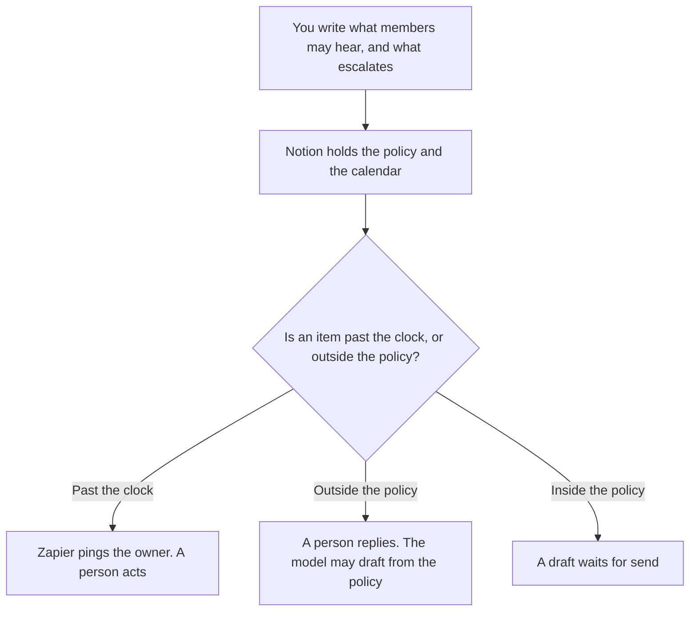

**Community ops should use AI to format the queue rules, the program calendar, and reply drafts that follow a policy a person already wrote.** The daily post is the community manager's page. This page is the system: what gets escalated, what the month contains, and which replies are allowed. We did not score engagement. A model does not speak as the community.

The manager's shelf is [best AI tools for community managers](/blog/best-ai-tools-for-community-managers-2026/). The month of posts, once you are publishing, is [how to build an AI content calendar](/blog/how-to-build-an-ai-content-calendar-2026/). The voice those posts have to match is [how to create a brand voice with AI](/blog/how-to-create-a-brand-voice-with-ai-2026/).

Prices are US list prices excluding tax from directory pages checked October 16, 2026. Published October 24, 2026.

## The ops job

| The job | Start here | First paid step | The limit |
|---|---|---|---|
| The policy, the escalation table, and the calendar | [Notion AI](/tools/notion-ai/) | Business is $20 a seat a month | A rule the model invented is not the policy |
| A reply draft from a policy you pasted | [Claude](/tools/claude/) | Pro is $20 a month, or $17 billed annually | The model drafts. A person sends |
| A ping when a queue item is past the clock you set | [Zapier](/tools/zapier/) | Professional is $19.99 a month billed annually, 750 tasks | The Zap notifies. It does not ban a member |
| Templates for announcements you already approved | [Canva](/tools/canva/) | Pro is $18 a month, or $180 a year | The words were approved before the template |
| Notes from a member call | [Fathom](/tools/fathom/) | Premium is $16 a month billed annually, or $20 monthly | Free includes unlimited recordings on that card. The note is not a promise |
| A bot on the public help docs, if you have them | [Chatbase](/tools/chatbase/) | Hobby is $32 a month billed yearly, 700 message credits | The bot answers only what the docs say. It escalates the rest |

Community ops owns the queue and the calendar. Community managers own the presence. Support owns a product ticket. The handoff, when a member is really a customer with a severity, is [how to create a support escalation matrix with AI](/blog/how-to-create-a-support-escalation-matrix-with-ai-2026/). Do not let a community reply invent a product commitment. A commitment is a success plan or a changelog, and only after it shipped.

## What you are paying for

**Notion Business at $20 a seat** holds the moderation rules, the escalation table, and the program calendar. Topics the model added to "cover more ground" are how a policy drifts. Write the list. The record rule is [what a system of record for AI is](/blog/what-is-a-system-of-record-for-ai-2026/).

**Claude Pro** drafts a reply from the rule you pasted. It can say Escalate when the note matches a row you listed. It cannot decide a ban. The review is [Claude review](/blog/claude-review-2026/). The person who sends is [what human-in-the-loop AI is](/blog/what-is-human-in-the-loop-ai-2026/).

**Zapier Professional** watches a queue field you defined, such as a status older than a number of hours you chose. Free is 100 tasks a month. Team is $69 a month billed annually, on the October 16 card used across this site's ops articles. The Zap does not message the member.

**Canva Pro** is the announcement template after the copy is approved. It is not the policy. Magic Studio pricing is [Canva Magic Studio pricing explained](/blog/canva-magic-studio-pricing-explained-2026/).

**Fathom** is the member call when a bot in the meeting is acceptable. Granola is the path when it is not. Business there is $14 a user a month. Pick one note tool.

**Chatbase** is optional. Use it when the answer is already a help-center article. A member question about a person, a billing exception, or a moderation appeal is not a bot job. The escalation matrix says who takes it.

A prompt that holds the line:

"Draft a reply using only the policy I pasted. If the note matches an escalation row, write Escalate and the row's name. Do not invent a remedy. Do not speak as the member. Do not send."

## What not to automate

Do not auto-ban. Do not auto-post. Do not let a bot promise a feature, a refund, or a moderation outcome. Do not generate a sentiment score and call it the health of the community. Health is a definition you wrote, with evidence you can show. A journey of the member, if you have interviews, is [how to create a customer journey map with AI](/blog/how-to-create-a-customer-journey-map-with-ai-2026/). It is not this queue.

## FAQ

### Is community ops the same as community management?

On this site, managers show up: posts, events, replies in public. Ops keeps the rules, the calendar, the queue clocks, and the templates. Buy the manager page when the job is the presence. Buy this page when the job is the system.

### Can AI moderate the forum?

It can label a post against categories you defined, for a person to review. It should not delete, ban, or warn on its own from this article's workflow. A wrong ban is a member you have to earn back. The label is the aid. The action is a person.

### Do we need a bot?

No. Most communities need the policy page and the queue before they need Chatbase. Add the bot when the repetitive questions are already written down as articles.

### What if the policy is silent?

Then the reply is Escalate, or a person writes a new rule and the owner signs it. The model must not fill the silence with a reasonable-sounding exception. Silence is a gap in the page, not a prompt to be helpful.

## Last verified

October 16, 2026 for Notion AI, Claude, Zapier, Canva, Fathom, and Chatbase. Published October 24, 2026.

**Sources:** [Notion pricing](https://www.notion.com/pricing), [Claude pricing](https://claude.com/pricing), [Zapier pricing](https://zapier.com/pricing), [Canva pricing](https://www.canva.com/pricing/), [Fathom](https://www.fathom.ai).

*Published by Andrew for [AI Tools Optimizer](https://aitoolsoptimizer.com).*

[Notion AI](/tools/notion-ai/) is in the [productivity and notes directory](/tools/category/productivity-notes/). Directory pages may use affiliate links. A purchase through them may earn us a commission at no extra cost to you.
