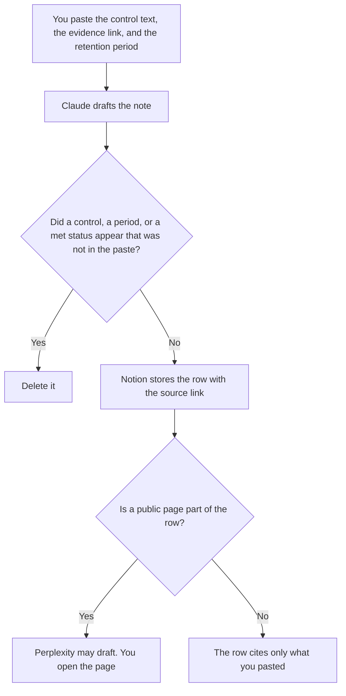

**A compliance-ops owner should use AI to format a control note from language a person already approved, an evidence row from a source they can open, and a retention line from a period they already chose.** The model does not decide a control is met, invent a policy, or close an audit request. Counsel and the control owner still sign. This page is not legal advice. The legal-ops intake desk is [best AI tools for legal ops](/blog/best-ai-tools-for-legal-ops-2026/). The retention note is [how to write a data retention note for AI with AI](/blog/how-to-write-a-data-retention-note-for-ai-with-ai-2026/).

How long a prompt stays is [what an AI data retention policy is](/blog/what-is-ai-data-retention-policy-2026/). A shorter view of a policy that already exists is [Claude vs ChatGPT for policy summaries](/blog/claude-vs-chatgpt-for-policy-summaries-2026/).

Claude's prices are from claude.com/pricing on October 24, 2026. Notion and Grammarly prices are from directory pages checked October 16, 2026. Perplexity's Enterprise Pro price is the directory FAQ checked October 16. A live fetch of the Perplexity enterprise URL returned HTTP 401 on October 24, so that dollar stays on the card. Published October 24, 2026. We did not score controls.

## The evidence week

| The job | Start here | First paid step | The limit |
|---|---|---|---|
| The control note and the retention sentence | [Claude](/tools/claude/) | Pro is $17 a month billed annually, or $20 monthly | No control you did not paste |
| The register the next reviewer opens | [Notion AI](/tools/notion-ai/) | Business is $20 a seat a month | Plus at $10 is not the full AI tier |
| A public source you will open | [Perplexity](/tools/perplexity/) | Enterprise Pro is $40 a user a month, or $400 a year, when the row is a company record | A citation is not evidence until you open it |
| A clarity pass that must not touch a control id | [Grammarly](/tools/grammarly/) | Pro is $12 a member a month billed annually, or $30 monthly | Compare the id before and after |

A note that says the control is "satisfied" without the evidence you pasted is a story. If the evidence is missing, the row says Evidence not attached. If the retention period was not chosen, the line says Period not set. The model does not pick a period because another company uses one.

## What you are paying for

**Claude Pro** holds the headings: control id, what the text says, evidence, period, owner. Team standard seats are $20 a seat a month billed annually, or $25 monthly, when the note is a company record, as recorded in [Claude Team pricing explained](/blog/claude-team-pricing-explained-2026/). The review is [Claude review](/blog/claude-review-2026/).

**Notion Business** is the register. Link the source. Do not paste a secret into the row if a pointer will do. The invoice is [Notion AI pricing explained](/blog/notion-ai-pricing-explained-2026/).

**Perplexity Enterprise Pro** is the organization seat when the public-source check is a company record. Personal Pro at $17 a month billed annually is a different stance. The enterprise article is [Perplexity Enterprise pricing explained](/blog/perplexity-enterprise-pricing-explained-2026/). The ladder is [Perplexity pricing explained](/blog/perplexity-pricing-explained-2026/). Papers belong on [Elicit](/tools/elicit/), not on this web seat. The split is [Perplexity vs Elicit for evidence tables](/blog/perplexity-vs-elicit-for-evidence-tables-2026/).

**Grammarly Pro** is the pass after the words are stable. It must not rewrite a control id or a period. Enterprise Grammarly has no list price on the October 16 card. The Business name is [Grammarly Business pricing explained](/blog/grammarly-business-pricing-explained-2026/).

A prompt that holds the line:

"Draft the control note from the control text, the evidence, and the retention period I pasted. If evidence is missing, write Evidence not attached. Do not mark the control met. Do not change the period. Do not add a control."

## What not to automate

Do not ask whether the company is compliant. Do not paste a customer file so the note "has proof." Do not send the note to an auditor because the table looks full. The control owner accepts the row. Counsel owns the policy text. This page is not legal advice.

## FAQ

### How is this different from the legal-ops page?

Legal ops runs intake, an approved playbook, and a file a lawyer still reads. Compliance ops keeps the control, the evidence pointer, and the retention line for a program that already exists. A lawyer may own both on a small team. The templates stay different so an intake summary does not become a control conclusion.

### How is this different from a policy summary?

A policy summary shortens a policy that already exists, without changing an obligation. This page is the operating row: which control, which evidence, which period. The summary can link the policy. It does not replace the evidence cell. If the cell is empty, say so.

### Do I need Enterprise Perplexity?

Not for a personal lookup you are allowed to do on Pro. Use Enterprise Pro when the company asked for the organization seat. The October 16 FAQ prices that seat at $40 a user a month, or $400 a year. A personal login on a company corpus is a different risk decision. Open the source either way.

### Who may mark a control met?

The control owner, with the evidence they are willing to show. A formatted note is not a conclusion. A missing period stays missing. A model that says the wording looks complete has not tested the control.

## Last verified

October 24, 2026 for Claude. October 16, 2026 for Notion, Grammarly, and Perplexity's directory FAQ. Published October 24, 2026. The Perplexity enterprise URL returned HTTP 401 on October 24.

**Sources:** [Claude pricing](https://claude.com/pricing), [Notion pricing](https://www.notion.com/pricing), [Perplexity enterprise](https://www.perplexity.ai/enterprise), [Grammarly pricing](https://www.grammarly.com/plans).

*Published by Andrew for [AI Tools Optimizer](https://aitoolsoptimizer.com).*

[Claude](/tools/claude/) is in the [chatbots and assistants directory](/tools/category/chatbots-assistants/). Directory pages may use affiliate links. A purchase through them may earn us a commission at no extra cost to you.
