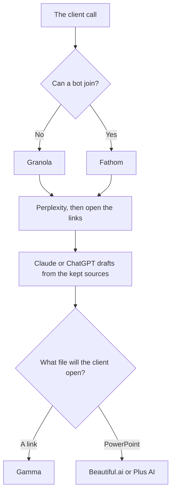

**A consultant should pay for the research source, the deck format the client will open, and notes from the working session.** A model can draft the memo from material you checked. It cannot sign the recommendation. If a figure is not on a page you opened, it does not go in the deck.

Prices are US list prices excluding tax. Most come from directory pages checked October 16, 2026. Perplexity's plan detail also appears in an October 24, 2026 pricing article. Nothing here is a utilization study. The adjacent solo stack is [best AI tools for freelancers](/blog/best-ai-tools-for-freelancers-2026/).

## One job, one starting tool

| Consulting job | Start here | First paid step | Leave it when |
|---|---|---|---|
| Public facts with links | [Perplexity](/tools/perplexity/) | Pro $17/month billed annually | The fact is not on a page you opened |
| The memo, from notes you trust | [Claude](/tools/claude/) or [ChatGPT](/tools/chatgpt/) | Claude Pro $20/month ($17 annual) or ChatGPT Plus $20 | You needed a citation engine, not a draft |
| A deck as a link or a one-pager | [Gamma](/tools/gamma/) | Plus $9/seat/month, 1,000 credits | The client requires a native slide file |
| A PowerPoint with layout guardrails | [Beautiful.ai](/tools/beautiful-ai/) | Pro $14.50/month annual, or $45 monthly | You must edit inside Google Slides |
| Slides inside Slides or PowerPoint | [Plus AI](/tools/plus-ai/) | Basic $10/user/month annual | You wanted a published web page, not a PPTX |
| Notes, no bot in the room | [Granola](/tools/granola/) | Business $14/user/month if you need history past 30 days | You wanted a live transcript |
| Notes, bot allowed | [Fathom](/tools/fathom/) | Free for unlimited recordings. Premium $16/month annual | The client will not accept a bot |
| A proofread before it goes out | [Grammarly](/tools/grammarly/) | Pro $12/member/month annual, or $30 monthly | The draft is still wrong on the facts |
| A chart from a spreadsheet you have | [Julius AI](/tools/julius-ai/) | Plus $16/month billed annually, or $20 monthly | The analysis needs a governed data stack |
| A shared project wiki | [Notion AI](/tools/notion-ai/) | Business $20/seat/month | The firm already lives in another wiki |

## Research before slides

[Perplexity](/tools/perplexity/) is the public-web pass. The steps are [how to use Perplexity for market research](/blog/how-to-use-perplexity-for-market-research-2026/). Pro at $17 billed annually is optional until the free allowance blocks a real week. The bill is [Perplexity pricing explained](/blog/perplexity-pricing-explained-2026/). The split with a general assistant is [ChatGPT vs Perplexity for research](/blog/chatgpt-vs-perplexity-for-research-2026/).

Papers are a different corpus. [Consensus](/tools/consensus/) Pro is $12 a month on a $144 year. [Elicit](/tools/elicit/) Plus is $11 a user a month billed annually on the non-Industry card. The workflow is [how to research with Elicit and Consensus](/blog/how-to-research-with-elicit-and-consensus-2026/).

Then the memo. Paste only the claims you kept. Ask Claude or ChatGPT to draft from that list and to mark gaps. The editing rule is [how to write a blog post with Claude](/blog/how-to-write-a-blog-post-with-claude-2026/). Grammarly is the surface pass after the facts are right. Whether Pro is worth $12 annual is [is Grammarly Pro worth it](/blog/is-grammarly-pro-worth-it-2026/).

[Julius](/tools/julius-ai/) is the chart step when the evidence is a spreadsheet, not a web page. Plus is $16 a month billed annually for 2,000 monthly credits plus a daily allowance. The spreadsheet shelf is [best AI for Excel and Google Sheets](/blog/best-ai-for-excel-and-google-sheets-2026/). Do not upload a client's confidential model to a new tool until the engagement letter allows it.

## The deck and the notes

Pick the deck tool from the file, not from a template gallery. The comparison is [Gamma vs Beautiful.ai vs Plus AI](/blog/gamma-vs-beautiful-ai-vs-plus-ai-2026/). Gamma's credits are [Gamma pricing explained](/blog/gamma-pricing-explained-2026/). Beautiful.ai's annual-versus-monthly gap is [Beautiful.ai pricing explained](/blog/beautiful-ai-pricing-explained-2026/). A consultant who presents twice a month and can send a link will feel Gamma Plus at $9. A consultant whose client opens PowerPoint will feel Beautiful.ai or Plus AI. Build the outline before you generate. A generated deck of twelve vague slides is a rewrite, and on Gamma it also spent credits.

Notes: tell the client when a bot or a recorder is on. [Fathom](/tools/fathom/) Free is the unlimited recording plan when a bot is acceptable. [Granola](/tools/granola/) is the local notes path when it is not. Business at $14 a user removes the 30-day history cap, and the workspace shares one plan. The split is [Granola vs Fathom](/blog/granola-vs-fathom-2026/). The wider shelf is [best AI meeting notetakers](/blog/best-ai-meeting-notetakers/).

[Notion](/tools/notion-ai/) Business at $20 a seat is the shared findings wiki if the team already writes there. The seat detail is [Notion AI pricing explained](/blog/notion-ai-pricing-explained-2026/). The wiki is not the client deliverable. The deck is.

## A small stack

One independent consultant: Perplexity Free, Claude or ChatGPT on the plan you already have, Gamma Plus or the Beautiful.ai trial, Granola Basic or Fathom Free, Grammarly Free. Add a paid seat when a limit is real. That is tens of dollars, not a research platform. A firm that also sells outbound should keep that work on [best AI tools for sales teams](/blog/best-ai-tools-for-sales-teams-2026/), not in the same inbox as client memos.

## FAQ

### What AI tool should a consultant buy first?

The one that matches the deliverable a client is waiting on. Usually that is a writing seat you already trust, plus a deck tool in the file format you send. Research can start on Perplexity's free tier.

### Gamma or Beautiful.ai for client work?

Gamma Plus at $9 if a link or a doc is acceptable. Beautiful.ai Pro at $14.50 annual, or $45 monthly, if you need PowerPoint and unlimited generation on the seat. The format article is linked above.

### Can I record client calls?

Only with a practice the client has agreed to, and only where the law allows it. This page is not legal advice. Granola is the option when a bot should not join. Fathom is the option when a bot is fine.

### Is Julius a replacement for an analyst?

It makes charts and answers from data you upload, inside a credit plan. You still check the number that will be in the recommendation. Plus is $16 a month billed annually.

## Last verified

October 16, 2026 for most plan prices. October 24, 2026 for Perplexity's annual Pro price as used in the pricing article. Published October 24, 2026.

**Sources:** [Perplexity pricing](https://www.perplexity.ai/pro), [Gamma pricing](https://gamma.app/pricing), [Beautiful.ai pricing](https://www.beautiful.ai/pricing), [Granola pricing](https://www.granola.ai/pricing), [Claude pricing](https://claude.com/pricing).

*Published by Andrew for [AI Tools Optimizer](https://aitoolsoptimizer.com).*

Directory pages for these tools may use affiliate links. A purchase through them may earn us a commission at no extra cost to you.
