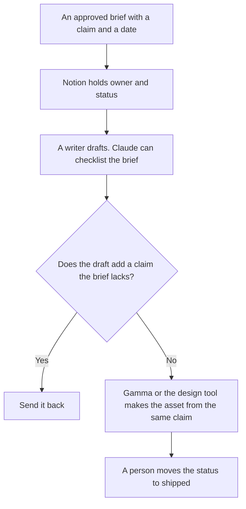

**Content ops should use AI to keep a board of owners and dates, turn an approved brief into a checklist, and hand a draft to the next person without changing the claim.** The writing itself is a different desk. That desk is [best AI tools for content teams](/blog/best-ai-tools-for-content-teams-2026/). This page is the system that moves a piece from assigned to shipped. We did not score throughput or rankings. The lead who writes the exception, the kill note, and the weekly note from dates they already have is [best AI tools for content ops leads](/blog/best-ai-tools-for-content-ops-leads-2026/).

The brief the board points at is [how to build a content brief with AI](/blog/how-to-build-a-content-brief-with-ai-2026/). The calendar the board should match is [how to build an AI content calendar](/blog/how-to-build-an-ai-content-calendar-2026/). A claim that was not in the brief is [what an AI hallucination is](/blog/what-is-ai-hallucination-2026/).

Prices are US list prices excluding tax from directory pages checked October 16, 2026. Published October 24, 2026.

## The ops job

| The job | Start here | First paid step | The limit |
|---|---|---|---|
| The board: status, owner, due date, link to the brief | [Notion AI](/tools/notion-ai/) | Business is $20 a seat a month. Plus is $10 and is not the full AI tier | One board. A second tracker will lie |
| A checklist from a brief you already approved | [Claude](/tools/claude/) | Pro is $20 a month, or $17 billed annually | The brief is the source. The checklist does not add a promise |
| A one-pager or a deck the calendar already planned | [Gamma](/tools/gamma/) | Plus is $9 a seat a month | The deck repeats the brief. It does not invent an offer |
| A notice when a status changes | [Zapier](/tools/zapier/) | Professional is $19.99 a month billed annually, 750 tasks | A status ping is a task. Read the meter |
| Many writers, one voice card, on a paid seat | [Jasper](/tools/jasper/) | Pro is $59 a seat a month billed yearly, or $69 monthly. Business is custom | A 7-day Pro trial is on the card. The voice card still has an owner |
| A search checklist, when that is the late job | [Frase](/tools/frase/) | $39 a month billed yearly, or $49 month to month | This is the editorial tool. Ops buys it when the board says SEO is the bottleneck |

Buy the row that is late. A team that misses dates needs the board and the ping. A team that ships the wrong claim needs the brief rule. A team that cannot find the post in search can look at Frase or the content-team page's Surfer row. Do not buy all six on day one.

## What the invoices are doing

**Notion Business at $20 a seat** is the ops home if the calendar and the briefs already live in Notion. Custom Agents at $10 per 1,000 credits are optional. A status field a person sets should not be overwritten by an agent. The invoice is [Notion AI pricing explained](/blog/notion-ai-pricing-explained-2026/).

**Claude Pro** formats the handoff: outline, sources, the claim, the out-of-scope list. The review is [Claude review](/blog/claude-review-2026/). Chain the steps only if a check sits between them: [what prompt chaining is](/blog/what-is-prompt-chaining-2026/).

**Gamma Plus at $9 a seat** is enough for a one-pager that matches the post. The invoice is [Gamma pricing explained](/blog/gamma-pricing-explained-2026/). The deck is not a second brief.

**Zapier Professional at $19.99 a month annually** can tell an editor the status moved. Free is 100 tasks a month. A noisy Zap will spend the 750. Write the Zap for one status change you actually want. Team is $69 a month billed annually. Enterprise is custom.

**Jasper** belongs when brand voice and a campaign seat are the constraint. A single checklist does not need it. [Copy.ai](/tools/copy-ai/) Chat at $24 a month billed annually is the smaller writing seat if you already know that invoice: [Copy.ai pricing explained](/blog/copy-ai-pricing-explained-2026/). One writing seat, not two.

**Frase** is the search checklist, not the production board. The invoice is [Frase pricing explained](/blog/frase-pricing-explained-2026/). Surfer's yearly Standard row is a different meter, explained in [Surfer SEO pricing explained](/blog/surfer-seo-pricing-explained-2026/). Pick one if SEO review is the bottleneck. The content-team page covers the draft and the line edit.

A prompt that holds the line:

"From this brief, list the handoff checks: claim, source, owner, due date, and asset needed. Do not add a claim, a keyword, or a channel. If a field is empty, write Missing."

The person who moves the card is [what human-in-the-loop AI is](/blog/what-is-human-in-the-loop-ai-2026/).

## What not to automate

Do not let a Zap publish. Do not let a model change the due date to make the board look healthy. Do not keep the status in Notion and in a chat. The board is the record: [what a system of record for AI is](/blog/what-is-a-system-of-record-for-ai-2026/).

## FAQ

### How is this different from a content team stack?

Content teams buy the brief, the draft, the edit, and the search pass. Content ops buys the board, the handoff, and the date. The same person may do both jobs at a small company. The tools still should not duplicate the tracker.

### Is Notion required?

No. Use the tracker you already run. Notion is the default on this page because the AI and the page can be the same home. If the board is a sheet, keep the sheet and use Claude for the checklist. Do not migrate on the day of a launch.

### Can Zapier be the system of record?

No. It moves a message. The status lives in the board. If Zapier and the board disagree, the board wins and you fix the Zap.

### When do we add Jasper?

When several people publish in one voice and you have a voice card with an owner. The card is [how to create a brand voice with AI](/blog/how-to-create-a-brand-voice-with-ai-2026/). Jasper does not replace the board.

## Last verified

October 16, 2026 for Notion AI, Claude, Gamma, Zapier, Jasper, Frase, and Copy.ai. Published October 24, 2026.

**Sources:** [Notion pricing](https://www.notion.com/pricing), [Zapier pricing](https://zapier.com/pricing), [Jasper pricing](https://www.jasper.ai/pricing), [Gamma pricing](https://gamma.app/pricing).

*Published by Andrew for [AI Tools Optimizer](https://aitoolsoptimizer.com).*

[Notion AI](/tools/notion-ai/) is in the [productivity and notes directory](/tools/category/productivity-notes/). Directory pages may use affiliate links. A purchase through them may earn us a commission at no extra cost to you.
