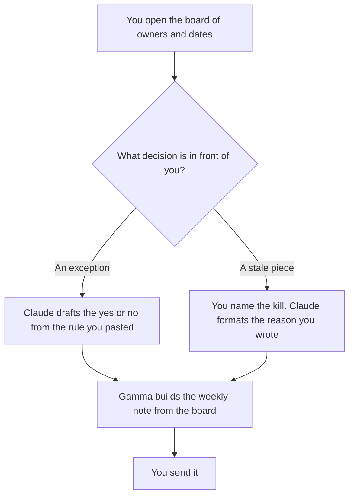

**A content ops lead should use AI to draft the exception decision, the kill note on a stale piece, and the weekly note to the team, from dates and owners they already have.** The board, the handoff, and the calendar are the system: [best AI tools for content ops](/blog/best-ai-tools-for-content-ops-2026/). The style card and the status line are [best AI tools for editorial ops](/blog/best-ai-tools-for-editorial-ops-2026/). This page is the person who says yes, no, or not this week. The writing desk is [best AI tools for content teams](/blog/best-ai-tools-for-content-teams-2026/).

The brief they are judging is [how to build a content brief with AI](/blog/how-to-build-a-content-brief-with-ai-2026/). A claim that was not in the brief is [what an AI hallucination is](/blog/what-is-ai-hallucination-2026/).

Prices are US list prices excluding tax from directory pages checked October 16, 2026. Published October 24, 2026. We did not score traffic, rankings, or throughput.

## The lead's week

| The decision | Start here | First paid step | The limit |
|---|---|---|---|
| An exception to the brief or the style card | [Claude](/tools/claude/) | Pro is $20 a month, or $17 billed annually | The note may not grant the exception. You do |
| The board the exception has to match | [Notion AI](/tools/notion-ai/) | Business is $20 a seat a month | Use the team's workspace |
| A weekly note the team will actually read | [Gamma](/tools/gamma/) | Plus is $9 a seat a month | Slides quote the board. They do not add a metric |
| A cleaner sentence in that note | [Grammarly](/tools/grammarly/) | Pro is $12 a member a month billed annually, or $30 monthly | It edits. It does not choose what to kill |

The ops page owns the system. Use it when you are designing the board. Use this page when you are the person who has to disappoint a request or stop a piece that missed its date. A weekly note that adds a performance number you did not export is the number you delete. The check is [how to fact-check AI writing](/blog/how-to-fact-check-ai-writing-2026/).

## What you are paying for

**Claude Pro at $20** holds the style card and the exception request in a Project. The draft should say which rule the request breaks and which owner would have to waive it. The model does not waive it. The review is [Claude review](/blog/claude-review-2026/).

**Notion Business** is the board, if that is where dates already live. Do not start a second wiki for the lead's notes. The invoice is [Notion AI pricing explained](/blog/notion-ai-pricing-explained-2026/).

**Gamma Plus at $9** is the weekly note when a short deck is how the team reads status. Pro at $18 a seat a month is the larger credit pool, not a better decision. The invoice is [Gamma pricing explained](/blog/gamma-pricing-explained-2026/).

**Grammarly Pro** is the last pass on the note. It will not know that a piece should be killed.

A prompt that holds the line:

"Draft an exception note from the rule and the request I pasted. State which rule it breaks. Do not approve it. If the owner who can waive it is missing, write Owner missing and stop."

## What not to automate

Do not let a model rank the team. Do not kill a piece because a draft said it was "low priority" without a date you wrote. Do not let the weekly deck update the brief. The brief changes in its own review.

## FAQ

### How is this different from the content ops roundup?

That page is the board, the handoff, and the date. This page is the lead's decisions on top of that board: the exception, the kill, and the weekly note. Use the ops page when you are buying the system. Use this page when you are the person who signs the exception.

### How is this different from editorial ops?

Editorial ops keeps the status, the owner, and the style card current. The lead uses that card to allow or refuse an exception. If you are maintaining the card, read the editorial page. If you are ruling on one request, stay here.

### Can I live on free plans?

Claude Free and a Notion seat you already have can draft one note. Gamma's free credits do not refresh, on the directory card. The paid step is the note you write every week.

### Who is allowed to kill a piece?

The owner named on the board, which should be you or a person you delegated in writing. A model can format the reason. It cannot be the reason.

## Last verified

October 16, 2026 for Claude, Notion, Gamma, and Grammarly. Published October 24, 2026.

**Sources:** [Claude pricing](https://claude.com/pricing), [Notion pricing](https://www.notion.com/pricing), [Gamma pricing](https://gamma.app/pricing), [Grammarly pricing](https://www.grammarly.com/plans).

*Published by Andrew for [AI Tools Optimizer](https://aitoolsoptimizer.com).*

[Gamma](/tools/gamma/) is in the [presentations directory](/tools/category/presentations/). Directory pages may use affiliate links. A purchase through them may earn us a commission at no extra cost to you.
