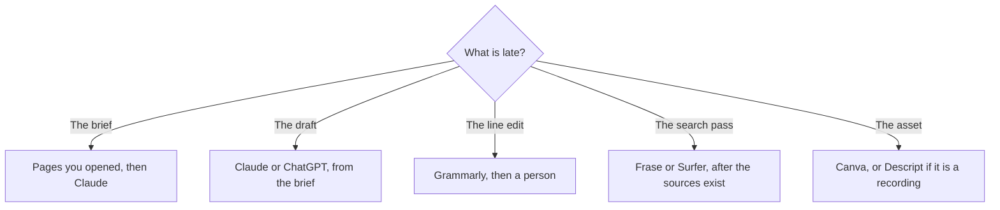

**A content team should buy one tool for the job that is late: the brief, the draft, the line edit, the search checklist, or the asset.** A suite that promises the whole calendar is how a three-person team inherits four meters. Marketers who also run ads and outbound can start from [best AI tools for marketers](/blog/best-ai-tools-for-marketers-2026/). This page is the editorial desk.

Prices are US list prices excluding tax from directory pages checked October 16, 2026. Published October 24, 2026. We did not measure rankings or watch time.

## The content job

| Job | Start here | First paid step | The limit |
|---|---|---|---|
| A draft from notes you supply | [Claude](/tools/claude/) or [ChatGPT](/tools/chatgpt/) | Claude Pro is $20 a month, or $17 billed annually. ChatGPT Plus is $20 | The notes are the source. The model formats them |
| A line edit on a finished paragraph | [Grammarly](/tools/grammarly/) | Pro is $12 per member per month billed annually, or $30 monthly | It does not know your prices |
| A search checklist on articles you write | [Surfer SEO](/tools/surfer-seo/) | Standard is $99 a month billed yearly, 360 documents | The score is a checklist, not a ranking |
| Ten articles a month on one site | [Frase](/tools/frase/) | Starter is $39 a month billed yearly, or $49 monthly | One seat and one site on that tier |
| The calendar and the brief archive | [Notion AI](/tools/notion-ai/) | Business is $20 per seat per month | Custom Agents are extra credits |
| Posts, cutouts, and sizes | [Canva](/tools/canva/) | Pro is $18 a month or $180 a year for one person | A second person with admin is Business at $25 per person per month, or $250 a year |
| A recording you will cut by the transcript | [Descript](/tools/descript/) | Hobbyist is $16 per person per month billed annually | Listen to the export |
| A saved brand voice for campaign copy | [Jasper](/tools/jasper/) | Pro is $59 per seat per month billed yearly, or $69 monthly | A single post does not need the seat |

The brief steps are [how to use AI for SEO briefs](/blog/how-to-use-ai-for-seo-briefs-2026/). The calendar is [how to build an AI content calendar](/blog/how-to-build-an-ai-content-calendar-2026/). The voice card is [how to create a brand voice with AI](/blog/how-to-create-a-brand-voice-with-ai-2026/).

## Draft, edit, and the checklist

Claude and ChatGPT are the draft seats. Put the brief in a Project so the writer is not re-attaching sources. The container choice is [Claude Projects vs ChatGPT Projects](/blog/claude-projects-vs-chatgpt-projects-2026/). A repeating format, such as release notes, can be a custom GPT. That split is [ChatGPT Projects vs custom GPTs](/blog/chatgpt-projects-vs-custom-gpts-2026/). The release-note workflow is [how to write release notes with AI](/blog/how-to-write-release-notes-with-ai-2026/).

Grammarly is the pass on sentences a reader will see. The comparison is [Grammarly vs ChatGPT for editing](/blog/grammarly-vs-chatgpt-for-editing-2026/). It will not catch a price you invented. The check for that is [how to fact-check AI writing](/blog/how-to-fact-check-ai-writing-2026/).

Surfer Standard at $99 yearly is the editor when the team wants terms and structure against pages that already rank. Pro at $182 yearly adds daily prompt tracking and internal linking at scale. Frase Starter at $39 is the smaller desk. The switch guide is [Surfer SEO alternatives](/blog/surfer-seo-alternatives-2026/). The two-desk comparison is [Surfer vs Frase](/blog/surfer-seo-vs-frase-2026/). Buy the checklist after the brief has sources. A score on an unsourced draft produces a fluent page you cannot defend.

Jasper is the brand vault when several writers must sound like the company and the examples live in the tool. A team that only needs one careful draft can stay on Claude. The alternatives are [Jasper alternatives](/blog/jasper-alternatives-2026/).

## Assets and the archive

Canva Pro is the social and the resize set. Magic Studio is not a separate subscription. The AI allowance is explained in [Canva Magic Studio review](/blog/canva-magic-studio-review-2026/). Interface files belong in Figma, which is [Figma AI vs Canva Magic Studio](/blog/figma-ai-vs-canva-magic-studio-2026/). Generate a still with tricky text somewhere else, then place it. The image shelf is [best AI image generators](/blog/best-ai-image-generators-2026/).

Descript is the cut when the source is a recording. The filler-word pass is [how to remove filler words with Descript](/blog/how-to-remove-filler-words-with-descript-2026/). A webinar that becomes three posts is [how to repurpose a webinar with AI](/blog/how-to-repurpose-a-webinar-with-ai-2026/).

Notion is the calendar and the brief archive. Business at $20 a seat is the AI wiki. The seat is [Notion AI pricing explained](/blog/notion-ai-pricing-explained-2026/). A weekly research issue that feeds the calendar is [how to build an AI research digest](/blog/how-to-build-an-ai-research-digest-2026/).

A small content pod: Claude or ChatGPT, Grammarly if the line edit is the bottleneck, Frase or Surfer only when the search pass is weekly, Canva Pro if you resize, and Notion if the briefs have nowhere to live. Add Jasper when the voice has to survive a second writer. Add Descript when you publish recordings.

## FAQ

### What should a content team buy first?

The draft seat, plus a rule that every factual sentence has a source in the brief. Add a search tool when you are publishing on a cadence and a person will use the checklist. Add Canva when production time is the resize, not the paragraph.

### Surfer or Frase?

Surfer Standard when you want the larger document allowance and the prompt tracker. Frase Starter when one site and about ten articles a month are the plan and $39 is the budget. Run one article in the trial of whichever you are unsure about.

### Do content teams need Jasper and Claude?

Usually one draft seat. Jasper when the saved voice and the campaign workflow are the reason. Claude when the work is long documents from notes you paste. Paying both for the same blog post is two drafts and one argument.

### Can AI own the editorial calendar?

It can lay out dates from a list you provide. The list of what you will claim is still an editor's job. The calendar article linked above starts with one channel for that reason.

## Last verified

October 16, 2026 for Claude, ChatGPT, Grammarly, Surfer, Frase, Notion, Canva, Descript, and Jasper prices in the directory. Published October 24, 2026.

**Sources:** [Surfer pricing](https://get.surferseo.com/surfer-pricing), [Frase pricing](https://www.frase.io/pricing), [Canva pricing](https://www.canva.com/pricing/), [Grammarly pricing](https://www.grammarly.com/plans).

*Published by Andrew for [AI Tools Optimizer](https://aitoolsoptimizer.com).*

[Surfer SEO](/tools/surfer-seo/) and [Frase](/tools/frase/) are in the [marketing directory](/tools/category/marketing-seo/). Directory pages may use affiliate links. A purchase through them may earn us a commission at no extra cost to you.
