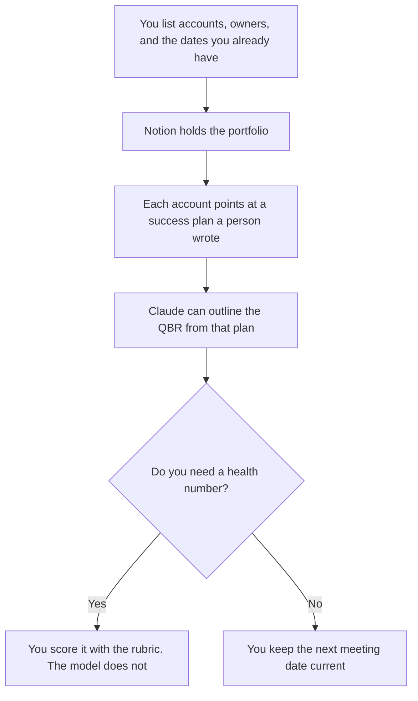

**A CS manager should use AI to format account plans, QBR outlines, and the portfolio list they already own.** The rep's call, the help-center article, and the ticket are the team page. This page is the manager's view across accounts. We did not score retention.

The team stack is [best AI tools for customer success](/blog/best-ai-tools-for-customer-success-2026/). One account's milestones are [how to write a customer success plan with AI](/blog/how-to-write-a-customer-success-plan-with-ai-2026/). The score you refuse to let a model invent is [how to write a customer health score rubric with AI](/blog/how-to-write-a-customer-health-score-rubric-with-ai-2026/).

Prices are US list prices excluding tax from directory pages checked October 16, 2026. Gong has no public price. HubSpot Starter was a limited-time offer. Published October 24, 2026.

## The manager's job

| The job | Start here | First paid step | The limit |
|---|---|---|---|
| The portfolio page: accounts, owners, next dates | [Notion AI](/tools/notion-ai/) | Business is $20 a seat a month | The page matches the CRM. One of them is a copy |
| A plan or a QBR outline from notes you paste | [Claude](/tools/claude/) | Pro is $20 a month, or $17 billed annually | The model formats. It does not forecast |
| The account record | [HubSpot](/tools/hubspot/) | Free CRM. Starter was $7 or $10 a seat on a promo | Professional and Enterprise are a quote |
| Notes when the customer expects a bot | [Fathom](/tools/fathom/) | Premium is $16 a month billed annually | Free includes unlimited recordings. Business syncs CRM fields at $25 a user annually |
| Notes when the room should not see a bot | [Granola](/tools/granola/) | Business is $14 a user a month | Free history is 30 days |
| Call evidence for a book of business, if you have a quote | [Gong](/tools/gong/) | Custom. Per-user licenses plus a platform fee | No public dollar. A transcript is not a health score |

The manager owns the definitions: what "at risk" means, who may change it, and which meeting reviews it. The rep owns the conversation. If one person does both jobs, still keep two documents. The portfolio is not a place to rewrite the customer's words.

## What you are paying for

**Notion Business at $20 a seat** holds the portfolio and the links to each success plan. Plus at $10 is not the full AI tier. If Notion and the CRM disagree on the renewal date, stop and use the signed source. The record rule is [what a system of record for AI is](/blog/what-is-a-system-of-record-for-ai-2026/).

**Claude Pro** drafts a QBR outline from the plan and the notes you pasted. It may flag a missing owner. It may not add a metric. The deck itself is [how to write a QBR deck with AI](/blog/how-to-write-a-qbr-deck-with-ai-2026/). The review is [Claude review](/blog/claude-review-2026/).

**HubSpot's free CRM** can be the record while the book fits. Do not budget a Professional dollar this page does not have. Cap credits before an agent writes a health field. The invoice is [HubSpot pricing explained](/blog/hubspot-pricing-explained-2026/).

**Fathom or Granola** is how the manager reads a call they did not attend, within the notice the meeting required. Fathom's paid rows are in [Fathom pricing explained](/blog/fathom-pricing-explained-2026/). Granola is the bot-free path. Read AI, if you want search across email and meetings, is priced in [Read AI pricing explained](/blog/read-ai-pricing-explained-2026/).

**Gong** is the quote you request when conversation evidence is the job. Until you have the quote, leave the dollar out. The explainer is [Gong pricing explained](/blog/gong-pricing-explained-2026/).

A prompt that holds the line:

"Outline a portfolio review from the accounts, owners, dates, and risks I pasted. Do not add an account. Do not invent a health score or a renewal amount. If a date is missing, write Missing."

## What not to automate

Do not let an agent set health from a transcript. Do not generate a renewal forecast from a plan title. Do not coach a rep with a model verdict on "how the call felt." Coaching uses the rubric and the notes. The motions every rep should follow are [how to write a customer success playbook with AI](/blog/how-to-write-a-customer-success-playbook-with-ai-2026/).

## FAQ

### Is this the same list as the customer success team page?

The team page is the call, the article, and the ticket. This page is the portfolio, the plan, and the QBR a manager reviews. Buy a help-center bot from the team page. Buy the portfolio habit here.

### Can we run the portfolio in a spreadsheet?

Yes. Use Claude or ChatGPT to format columns you already export. [ChatGPT](/tools/chatgpt/) Plus is $20 a month. The sheet remains the record if you said it was. Do not let a chat thread become a second book of business.

### Do managers need Gong?

Only when you need conversation intelligence across a team and you can get a quote. Notes from Fathom or Granola cover a manager who reads specific calls. No public Gong dollar belongs in the budget.

### What should a weekly review show?

The accounts with a date this week, the plans missing an owner, and the risks a person already marked. Anything else is optional. A model-written narrative of the book is optional and unchecked until you read the rows.

## Last verified

October 16, 2026 for Notion AI, Claude, HubSpot, Fathom, Granola, and Gong's pricing model. HubSpot Starter was a promotion. Gong has no public dollar. Published October 24, 2026.

**Sources:** [Notion pricing](https://www.notion.com/pricing), [Claude pricing](https://claude.com/pricing), [HubSpot pricing](https://www.hubspot.com/pricing), [Fathom pricing](https://www.fathom.ai/pricing).

*Published by Andrew for [AI Tools Optimizer](https://aitoolsoptimizer.com).*

[Fathom](/tools/fathom/) is in the [meetings and transcription directory](/tools/category/meetings-transcription/). Directory pages may use affiliate links. A purchase through them may earn us a commission at no extra cost to you.
