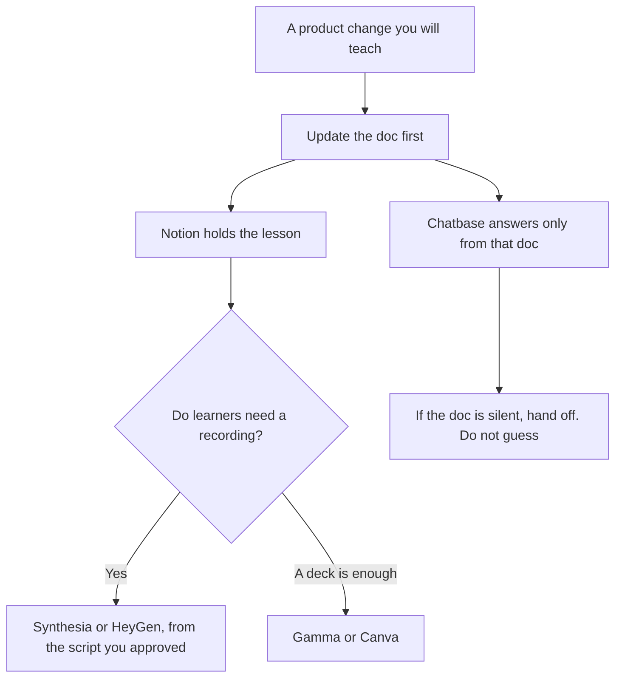

**A customer-education team should use AI to draft a lesson from docs you already approved, record a short explainer you can replace when the UI changes, and answer a learner only from those materials.** This page is the academy for people who bought the product. It is not a K-12 classroom and not the support queue, though the docs should match.

The help center beside the academy is [how to build a help center with AI](/blog/how-to-build-a-help-center-with-ai-2026/). The bot that should quote those articles is [how to build a knowledge base chatbot](/blog/how-to-build-a-knowledge-base-chatbot-2026/). A live session is [how to create a webinar script with AI](/blog/how-to-create-a-webinar-script-with-ai-2026/). The avatar split for onboarding video is [HeyGen vs Synthesia for onboarding](/blog/heygen-vs-synthesia-for-onboarding-2026/).

Prices are US list prices excluding tax from directory pages checked October 16, 2026. Published October 24, 2026. We did not score course completion or learning outcomes.

## The education job

| The job | Start here | First paid step | The limit |
|---|---|---|---|
| The curriculum and the lesson page | [Notion AI](/tools/notion-ai/) | Business is $20 a seat a month | Plus at $10 is not the full AI tier |
| A narrated lesson you can remake when the UI changes | [Synthesia](/tools/synthesia/) | Starter is $29 a month billed monthly | SCORM is Enterprise, not Starter |
| A camera-free explainer with a cloned voice | [HeyGen](/tools/heygen/) | Creator is $29 a month | SCORM and SSO are on Business at $149 a month |
| A lesson deck from an outline | [Gamma](/tools/gamma/) | Plus is $9 a seat a month | The outline has to be true before you generate |
| Answers in the product, from the same docs | [Chatbase](/tools/chatbase/) | Hobby is $32 a month billed yearly | The bot may not invent a workaround |
| A one-page worksheet on a brand template | [Canva](/tools/canva/) | Pro is $18 a month, or $180 a year, for one person | A worksheet is not a certification |

A lesson that contradicts the help center will be what learners quote back to support. Update the doc, then the lesson, then the bot. The order is the system. The handoff, when the doc is silent, belongs on [a support escalation matrix](/blog/how-to-create-a-support-escalation-matrix-with-ai-2026/).

## What to pay for

**The lesson home.** Notion Business at $20 a seat a month includes the agent tier on the directory card. Keep one page per lesson: outcome, steps, the doc it depends on, and the date the UI was last checked. Free includes a trial of Notion AI. Do not run the academy from a trial. The invoice is [Notion AI pricing explained](/blog/notion-ai-pricing-explained-2026/).

**The video.** Synthesia Basic is free, watermarked, with 500 credits and about 10 minutes of video on the card. Starter at $29 a month billed monthly removes the logo and allows downloads. The card also shows a yearly figure. Enterprise is where SCORM, Brand Kits, and SSO sit. Learner seats were recorded at $29 per learner per month. A customer academy that must live inside an LMS should read the Enterprise row before it promises SCORM. The invoice is [Synthesia pricing explained](/blog/synthesia-pricing-explained-2026/).

HeyGen Free is 3 videos a month, up to 1 minute. Creator at $29 a month includes 600 credits and watermark-free 1080p on the card. Business at $149 a month is the SCORM and SSO row, with extra seats at $20. Pick one video vendor until the export requirement forces the other. The invoice is [HeyGen pricing explained](/blog/heygen-pricing-explained-2026/).

**The deck and the worksheet.** Gamma Plus at $9 when you are starting from an outline. Canva Pro at $18, or $180 for the year, when the brand kit already lives there. The webinar version of that choice is [Gamma vs Canva for webinars](/blog/gamma-vs-canva-for-webinars-2026/).

**The in-product answer.** Chatbase Hobby at $32 a month billed yearly ($40 monthly). Standard is $120 billed yearly. The bot is trained on the docs you upload. If the doc is wrong, the answer is wrong in the product. There is no permanent free plan on the card, and a 7-day trial is recorded. Branding removal is a paid add-on the directory lists at $1,188 a year. Budget that separately if the academy cannot show a vendor mark.

A prompt that holds the line:

"Draft a lesson from this help article only. List the steps that are in the article. If a step is missing, write Missing. Do not add a tip, a limit, or a price that is not in the article. End with the question a learner should be able to answer. Do not claim they are certified."

The editor who ships the lesson is [what human-in-the-loop AI is](/blog/what-is-human-in-the-loop-ai-2026/). A step the UI does not have is [what an AI hallucination is](/blog/what-is-ai-hallucination-2026/).

## What not to automate

Do not generate a certificate the product does not track. Do not paste a customer's private workspace into a video tool to "make it feel real." Use demo data you have the right to show. Do not let a bot teach a billing rule that finance has not written down. Price changes go through [how to write a pricing page with AI](/blog/how-to-write-a-pricing-page-with-ai-2026/), then into the lesson.

Teacher tools such as MagicSchool are for school classrooms. They are the wrong shelf for a B2B academy. The teacher invoice, if you also have that job, is [MagicSchool pricing explained](/blog/magicschool-pricing-explained-2026/).

## FAQ

### Is customer education the same as support?

Support answers a broken moment. Education teaches the path before it breaks. They should share docs. They should not share a single bot prompt that both refunds and teaches. The escalation matrix is the seam.

### Do I need SCORM on day one?

Only if the customer's LMS requires it. Synthesia Enterprise and HeyGen Business are the recorded rows with SCORM. A link to a lesson page is enough for many academies. Buy the export when a contract names it.

### Can the video use an employee's face?

Only with that person's permission and the vendor's current terms. A stock avatar avoids that question. A cloned voice is a separate permission. The HeyGen workflow for avatars you do intend to make is [how to create AI avatars with HeyGen](/blog/how-to-create-ai-avatars-with-heygen-2026/).

### How do we keep lessons from going stale?

Put the doc URL and a review date on the lesson. When the doc changes, the lesson is outdated by definition. The model can diff the new doc against the old script. A person accepts the new recording. An unreviewed regen will teach the old button with a new voice.

## Last verified

October 16, 2026 for Notion AI, Synthesia, HeyGen, Gamma, Chatbase, and Canva. Published October 24, 2026.

**Sources:** [Notion pricing](https://www.notion.com/pricing), [Synthesia pricing](https://www.synthesia.io/pricing), [HeyGen pricing](https://www.heygen.com/pricing), [Chatbase pricing](https://www.chatbase.co/pricing).

*Published by Andrew for [AI Tools Optimizer](https://aitoolsoptimizer.com).*

[Synthesia](/tools/synthesia/) is in the [video directory](/tools/category/video/). Directory pages may use affiliate links. A purchase through them may earn us a commission at no extra cost to you.
