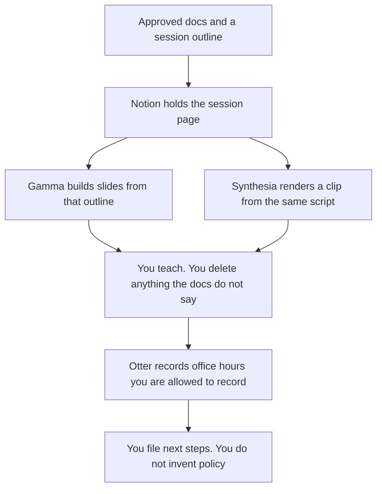

**A customer educator should use AI to format a live session from material a person already approved, build the deck from that outline, play a clip that matches it, and file office-hours notes that do not invent policy.** The academy catalog is a different job: [best AI tools for customer education](/blog/best-ai-tools-for-customer-education-2026/). The person who writes the objective and the assessment is [best AI tools for learning designers](/blog/best-ai-tools-for-learning-designers-2026/). This page is the instructor: the hour with customers, the questions they ask, and the follow-up that stays inside the docs.

A policy clip with a quiz is [HeyGen vs Synthesia for policy training](/blog/heygen-vs-synthesia-for-policy-training-2026/). The words you say on a webinar are [how to create a webinar script with AI](/blog/how-to-create-a-webinar-script-with-ai-2026/).

Prices for Synthesia and Otter are from their pricing pages on October 24, 2026. Gamma and Notion prices are from directory pages checked October 16, 2026. gamma.app/pricing returned HTTP 403 on October 24. Published October 24, 2026. We did not score attendance or learning.

## The hour with customers

| The job | Start here | First paid step | The limit |
|---|---|---|---|
| The session page the instructor will teach from | [Notion AI](/tools/notion-ai/) | Business is $20 a seat a month | Plus at $10 is not the full AI tier. The page cites approved docs |
| A deck from that outline | [Gamma](/tools/gamma/) | Plus is $9 a seat a month | No statistic that is not in the outline |
| A short clip you play in the session | [Synthesia](/tools/synthesia/) | Starter is $29 a month billed monthly | The script is the approved page. Basic is watermarked |
| Office hours, with a minute cap in USD | [Otter](/tools/otter-ai/) | Pro is $16.99 a user a month, or $8.33 billed annually | The note does not add a promise |

Learning designers own the objective. The catalog team owns the course that stays up after you log off. You own the session in front of customers. If a learner asks for an exception, you write the question down. You do not answer it from a model.

## What you are paying for

**Notion Business** is the session page and the follow-up. The chat is not the curriculum. The invoice is [Notion AI pricing explained](/blog/notion-ai-pricing-explained-2026/).

**Gamma Plus** is the first deck, shared as a link. Free credits do not refresh, on the October 16 card. Pro at $18 is the API tier. A live session does not need the API. If the producer needs Smart Slides and PowerPoint, the other deck is [Gamma vs Beautiful.ai for webinar decks](/blog/gamma-vs-beautiful-ai-for-webinar-decks-2026/). The invoice is [Gamma pricing explained](/blog/gamma-pricing-explained-2026/).

**Synthesia Starter** removes the logo and allows downloads, on the October 24 page. Basic includes 10 minutes, 500 credits, and a watermark. A room of customers should not see a trial watermark if the company has a paid seat. SCORM is an Enterprise line on that page. A live instructor usually needs a clip, not a SCORM package. The invoice is [Synthesia pricing explained](/blog/synthesia-pricing-explained-2026/).

**Otter Pro** is the office-hours seat when you need the annual USD price. Basic is free, with 300 minutes a month and 30 minutes a conversation. A long lab can cross that cap. Business is $30 a user a month, and the October 24 page showed $24 as 20% off for 3 months. The invoice is [Otter.ai pricing explained](/blog/otter-ai-pricing-explained-2026/).

A prompt that holds the line:

"Draft the session outline from the docs I pasted. Do not add a feature, a date, or an exception. If a step is not in the docs, write Not in the docs and stop."

## What not to automate

Do not let a model answer a live chat with a policy it was not given. Do not paste a learner's account data into a personal seat to "prepare the example." Do not record office hours the customer did not agree to record. The note from a success call, which is a different meeting, is [Otter vs tl;dv for customer success calls](/blog/otter-vs-tl-dv-for-customer-success-calls-2026/).

## FAQ

### How is this different from the customer education page?

That page is the academy: the lesson, the standing video, the answer bot. This page is the person who teaches a session and holds office hours. The docs should match. The jobs should not share a tool list as if they were the same hour.

### How is this different from a learning designer?

The designer writes the objective, the sequence, and the check. The educator delivers a session from material that is already approved. If you are still deciding the objective, you are on the designer page.

### Do I need Synthesia and Gamma?

You need the outline first. Gamma is the deck. Synthesia is the clip. A session can be a deck and no clip. Buy the clip seat when you will press play in front of customers, on a plan that does not watermark the lesson.

### Who may add an exception during office hours?

The owner of that policy, later, in the doc. You can record the question. You cannot promote a model's suggestion into a rule. The follow-up says who will answer, and by when, if you know. Otherwise it says Owner missing.

## Last verified

October 24, 2026 for Synthesia and Otter. October 16, 2026 for Notion and Gamma. Published October 24, 2026.

**Sources:** [Notion pricing](https://www.notion.com/pricing), [Gamma pricing](https://gamma.app/pricing), [Synthesia pricing](https://www.synthesia.io/pricing), [Otter pricing](https://otter.ai/pricing).

*Published by Andrew for [AI Tools Optimizer](https://aitoolsoptimizer.com).*

[Notion AI](/tools/notion-ai/) is in the [productivity and notes directory](/tools/category/productivity-notes/). Directory pages may use affiliate links. A purchase through them may earn us a commission at no extra cost to you.
