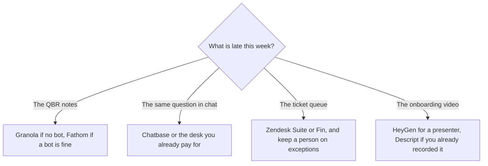

**A customer-success team should buy the tool that matches the job in front of the renewal: notes from the call, an answer from the help center, or a ticket a human still owns.** A health score the model invented is not a system. This page is one tool per job. The support-bot category is [best AI chatbots for business](/blog/best-ai-chatbots-for-business-2026/). The build steps for the articles are [how to build a knowledge-base chatbot](/blog/how-to-build-a-knowledge-base-chatbot-2026/). The manager who owns a book of accounts, and must not invent a health score, is [best AI tools for customer success managers](/blog/best-ai-tools-for-customer-success-managers-2026/).

Prices are US list prices excluding tax. Granola's cards were read October 24, 2026. Fathom's prices are from the October 24, 2026 pricing article. The rest are from directory pages checked October 16, 2026. Published October 24, 2026. Nothing here is a retention score.

## The job, with a price

| CS job | Start here | First paid step | The limit |
|---|---|---|---|
| Notes on a QBR, and the customer will not accept a bot | [Granola](/tools/granola/) | Business is $14/user/month for unlimited history. Basic is free with 30 days | Salesforce-class integrations are on Enterprise at $35/user/month |
| Notes, and a bot in the call is fine | [Fathom](/tools/fathom/) | Premium is $16/month billed annually. Business is $25/user/month annually, two-user minimum, for CRM field sync | Free lists unlimited recordings. Confirm it on the page you check out |
| Answers from articles you maintain | [Chatbase](/tools/chatbase/) | Hobby is $32/month billed yearly, 700 message credits | Branding removal is a separate add-on. The corpus has to be true |
| A resolution meter on Intercom | [Intercom Fin](/tools/intercom-fin/) | $49/month including 50 outcomes, then $0.99 per outcome | A handoff can count as an outcome. Price a real month |
| The ticket desk you already run | [Zendesk](/tools/zendesk-ai/) Suite Team | $55/agent/month paid yearly, including AI agents and a knowledge base | Support Team at $19 does not include those agents. Resolutions can bill separately |
| The account plan in the wiki | [Notion AI](/tools/notion-ai/) | Business is $20/seat/month | Custom Agents are extra credits at $10 per 1,000 |
| A short onboarding video | [HeyGen](/tools/heygen/) | Creator is $29/month | A policy video that must be SCORM is a different tier. See the training comparison below |

Granola's invoice is [Granola pricing explained](/blog/granola-pricing-explained-2026/). Fathom's is [Fathom pricing explained](/blog/fathom-pricing-explained-2026/). The capture habit is [how to summarize meetings with AI](/blog/how-to-summarize-meetings-with-ai-2026/).

## Calls and the account record

Customer success lives in conversations. Granola Business at $14 is the seat when the champion hates a bot and you need history past 30 days. Briefs before external meetings are on that plan. Enterprise at $35 is the seat when security wants SSO and a workspace-wide training opt-out. A five-person CS pod on Business is $70 a month. The same pod on Enterprise is $175. Buy Enterprise for the control, and for a connector the Business table does not list.

Fathom is the seat when the company already accepts a notetaker and you want the recording library. Premium at $16 annually is the individual step for advanced summaries and action items. Business at $25 annually is the CRM writeback, with a two-user minimum. Writing a field into the CRM is a product feature. The field still needs a person when the summary mishears a renewal date. Fireflies is the archive-and-dialer alternative. Pro is $10 per user per month annually. That invoice is [Fireflies pricing explained](/blog/fireflies-pricing-explained-2026/).

Put the kept decisions in Notion if Notion is the account wiki. Notion Business at $20 is the AI seat. A success plan that exists only in a chat thread will not be there when the champion changes. The notes comparison is [Notion AI vs ChatGPT for notes](/blog/notion-ai-vs-chatgpt-for-notes-2026/).

## The help center and the queue

Chatbase is the bot when the help center is a set of files and you do not yet have a desk. Hobby at $32 yearly is the test, inside 700 message credits and 10 MB. The build is the Chatbase how-to linked above, and the rule is the same: silence when the article is silent.

Fin at $49 including 50 outcomes fits a team already in Intercom, or a team that wants the outcome price in writing. Extra outcomes are $0.99. Intercom's own example: five resolutions stay in the base; one hundred cost more. Run last month's chat volume through that sentence before you forecast.

Zendesk Suite Team at $55 per agent per month, paid yearly, is the "we already live here" path. The $19 Support Team plan, also per agent per month paid yearly, is email and tickets without the AI-agent and knowledge-base bundle on the card we used. Copilot as an add-on was $50 per agent per month, paid yearly, on that card. Add it when agents want the writing tools, and skip it when the knowledge-base bot is the only gap.

[HubSpot](/tools/hubspot/) has a free CRM, which is often where the account already sits. Starter has been shown at $7 or $10 a seat on a limited-time offer, recorded October 16, 2026. Confirm the live offer. A free CRM plus Granola is a coherent small-team stack. A paid success platform with a custom price, such as Gong for conversation intelligence, is a sales-leadership purchase. Gong's directory entry is custom pricing. This page does not invent a Gong seat price.

## Onboarding that is a video

HeyGen Creator at $29 covers a spokesperson video for a feature launch. If the customer needs SCORM for an LMS, read [Synthesia vs HeyGen for training](/blog/synthesia-vs-heygen-for-training-2026/) before you buy Business at $149. If you already recorded the training call, cut it in [Descript](/tools/descript/) instead of generating a person. The webinar path is [how to repurpose a webinar with AI](/blog/how-to-repurpose-a-webinar-with-ai-2026/).

## FAQ

### What should a customer-success team buy first?

The notetaker the customer will tolerate, and a home for the decisions. Granola or Fathom, then the wiki you already have. Add a knowledge-base bot when the same question arrives in chat every week and the article exists.

### Is an AI health score worth a platform fee?

Only if the inputs are fields you already trust: usage from the product, tickets from the desk, dates from the CRM. A score computed from a transcript the model summarized is a draft. This page does not recommend a score you cannot recompute from those fields.

### Can one Chatbase bot cover every customer?

It can cover the public help center. Account-specific promises belong in the human queue, with the transcript attached. A bot that "knows" a discount you once offered in a call will offer it again.

### How is this different from a support team's stack?

Support lives in the queue and the macro. Success lives in the renewal conversation and the account plan. The tools overlap at the help center. The notetaker and the wiki are the success-specific seats. A support-only roundup would start from the ticket desk and stay there.

## Last verified

October 24, 2026 for Granola's pricing page and for the Fathom prices in the pricing article. October 16, 2026 for Chatbase, Fin, Zendesk, Notion, HeyGen, HubSpot, Fireflies, and Descript. Published October 24, 2026.

**Sources:** [Granola pricing](https://www.granola.ai/pricing), [Chatbase pricing](https://www.chatbase.co/pricing), [Zendesk pricing](https://www.zendesk.com/pricing/), [Fin pricing](https://fin.ai/help/en/articles/13975800-fin-pricing-outcomes).

*Published by Andrew for [AI Tools Optimizer](https://aitoolsoptimizer.com).*

These tools sit in the [customer support directory](/tools/category/customer-support/) and the [meetings directory](/tools/category/meetings-transcription/). Directory pages may use affiliate links. A purchase through them may earn us a commission at no extra cost to you.
