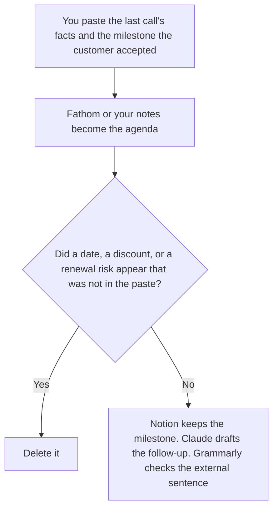

**A customer success manager who owns a book of accounts should use AI to draft the next call's agenda from the last call's facts, keep the milestone the customer already accepted, and write a follow-up that adds no new promise.** The model does not score health, forecast a renewal, or assign a risk. The portfolio view across accounts, the QBR outline, and the account plan as a manager's stack are [best AI tools for CS managers](/blog/best-ai-tools-for-cs-managers-2026/). This page is the CSM on the account: the agenda, the milestone, and the email.

The team's help-center bot, the ticket, and the onboarding video are [best AI tools for customer success](/blog/best-ai-tools-for-customer-success-2026/). The weekly ops note is [best AI tools for customer success ops](/blog/best-ai-tools-for-customer-success-ops-2026/).

Fathom's prices are the October 16, 2026 directory card recorded in [Fathom pricing explained](/blog/fathom-pricing-explained-2026/). Claude's prices are the October 24 read of claude.com/pricing recorded in [Claude pricing explained](/blog/claude-pricing-explained-2026/). Notion and Grammarly are the October 16 cards. A live fetch of Grammarly's plans URL returned HTTP 401 on October 24. Published October 24, 2026. We did not score retention.

## The CSM's three files

| The file | Start here | First paid step | The limit |
|---|---|---|---|
| The agenda, from the last call you already have | [Fathom](/tools/fathom/) | Premium is $16 a month billed annually, or $20 monthly, for advanced summaries | Free includes unlimited recordings. CRM field sync is Business, at $25 annually or $34 monthly |
| The milestone the customer accepted | [Notion AI](/tools/notion-ai/) | Business is $20 a seat a month | A date you did not write stays out. Plus at $10 is not the full AI tier |
| The follow-up, from that milestone | [Claude](/tools/claude/) | Pro is $17 a month billed annually, or $20 monthly | No new commitment |
| The sentence that leaves the company | [Grammarly](/tools/grammarly/) | Pro is $12 a member a month billed annually, or $30 monthly | Tone is not a promise |

Fathom's free plan includes unlimited recordings and instant summaries. Premium adds advanced summaries and AI action items. You do not need Business at $25 a user a month, billed annually, unless CRM fields must update. That cut is [Fathom Business pricing explained](/blog/fathom-business-pricing-explained-2026/). A CSM who only needs the agenda from a video call can stay on Free or Premium. A dialer archive is a different product, compared on [Fathom vs Fireflies for sales calls](/blog/fathom-vs-fireflies-for-sales-calls-2026/). Sales calls are not this page. The CSM's call is the customer's milestone, not a forecast.

Notion holds the milestone: the outcome the customer accepted, the date they accepted, and the owner. If the date is missing, the line says Date not set. Claude writes the follow-up from that line only. "We will have this done by Friday" is allowed when Friday was the date they accepted. It is not allowed when the model thought Friday sounded prompt.

The CS managers page is the person looking across the book: plans, QBRs, portfolio. If you are that person this week, use that page. If you are preparing one customer's next call, stay here. The ops page is the queue and the weekly note. It does not send the follow-up.

## What you are paying for

**Fathom Premium** is the richer summary of a call you already recorded. Free may be enough for the agenda. Business is the CRM seat, not the agenda seat. The review is [Fathom review](/blog/fathom-review-2026/).

**Notion Business** is the milestone the next CSM can open. The invoice is [Notion AI pricing explained](/blog/notion-ai-pricing-explained-2026/). The plan workflow, when you are writing the whole plan, is [how to write a customer success plan with AI](/blog/how-to-write-a-customer-success-plan-with-ai-2026/).

**Claude Pro** is the follow-up. The review is [Claude review](/blog/claude-review-2026/).

**Grammarly Pro** is the external sentence. The invoice is [Grammarly pricing explained](/blog/grammarly-pricing-explained-2026/).

A prompt that holds the line:

"Draft the agenda and the follow-up from the last call and the milestone I pasted. If a date is missing, write Date not set. Do not add a promise. Do not score the account."

## What not to automate

Do not let a model mark the account red. Do not offer a discount in the follow-up. Do not sync a CRM field from an agenda the customer has not heard. The CSM owns the draft. The customer already owns the milestone they accepted.

## FAQ

### How is this different from the CS managers page?

That page is the portfolio: account plans, QBR outlines, and a view across accounts. This page is one CSM's next call, the milestone on that account, and the email after it. A QBR can use the milestone. The QBR is not the agenda.

### How is this different from the customer success team page?

That page includes the help-center bot, the ticket a human still owns, and an onboarding video. This page does not buy a bot. It prepares one relationship. If the follow-up is really a ticket, use the team page's support tool, and do not hide it in a friendly email.

### How is this different from customer success ops?

Ops formats the weekly note, the handoff queue, and a playbook exception. The CSM sends the note the customer will read. Ops does not get to add a promise while moving a row.

### Who may send the follow-up?

The CSM, after the milestone in the email matches the one the customer accepted. Date not set stays out of the email. A summary of the last call is not a new commitment.

## Last verified

October 16, 2026 for Fathom, Notion, and Grammarly, via the posts cited above. October 24, 2026 for Claude. Published October 24, 2026. Grammarly's plans URL returned HTTP 401 on October 24. We did not score retention.

**Sources:** [Fathom pricing](https://www.fathom.ai/pricing), [Notion pricing](https://www.notion.com/pricing), [Claude pricing](https://claude.com/pricing), [Grammarly pricing](https://www.grammarly.com/plans).

*Published by Andrew for [AI Tools Optimizer](https://aitoolsoptimizer.com).*

[Fathom](/tools/fathom/) is in the [meetings directory](/tools/category/meetings-transcription/). Directory pages may use affiliate links. A purchase through them may earn us a commission at no extra cost to you.
