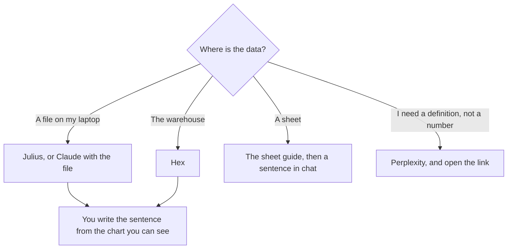

**A data analyst should buy the tool that matches the file they already have: a CSV in a chat, a notebook on the warehouse, or a sentence under a chart they made.** An assistant that invents a trend is not an analyst. The chart is the source. The model formats the sentence and, if you let it, the wrong total.

The grid-specific shelf is [best AI for Excel and Google Sheets](/blog/best-ai-for-excel-and-google-sheets-2026/). Hex's invoice is [Hex pricing explained](/blog/hex-pricing-explained-2026/). A figure inside a PDF, rather than a table you own, is [what multimodal RAG is](/blog/what-is-multimodal-rag-2026/).

Prices are US list prices excluding tax from directory pages checked October 16, 2026. Published October 24, 2026. We did not score query accuracy.

## The analyst's job

| Job | Start here | First paid step | The limit |
|---|---|---|---|
| A CSV or a small extract, with a chart | [Julius AI](/tools/julius-ai/) | Plus is $20/month, or $16 billed annually, for 2,000 credits | The file you uploaded is the population. It is not the warehouse |
| A notebook, SQL, and a published app | [Hex](/tools/hex/) | Professional is $36 per editor per month | Compute is a second meter. Community is the free trial of the agent |
| A narrative under a chart you already trust | [Claude](/tools/claude/) or [ChatGPT](/tools/chatgpt/) | Claude Pro is $20, or $17 billed annually. ChatGPT Plus is $20 | Paste the numbers. Do not ask it to remember last quarter |
| The sheet lives in Google or Excel | [Gemini](/tools/gemini/) on the plan that reaches your files, or the sheet tools in the linked guide | Google AI Pro is $19.99 and lists Gemini in Gmail and Docs. Sheets are a separate check | Do not assume the Docs line covers a financial model |
| A method question, with a link | [Perplexity](/tools/perplexity/) | Pro is $17/month billed annually | Open the citation. A formula explained from memory can be wrong |
| The write-up has to live in the wiki | [Notion AI](/tools/notion-ai/) | Business is $20/seat | The wiki is not the query layer |

## Julius and Hex

[Julius AI](/tools/julius-ai/) is the short path from a file to a chart. Free has a daily credit allowance. Plus is $20 a month, or $16 billed annually, with 2,000 credits a month plus 100 daily. Pro is $45, or $37 annually, with 5,000 credits. Business is $450, or $375 annually, with 60,000 credits and connectors for up to 50 members. Use Plus when the extract fits a chat and you will look at the chart. Use Business only when the connector and the seat count are real. A 2,000-credit month is a sketch budget. Watch one week of debits before you annualize.

[Hex](/tools/hex/) is the notebook when the data should stay in the warehouse and the output is an app or a scheduled notebook. Professional is $36 per editor per month. Team is $75 per editor. Community is free, with a Hex agent trial and small compute. Compute is extra: the directory card records large and extra-large runtimes at $0.32 and $0.65, and GPU rates above that. The editor price is not the whole invoice. If you publish an app that refreshes, price the refresh. The review is [Hex review](/blog/hex-review-2026/).

Do not run the same question in both and average the totals. Pick the system of record. Julius on an export will disagree with Hex on the live table if the export is old. That disagreement is a process bug, not an insight.

## The sentence, after the number exists

[Claude](/tools/claude/) is the better default when the write-up is long and the file is attached. Pro is the usage step. The long-document habit is [Claude vs Gemini for long documents](/blog/claude-vs-gemini-for-long-documents-2026/). [ChatGPT](/tools/chatgpt/) Plus is the default when the analyst also wants projects, or the team already standardized there. Advanced reasoning starts at Plus, which is the right row for a multi-step calculation you will still check, and the wrong row for a caption. That distinction is [what a reasoning model is](/blog/what-is-ai-reasoning-models-2026/).

Paste the table. Ask for three sentences and a list of figures used. Delete any figure not in the paste. A model that "knows" your revenue from a previous chat is using [memory](/blog/what-is-ai-memory-2026/) or a stale thread. Neither one is the warehouse.

[Perplexity](/tools/perplexity/) Pro at $17 billed annually is how you check a definition or a public dataset, with a link. It is not how you query your orders table. The research split is [ChatGPT vs Perplexity for research](/blog/chatgpt-vs-perplexity-for-research-2026/).

[Gemini](/tools/gemini/) belongs when the analyst already works in Google. Pro at $19.99 lists Gemini in Gmail and Docs and Gemini 4 Argon. Notebook, free with a Google account, is the right surface for a folder of exported reports you want cited. The Workspace seating is [Gemini vs ChatGPT for Google Workspace](/blog/gemini-vs-chatgpt-for-google-workspace-2026/). The sheet article remains the one to read before you buy Pro "for Excel."

[Notion AI](/tools/notion-ai/) Business at $20 a seat is where the weekly readout lives after the chart is done. Generate the paragraph there so the number and the commentary cannot drift across tools. The card is [Notion AI pricing explained](/blog/notion-ai-pricing-explained-2026/).

## FAQ

### What should an analyst buy first?

The tool that opens the data they already have. A CSV points at Julius or a chat upload. A warehouse points at Hex. A Google Sheet points at the sheet guide. A narrative tool without a source is the last purchase, not the first.

### Can ChatGPT replace a notebook?

For a file you upload and a chart you check, often enough. For scheduled refreshes, permissions, and a published app, no. That is Hex, or the BI tool you already pay for. Plus at $20 does not become a warehouse.

### How do I stop invented metrics?

Ask for the sentence and the cell it came from. If there is no cell, cut the sentence. Do not ask for "insights" on an empty prompt. The eval habit, if this write-up faces customers, is [what AI eval testing is](/blog/what-is-ai-eval-testing-2026/).

### Is Julius or Hex the better "AI analyst"?

Julius for an extract. Hex for the warehouse. They are different meters, credits versus editors plus compute. Owning both is reasonable when both files exist. Owning both to see which total you prefer is not analysis.

## Last verified

October 16, 2026 for Julius, Hex, Claude, ChatGPT, Gemini, Perplexity, and Notion prices. Published October 24, 2026.

**Sources:** [Julius pricing](https://julius.ai/pricing), [Hex pricing](https://hex.tech/pricing/), [Claude pricing](https://claude.com/pricing).

*Published by Andrew for [AI Tools Optimizer](https://aitoolsoptimizer.com).*

[Julius AI](/tools/julius-ai/) and [Hex](/tools/hex/) are in the [data and analytics directory](/tools/category/data-analytics/). Directory pages may use affiliate links. A purchase through them may earn us a commission at no extra cost to you.
