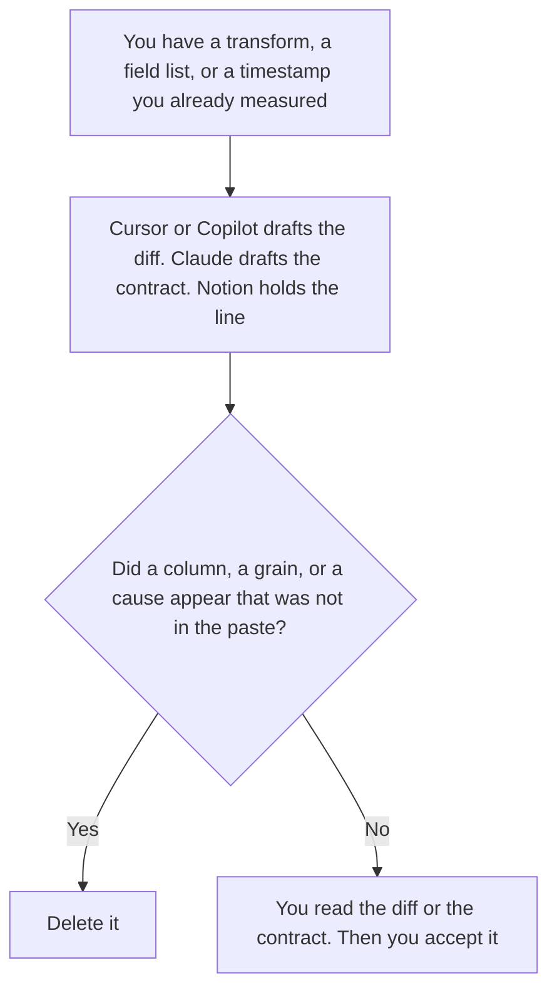

**A data engineer should use AI to draft a pipeline diff they will read, to format a schema contract from fields a person already named, and to write a freshness line from a timestamp they already measured.** The model does not invent a column, a grain, or a cause for a late table. The sentence under a chart a person made is [best AI tools for data analysts](/blog/best-ai-tools-for-data-analysts-2026/). The definition of a metric, before any pipeline number, is [how to write an AI KPI definition sheet with AI](/blog/how-to-write-an-ai-kpi-definition-sheet-with-ai-2026/).

The date on one retrieved item is [what an AI retrieval freshness stamp is](/blog/what-is-ai-retrieval-freshness-stamp-2026/). Which corpus a retrieval call may search is [what an AI retrieval tenant scope is](/blog/what-is-ai-retrieval-tenant-scope-2026/).

Cursor's Plus price is the October 24, 2026 help-center figure recorded in [Cursor pricing explained](/blog/cursor-pricing-explained-2026/). Claude's prices are the October 24 read of claude.com/pricing recorded in [Claude pricing explained](/blog/claude-pricing-explained-2026/). Notion and GitHub Copilot prices are from directory pages checked October 16, 2026. Published October 24, 2026. We did not score pipelines. A suggested model is not a contract you have accepted.

## The engineer's three files

| The file | Start here | First paid step | The limit |
|---|---|---|---|
| A diff in the transform, which you will read | [Cursor](/tools/cursor/) | Plus is $8 a month, or $80 a year | You still run the checks you trust. Plus omits Cloud Agents on the October 24 help page |
| The schema contract, from fields you named | [Claude](/tools/claude/) | Pro is $17 a month billed annually, or $20 monthly | A new column is not a clarification |
| The contract page and the freshness line | [Notion AI](/tools/notion-ai/) | Business is $20 a seat a month | A timestamp you did not measure stays out |
| Completions in the editor you already use on GitHub | [GitHub Copilot](/tools/github-copilot/) | Pro is $10 a month | Business is $19. Enterprise is $39. Neither is a grain |

The analyst page is a CSV chat, a notebook, and a sentence under a chart. This page is the pipeline those charts read. Hex's invoice, Professional at $36 an editor a month and Team at $75, is [Hex pricing explained](/blog/hex-pricing-explained-2026/), for the analyst's notebook. This page does not move that notebook onto the engineer. If you use Hex to inspect a result, the contract still lives in the words you accepted.

Cursor Plus at $8 is the editor seat on the October 24 help page. The company rows are [Cursor Business pricing explained](/blog/cursor-business-pricing-explained-2026/) and [Cursor Enterprise pricing explained](/blog/cursor-enterprise-pricing-explained-2026/). A diff that adds a column the contract does not name is a contract change, not a formatting fix. You read it.

Claude Pro holds the field list: name, type, grain, and what the field is not allowed to mean. Grain not set stays in the contract. "Per day" and "per event" are different pipelines. The model does not pick the one that backfills faster.

GitHub Copilot Pro at $10 is the individual seat on the October 16 card recorded in [GitHub Copilot pricing explained](/blog/github-copilot-pricing-explained-2026/). The freshness line says the timestamp you measured and the source you read it from. Cause not measured stays those words. A late table is not automatically an upstream incident because the sentence would be tidier that way.

The tenant scope still applies if the pipeline feeds a retrieval index. A transform that unions two customers into one table is a scope change. The contract should say so, in words you wrote, or the row says Scope not set.

## What you are paying for

**Cursor Plus** is the diff. The review is [Cursor review](/blog/cursor-review-2026/).

**Claude Pro** is the contract. The review is [Claude review](/blog/claude-review-2026/).

**Notion Business** holds the accepted contract and the freshness line. The invoice is [Notion AI pricing explained](/blog/notion-ai-pricing-explained-2026/).

**Copilot Pro** is completions on the GitHub seat. The company dollar, if you need it, is Business at $19 or Enterprise at $39 on the October 16 card.

A prompt that holds the line:

"Draft the diff description, the schema contract, or the freshness line from the fields and the timestamp I pasted. If a grain is missing, write Grain not set. Do not add a column. Do not add a cause."

## What not to automate

Do not let an agent backfill a table because a check failed. Do not drop a test to make a pipeline green. Do not publish a freshness time you did not measure. The engineer owns the diff. The contract owner named on the page accepts a new field.

## FAQ

### How is this different from the data analyst page?

That page is the chart and the sentence under it. This page is the pipeline, the schema contract, and the freshness line. An analyst can quote a number the contract defines. The engineer does not get a new column because the chart would look better.

### How is this different from a KPI definition?

The KPI sheet says what a metric means: formula, source, grain, owner. This page is the transform that produces a table the metric might use. A formula is not a model. A model that adds a field the formula did not name is a contract change.

### How is this different from a freshness stamp?

The stamp is the date on one retrieved item. The freshness line is the sentence on your pipeline: when you measured it, and from which source. The stamp does not set your pipeline's grain.

### Who may merge?

The person who owns the change, after they read the diff and run the checks they trust. Grain not set stays in the contract. A suggested column is not a field you have accepted.

## Last verified

October 24, 2026 for Cursor's help page and for Claude, via the posts cited above. October 16, 2026 for Notion and GitHub Copilot. Published October 24, 2026. We did not score pipelines.

**Sources:** [Cursor pricing](https://cursor.com/help/account-and-billing/pricing), [Claude pricing](https://claude.com/pricing), [Notion pricing](https://www.notion.com/pricing), [GitHub Copilot plans](https://github.com/features/copilot/plans).

*Published by Andrew for [AI Tools Optimizer](https://aitoolsoptimizer.com).*

[Cursor](/tools/cursor/) is in the [coding directory](/tools/category/coding/). Directory pages may use affiliate links. A purchase through them may earn us a commission at no extra cost to you.
