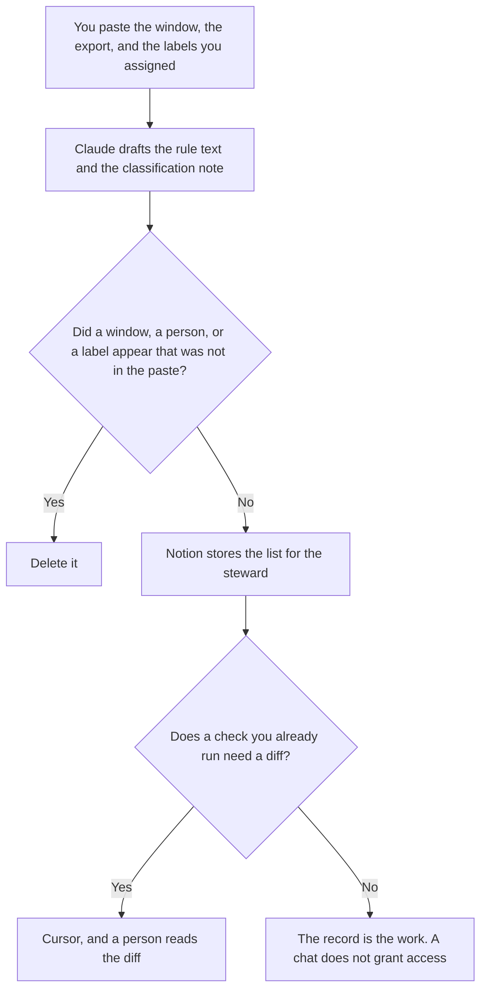

**A data governance lead should use AI to format a retention rule from a window counsel already approved, an access list from an export a person already ran, and a classification note that uses only labels a person already assigned.** The model does not decide how long data may live, and it does not invent a lawful basis. The pipeline work, which is the refresh and the row count, is [best AI tools for data ops](/blog/best-ai-tools-for-data-ops-2026/). The shift that triages an alert is [best AI tools for security ops](/blog/best-ai-tools-for-security-ops-2026/).

The rule this page formats is [what an AI data retention policy is](/blog/what-is-ai-data-retention-policy-2026/). The one-system explanation for the team is [how to write a data retention note for AI with AI](/blog/how-to-write-a-data-retention-note-for-ai-with-ai-2026/).

This page is workflow. It is not legal advice. Claude's prices are from claude.com/pricing on October 24, 2026. Notion and Cursor prices are from directory pages checked October 16, 2026. ChatGPT's Plus price is from learn.chatgpt.com/docs/pricing on October 24. Published October 24, 2026. We did not score compliance.

## The record

| The job | Start here | First paid step | The limit |
|---|---|---|---|
| The rule text and the classification note | [Claude](/tools/claude/) | Pro is $17 a month billed annually, or $20 monthly | No window you did not approve |
| The page the steward opens | [Notion AI](/tools/notion-ai/) | Business is $20 a seat a month | Plus at $10 is not the full AI tier |
| One note from a short paste | [ChatGPT](/tools/chatgpt/) | Plus is $20 a month | No data type that was not in the paste |
| A diff in a check you already own | [Cursor](/tools/cursor/) | Plus is $8 a month, or $80 a year | You review the diff. The note does not merge it |

A classification note that labels a table "public" because the name sounds harmless is a risk. If the export has no label, the note says Label not assigned. The access list copies accounts from the export. It does not recommend who should be added.

## What you are paying for

**Claude Pro** keeps the rule's words stable across systems. Team standard seats are $20 a seat a month billed annually, or $25 monthly, when the note is a company record, as recorded in [Claude Team pricing explained](/blog/claude-team-pricing-explained-2026/). The review is [Claude review](/blog/claude-review-2026/).

**Notion Business** holds the register: system, window, label, steward. The invoice is [Notion AI pricing explained](/blog/notion-ai-pricing-explained-2026/).

**ChatGPT Plus** formats one paste. When the export is company data, Business is the workspace: $25 a user a month billed monthly, for two or more users, on the October 24 plan page. The ladder is [ChatGPT pricing explained](/blog/chatgpt-pricing-explained-2026/). The review is [ChatGPT review](/blog/chatgpt-review-2026/).

**Cursor Plus** is the editor when a check you already run needs a diff. The governance note does not require a coding seat. The ladder is [Cursor pricing explained](/blog/cursor-pricing-explained-2026/).

A prompt that holds the line:

"Draft the governance note from the window, the access export, and the labels I pasted. If a label is missing, write Label not assigned. Do not add a person. Do not choose a retention period. Do not say the set is compliant."

## What not to automate

Do not ask what the retention period should be. Do not paste a full directory export into a personal account. Do not mark a system compliant because the headings look complete. Counsel or the policy owner sets the window. The steward assigns labels. A formatted register is not an approval.

## FAQ

### How is this different from the data ops page?

Data ops is the refresh, the owner of a pipeline, and the row count. This page is the rule: how long data stays, who is on the access export, and which label a person assigned. The same table can appear on both pages. The ops page does not set the window.

### How is this different from the security ops page?

Security ops is the shift: a triage note for an alert and a handoff. Governance is the standing record of retention and classification. An alert can show that access was wrong. The access change is still a governance record, not a rewrite of the alert.

### Do I need a coding seat to keep the register?

No. The register is Claude and Notion. A coding seat matters when a check you already own needs a diff. The diff is reviewed by a person. A chat does not grant or remove access.

### Who may change a label?

The steward your process names, with the date. A model that infers a label from a column name has not classified the data. Put the cell back to Label not assigned.

## Last verified

October 24, 2026 for Claude and for ChatGPT's plan page. October 16, 2026 for Notion and Cursor. Published October 24, 2026.

**Sources:** [Claude pricing](https://claude.com/pricing), [Notion pricing](https://www.notion.com/pricing), [ChatGPT and Codex pricing](https://learn.chatgpt.com/docs/pricing), [Cursor pricing](https://cursor.com/help/account-and-billing/pricing).

*Published by Andrew for [AI Tools Optimizer](https://aitoolsoptimizer.com).*

[Claude](/tools/claude/) is in the [chatbots and assistants directory](/tools/category/chatbots-assistants/). Directory pages may use affiliate links. A purchase through them may earn us a commission at no extra cost to you.
