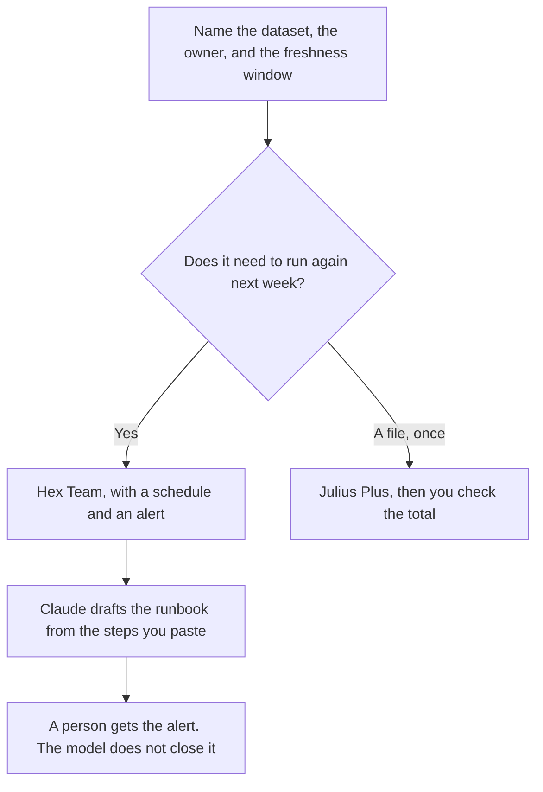

**A data-ops owner should use AI to keep three things true: a refresh that runs when you said it would, a named owner for each dataset, and a check that today's row count is in the band you wrote down.** The model can draft the runbook note or the SQL. It cannot declare the pipeline healthy. If the count is missing, the page says the check did not run. Analysts ask questions of data that already exists. This page is the work that makes the next question possible.

The question-asking shelf is [best AI tools for data analysts](/blog/best-ai-tools-for-data-analysts-2026/). The infrastructure shelf next door is [best AI tools for devops teams](/blog/best-ai-tools-for-devops-teams-2026/). Drafting a query you still run yourself is [ChatGPT vs Claude for SQL](/blog/chatgpt-vs-claude-for-sql-2026/). The retention rule, the access list, and the classification note are [best AI tools for data governance](/blog/best-ai-tools-for-data-governance-2026/).

Prices are US list prices excluding tax from directory pages checked October 16, 2026. Published October 24, 2026. We did not score pipeline reliability. One automation tool in the wider market bills in euros. This page does not convert that price. The tools below are the USD figures the directory records.

## The data-ops job

| The job | Start here | First paid step | The limit |
|---|---|---|---|
| A notebook that can run on a schedule | [Hex](/tools/hex/) | Team is $75 an editor a month | Professional at $36 does not include scheduled runs on the card |
| A quick read of a file, not a warehouse | [Julius AI](/tools/julius-ai/) | Plus is $16 a month billed annually | Connectors start on Business |
| A workflow around the warehouse, not inside it | [Make](/tools/make/) | Core is $9 a month billed annually for 10,000 credits | Make credits are not model tokens and not row counts |
| The runbook prose | [Claude](/tools/claude/) | Pro is $20 a month, or $17 billed annually | It may not invent a freshness SLO |
| A shared Project for the schema notes | [ChatGPT](/tools/chatgpt/) | Business is $20 a user a month billed annually, minimum two | Plus has no admin controls |

A dashboard that says "updated" without a timestamp is [a hallucination](/blog/what-is-ai-hallucination-2026/) for the next analyst who trusts it. The check on any number you paste into a note is [how to fact-check AI writing](/blog/how-to-fact-check-ai-writing-2026/).

## What to pay for

**The scheduled notebook.** Hex Community is free, with a Hex agent trial and small compute. Professional at $36 an editor a month adds the agent and up to 5 published apps. Team at $75 an editor a month is the row that adds scheduled runs, alerts, and unlimited apps, with a 14-day trial on the card. Data ops that stops at a manual run will miss the Monday failure. Pay for the schedule when the dataset has a consumer waiting. The invoice is [Hex pricing explained](/blog/hex-pricing-explained-2026/).

**The file that is not a pipeline.** Julius Plus at $16 a month billed annually, or $20 monthly, with 2,000 credits and 16 GB of RAM. Business at $375 a month billed annually is the connector tier, with Postgres, BigQuery, and Snowflake on the card, and it is a large jump. If the warehouse is already in Hex, do not buy Julius Business to feel covered. The invoice is [Julius AI pricing explained](/blog/julius-ai-pricing-explained-2026/).

**The side workflow.** Make Core at $9 a month billed annually. Use it to file a ticket or post a message when a check fails. Do not use it as the place the SQL lives. Free is 1,000 credits a month on the card. The invoice is [Make pricing explained](/blog/make-pricing-explained-2026/).

**The runbook.** Claude Pro, in a Project, from the steps you already run. The page for what that document is called when the system is a model is [what an AI runbook is](/blog/what-is-an-ai-runbook-2026/). A freshness miss that pages a human is closer to [what AI incident response is](/blog/what-is-ai-incident-response-2026/) than to a new chart.

**The schema notes.** ChatGPT Business when more than one engineer will paste warehouse details. A personal Plus seat at $20 is fine for a scratch query and a poor place for production table names if policy says otherwise. The ladder is [ChatGPT Go vs Plus vs Pro](/blog/chatgpt-go-vs-plus-vs-pro-2026/).

A prompt that holds the line:

"Draft a data-ops note for this dataset. Include owner, source, freshness window, the check query I pasted, and who is paged. If I did not name an owner or a window, write Missing. Do not invent a row count or an SLO."

The person who is paged is [what human-in-the-loop AI is](/blog/what-is-human-in-the-loop-ai-2026/). The record of the owner is [what a system of record for AI is](/blog/what-is-a-system-of-record-for-ai-2026/).

## What not to automate

Do not let a model change a production query because a chat suggested a faster join. Review the SQL, run it, and compare the count to the band you wrote. Do not paste credentials into a chat. Do not describe a euro-priced automation tool as if it were a USD seat. If you need that tool, read its own price in the currency on the card.

A one-off spreadsheet question remains the Excel workflow: [ChatGPT vs Claude for Excel analysis](/blog/chatgpt-vs-claude-for-excel-analysis-2026/).

## FAQ

### Is data ops the same as analytics?

No. Analytics answers a question. Data ops makes the dataset show up, on time, with an owner. The same person sometimes does both. The tools on this page are for the second job. The analyst page is for the first.

### Do we need Hex Team on day one?

Not if nobody is waiting on a schedule. Community or Professional can hold the notebook. Move to Team when a missed morning run would page someone. The $75 figure is the recorded reason to wait until that is true.

### Can Make replace a warehouse schedule?

No. Make can move a message or a file. The query belongs in the warehouse tool you already trust. Two schedulers for the same table will disagree about which run won.

### What belongs in the freshness window?

A duration a consumer can notice: "weekday mornings by 7 a.m. local" or "within 24 hours of the source." The model may format it. You pick it. A window you cannot alert on is a sentence, not an operation.

## Last verified

October 16, 2026 for Hex, Julius, Make, Claude, and ChatGPT. Published October 24, 2026.

**Sources:** [Hex pricing](https://hex.tech/pricing/), [Julius AI pricing](https://julius.ai/pricing), [Make pricing](https://www.make.com/en/pricing).

*Published by Andrew for [AI Tools Optimizer](https://aitoolsoptimizer.com).*

[Hex](/tools/hex/) is in the [data and analytics directory](/tools/category/data-analytics/). Directory pages may use affiliate links. A purchase through them may earn us a commission at no extra cost to you.
