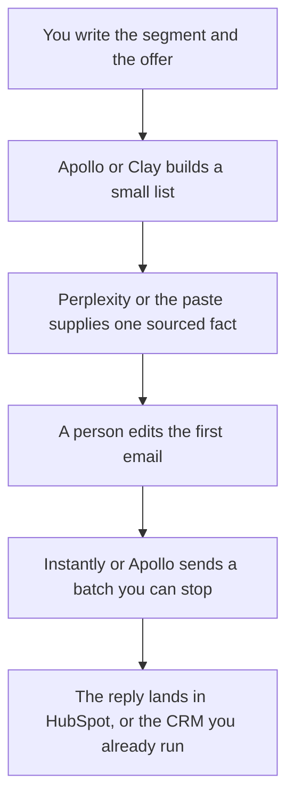

**A demand-gen team should use AI to build a list it can afford, attach a fact it can open, and draft a first email a person will edit before anything sends.** The sales team's discovery call is a later job. This page is the program that creates the conversation: who to contact, why now, and the note that asks. We did not score reply rates or sourced pipeline.

The seller's shelf is [best AI tools for sales teams](/blog/best-ai-tools-for-sales-teams-2026/). The research habit is [how to use Perplexity for market research](/blog/how-to-use-perplexity-for-market-research-2026/). The sourced story, once a rival matters, is [how to write a competitive battle narrative with AI](/blog/how-to-write-a-competitive-battle-narrative-with-ai-2026/). A launch note to people who already know you is [how to create a feature announce email with AI](/blog/how-to-create-a-feature-announce-email-with-ai-2026/).

Prices are US list prices excluding tax from directory pages checked October 16, 2026. Published October 24, 2026. Apollo called its recorded prices introductory. HubSpot's Starter figure was a limited-time offer. Confirm both at checkout.

## The demand job

| The job | Start here | First paid step | The limit |
|---|---|---|---|
| A B2B list and a short sequence | [Apollo.io](/tools/apollo-io/) | Basic is $49 a seat a month billed annually | Credits expire. Free is 900 credits a seat a year |
| A waterfall when one data vendor is not enough | [Clay](/tools/clay/) | Launch is from $167 a month billed annually | Free is 500 actions and 100 data credits a month |
| Sending infrastructure for email you already can justify | [Instantly](/tools/instantly/) | Growth, outreach-only, is $47 a month | 5,000 emails and 1,000 contacts on that row |
| A cited fact for the first line | [Perplexity](/tools/perplexity/) | Pro is $17 a month billed annually | Open the page. Do not mail a snippet |
| The CRM the lead should land in | [HubSpot](/tools/hubspot/) | Free CRM. Starter was $7 or $10 a seat a month on a promo | Professional and Enterprise were not a single sticker |
| On-brand campaign copy from a real brief | [Jasper](/tools/jasper/) | Pro is $59 a seat a month billed yearly | Business is custom. A 7-day Pro trial is on the card |

Start with one list tool and one sending path. Apollo can do both. Add Clay when the enrichment has to cross providers. Add Instantly when deliverability infrastructure is the pain and the list already exists. Three meters on day one hide which one wasted the quarter.

## What the invoices are

**Apollo.** Free is usable: two sequences and 900 credits a seat a year, granted monthly, Gmail only. Basic at $49 annual unlocks unlimited sequences and 30,000 credits a seat a year, up front. Professional is $79. Organization is $119 with a three-seat minimum. Credits do not roll over. All seats share one plan. The full table is [Apollo.io pricing explained](/blog/apollo-io-pricing-explained-2026/).

**Clay.** Launch starts at $167 a month billed annually, Growth at $446 billed annually on the card. Actions and data credits are separate meters. Annual billing saves 10 percent on that card. The invoice is [Clay pricing explained](/blog/clay-pricing-explained-2026/).

**Instantly.** Growth at $47 a month is the outreach-only entry on the directory table: 5,000 emails and 1,000 contacts. Hypergrowth is $97. The bundles (Starter, Scale, Agency) are a different price list, from $94 a month. Read which table you are buying. The invoice is [Instantly pricing explained](/blog/instantly-pricing-explained-2026/).

**Perplexity Pro at $17 a month billed annually** is the citation seat. The file-versus-web choice is [Perplexity vs Gemini for market research](/blog/perplexity-vs-gemini-for-market-research-2026/). A news watch is [Perplexity vs ChatGPT for news monitoring](/blog/perplexity-vs-chatgpt-for-news-monitoring-2026/).

**HubSpot.** Free tools exist. The directory recorded a Starter Customer Platform promotion at $7 or $10 a seat a month, described as limited-time and up to 65 percent off. That is not a permanent list price. Professional and Enterprise were "see the pricing page." Extra HubSpot Credits were listed at $10 per 1,000. If you need a number for a budget, get it from the quote, not from this promo line.

**Jasper Pro** is $69 a seat a month monthly, or $59 billed yearly, with a 7-day trial. Use it when Brand Voice and a campaign brief are the job. A simpler chat draft can live in [Copy.ai](/tools/copy-ai/) Chat at $24 a month billed annually. The invoice is [Copy.ai pricing explained](/blog/copy-ai-pricing-explained-2026/). Do not buy both to write one cold email.

[Gamma](/tools/gamma/) Plus at $9 a seat a month is enough for a one-pager that matches the email. The deck is not the campaign.

A prompt that holds the line:

"Draft a first email from this account note and this offer only. Use one fact that appears in the note, and name the source. If the note has no fact, write Missing and stop. Do not invent funding, hiring, or a pain. Keep it under 120 words. Do not mention a discount."

The person who sends is [what human-in-the-loop AI is](/blog/what-is-human-in-the-loop-ai-2026/). A fabricated trigger event is [what an AI hallucination is](/blog/what-is-ai-hallucination-2026/).

## What not to automate

Do not buy a list you will not mail, just because the credits expire. Do not connect a sending domain you have not warmed. Apollo's paid plans include a deliverability suite on the card. Read it. Warm the domain before volume. Do not upload a purchased list into a tool your privacy review has not seen.

The discovery script, after someone replies, is [how to create a sales discovery script with AI](/blog/how-to-create-a-sales-discovery-script-with-ai-2026/). Demand gen does not skip that conversation by writing a longer email.

## FAQ

### Is Apollo enough without Clay?

For a team that can live inside one database and a sequence, start there, often on Free until the credit cap is real. Clay is the next tool when you need a waterfall or a table the CRM sync has to keep up with. It is not a required second subscription.

### Can AI write the whole program?

It can draft from a segment and an offer you approved. The segment, the offer, the suppression list, and the stop rule are yours. A model that picks industries from a vibe will spend credits on the wrong titles.

### What about HubSpot's AI agents?

Breeze exists on the HubSpot tool page. Credits meter the work. Turn on an agent after you know the credit price and the fields it may write. A prospecting agent that emails without the edit step above skips this page's rule.

### How small can the first batch be?

Small enough that a person can read every reply. The directory's Instantly Growth row starts at 5,000 emails. You do not have to send 5,000. A first week of a few dozen, with the sourced fact checked, tells you whether the offer is real.

## Last verified

October 16, 2026 for Apollo.io, Clay, Instantly, Perplexity, HubSpot, Jasper, Copy.ai, and Gamma. Published October 24, 2026. Apollo's card was introductory. HubSpot Starter was a promotion.

**Sources:** [Apollo.io pricing](https://www.apollo.io/pricing), [Clay pricing](https://www.clay.com/pricing), [Instantly pricing](https://instantly.ai/pricing), [HubSpot pricing](https://www.hubspot.com/pricing).

*Published by Andrew for [AI Tools Optimizer](https://aitoolsoptimizer.com).*

[Apollo.io](/tools/apollo-io/) is in the [sales directory](/tools/category/sales/). Directory pages may use affiliate links. A purchase through them may earn us a commission at no extra cost to you.
