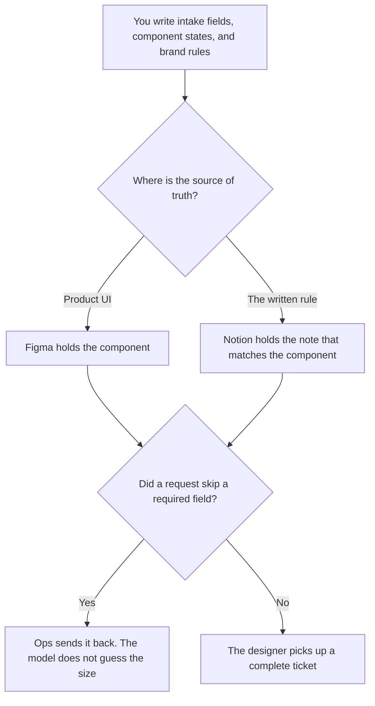

**Design ops should use AI to format the intake fields, the system notes, and the brand-kit rules a person already defined.** The pixels are the designer's page. This page is the system that keeps requests, components, and templates from drifting apart. We did not score visual quality.

The designer's shelf is [best AI tools for designers](/blog/best-ai-tools-for-designers-2026/). The written rules are [how to create a style guide with AI](/blog/how-to-create-a-style-guide-with-ai-2026/). A journey that should inform the system, only when you have evidence, is [how to create a customer journey map with AI](/blog/how-to-create-a-customer-journey-map-with-ai-2026/).

Prices are US list prices excluding tax from directory pages checked October 16, 2026. Published October 24, 2026.

## The ops job

| The job | Start here | First paid step | The limit |
|---|---|---|---|
| The file, the components, and the handoff | [Figma](/tools/figma/) | Professional Full seat is $16 a month billed annually, 3,000 AI credits | Starter is free, with up to 500 AI credits a month. The model does not invent a component |
| The intake fields and the system notes | [Notion AI](/tools/notion-ai/) | Business is $20 a seat a month | A field the model added is not required until you say so |
| A clean draft of a ticket from notes you pasted | [Claude](/tools/claude/) | Pro is $20 a month, or $17 billed annually | It formats. It does not prioritize |
| Social and marketing templates that are not the product UI | [Canva](/tools/canva/) | Pro is $18 a month, or $180 a year | Canva is not the design system of record |
| A generated image under a commercial-use rule you accept | [Adobe Firefly](/tools/adobe-firefly/) | Standard is $9.99 a month, 2,000 credits | Credits are for premium features. The offer text is still yours |
| A ping when intake is missing a field | [Zapier](/tools/zapier/) | Professional is $19.99 a month billed annually, 750 tasks | The Zap notifies. It does not triage taste |

Design ops owns the hygiene. Designers own the work. Marketing owns the ad claim. A social ad with words in the image is [Midjourney vs Ideogram for social ads](/blog/midjourney-vs-ideogram-for-social-ads-2026/). If the words are an offer, they were written by a person. The file ops keeps is the system, not the campaign.

## What you are paying for

**Figma Professional at $16 a Full seat** is the product-UI record. Dev seats are $12 a month and Collab seats are $3, on the October 16 card. AI credits on the Full seat are 3,000 a month. Starter includes 150 a day, up to 500 a month. Buy the seat the person needs. Do not put every marketer on a Full seat because the AI credit number looks larger. The invoice detail is [Figma AI pricing explained](/blog/figma-ai-pricing-explained-2026/).

**Notion Business at $20 a seat** holds the intake definition: what a request must include, and the component status words. The record rule is [what a system of record for AI is](/blog/what-is-a-system-of-record-for-ai-2026/). A second system page that disagrees with the Figma file is the bug this role exists to catch.

**Claude Pro** turns a Slack dump into a ticket with your fields. Missing stays Missing. The review is [Claude review](/blog/claude-review-2026/). The person who accepts the ticket is [what human-in-the-loop AI is](/blog/what-is-human-in-the-loop-ai-2026/).

**Canva Pro** is the marketing template library, with a brand kit, after design ops has said which kit is current. Business is $25 a person a month, or $250 a year, on the October 16 card. Magic Studio pricing is [Canva Magic Studio pricing explained](/blog/canva-magic-studio-pricing-explained-2026/). Canva is the wrong system of record for a product component.

**Firefly Standard at $9.99** is the row when the team wants Adobe's commercial-use positioning for generated images, as the directory describes it. Paid plans include unlimited standard image generations, and credits spend on premium features such as video and partner models. Pro is $19.99. This page does not score that positioning. Read the license you will rely on. A stylized scene with type set later can still be Midjourney. Basic there is $10 a month. Do not mix their licenses in one sentence of a brand rule.

**Zapier Professional** pings a channel when a required intake field is empty. Free is 100 tasks. The Zap does not assign a designer and does not rank requests.

A prompt that holds the line:

"Turn these notes into a design request using only our fields. If a field is missing, write Missing. Do not add a component. Do not set a priority. Do not invent a size or a hex value."

## What not to automate

Do not auto-close requests. Do not generate a design system from a mood board. Do not let an image model become the logo. A wordmark job is [Midjourney vs Ideogram for logos](/blog/midjourney-vs-ideogram-for-logos-2026/). Do not publish a generated ad until a person has read the words at the size the placement uses.

## FAQ

### Is design ops the same as design?

On this site, designers make the work. Design ops keeps intake, the system notes, the file hygiene, and the brand-kit rules. Buy the designer page when the job is the canvas. Buy this page when the job is the system around it.

### Can AI name the components?

It can format names you already use. A new component name is a decision, because code and documentation will follow it. Leave the name blank until the owner writes it.

### Do we need both Figma and Canva?

Often, yes, and only with a written split: Figma for the product UI, Canva for marketing templates. If you will not maintain the split, pick one library and say so. Two sources of truth for the same logo is the failure mode.

### Who approves a generated image?

A person who can see the words and the claim. Firefly's plan price is not that approval. Neither is a credit balance.

## Last verified

October 16, 2026 for Figma, Notion AI, Claude, Canva, Adobe Firefly, and Zapier. Published October 24, 2026.

**Sources:** [Figma pricing](https://www.figma.com/pricing/), [Notion pricing](https://www.notion.com/pricing), [Canva pricing](https://www.canva.com/pricing/), [Adobe Firefly](https://firefly.adobe.com), [Zapier pricing](https://zapier.com/pricing).

*Published by Andrew for [AI Tools Optimizer](https://aitoolsoptimizer.com).*

[Figma](/tools/figma/) is in the [design directory](/tools/category/design/). Directory pages may use affiliate links. A purchase through them may earn us a commission at no extra cost to you.
