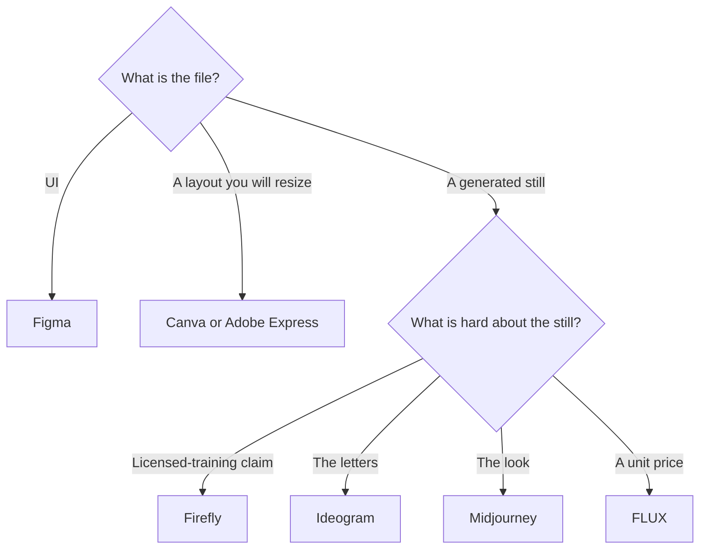

**Designers need a tool for the file they are already responsible for, not a generator that replaces the file.** Interface work stays in [Figma](/tools/figma/). Everyday social and marketing layouts stay in [Canva](/tools/canva/) or [Adobe Express](/tools/adobe-express/). Generated stills are a third job, and the right generator depends on whether you need a look, readable type, a licensed-training claim, or a price per image.

Prices are US list prices excluding tax, recorded October 16, 2026, except Ideogram's plan page, which the Ideogram review re-read on October 24, 2026. We did not run a blind test of image taste. [Magnific](/tools/magnific/) is omitted from the price table because the prices we saw were in Canadian dollars, not a confirmed USD list.

## The file, then the tool

| Design job | Start here | First paid step | A different job |
|---|---|---|---|
| The interface, the system, the handoff | [Figma](/tools/figma/) | Professional Full seat $16/month billed annually, 3,000 AI credits | A social post |
| A social post, a one-pager, a resize | [Canva](/tools/canva/) | Pro $18/month or $180/year | A product UI |
| Templates plus Firefly in an Adobe-shaped editor | [Adobe Express](/tools/adobe-express/) | Premium $9.99/month, 250 generative credits | A custom trained character |
| A still you may need to defend as trained on licensed content | [Adobe Firefly](/tools/adobe-firefly/) | Standard $9.99/month, unlimited standard images, 2,000 credits for premium work | Readable poster type as the main problem |
| Words that have to render in the image | [Ideogram](/tools/ideogram/) | Plus $20/month, or $15 billed yearly | An API inside your product |
| A stylized campaign look | [Midjourney](/tools/midjourney/) | Basic $10/month, or $8 annual. Standard $30, or $24 annual, is the working plan | A per-image API bill |
| Thousands of images in your own app | [FLUX](/tools/flux/) | From $0.008 an image for FLUX 3 Klein at 768×768. One credit is $0.01 | A moodboard subscription |
| Many models in one playground | [Krea](/tools/krea/) | Basic $9/month or $5 yearly. Paid plans include a commercial license | The system of record for UI |
| A diagram from a paragraph | [Napkin AI](/tools/napkin-ai/) | Plus $9/person/month. Free is 500 credits a week | A brand system |
| A first logo for a new business | [Looka](/tools/looka/) | Premium logo package $72 one time. Brand Kit $96/year | An established brand's identity |

The generator field is [best AI image generators](/blog/best-ai-image-generators-2026/). FLUX, Ideogram, and Firefly as a commercial-use choice are [FLUX vs Ideogram vs Firefly](/blog/flux-vs-ideogram-vs-firefly-2026/). Midjourney against a trained model and an API is [Midjourney vs Leonardo vs FLUX](/blog/midjourney-vs-leonardo-vs-flux-2026/).

## UI and the everyday layout

Figma Starter is free, with unlimited drafts and 150 AI credits a day, up to 500 a month. Professional is $16 a month for a Full seat on annual billing, with 3,000 AI credits. A Dev seat is $12. A Collab seat is $3. Figma Make and the AI agent sit inside that product. They do not move the source of truth to a chat window. The review is [Figma review](/blog/figma-review-2026/).

Canva Free includes a large template and asset library. Pro at $18 a month or $180 a year is the brand kit and the resize. Magic Studio's review is [Canva Magic Studio review](/blog/canva-magic-studio-review-2026/). Adobe Express Premium at $9.99 a month is the alternative when you want Firefly credits, Adobe Stock, and a brand kit in a template editor. The review is [Adobe Express review](/blog/adobe-express-review-2026/).

Napkin turns text into diagrams. Free is 500 credits a week. Plus is $9 a person a month. It is a figure tool, not a layout tool. The review is [Napkin AI review](/blog/napkin-ai-review-2026/). Looka is a logo generator for a new business: design is free, the Premium package is $72, and Brand Kit is $96 a year. An established brand does not outsource its identity to a logo quiz.

## Generated stills

Firefly Standard at $9.99 includes unlimited standard image and vector generations. Credits spend on video, audio, partner models, and higher image models. Adobe says its Firefly models were trained on licensed content, including Adobe Stock, and on public-domain content. That is the sentence agencies ask for. Confirm commercial use and indemnity on your plan. Beta outputs have a narrower indemnity note in the tool page. The review is [Adobe Firefly review](/blog/adobe-firefly-review-2026/).

Ideogram is the text-in-the-picture tool. Free is 30 credits a week if you sign in with Google, Apple, or Microsoft, and those images are public. Plus at $15 a month on a $180 year makes new generations private and includes 2,400 credits. The directory does not record a separate "commercial license" sentence for Ideogram the way it does for Krea's paid plans and Firefly's terms. Read Ideogram's current terms before a client file. The review is [Ideogram review](/blog/ideogram-review-2026/).

Midjourney Standard is the stylized look, at $30 a month or $24 annual. Companies over $1,000,000 in gross annual revenue need Pro or Mega for commercial use, on the terms summarized in our Midjourney coverage. Stealth, for private images, is Pro and Mega only. If that shape is what you want to avoid, start with [Midjourney alternatives](/blog/midjourney-alternatives-2026/).

FLUX is the API. There is no seat. FLUX 3 Klein runs from $0.008 at 768×768 to $0.036 at 4K. Open-weight licenses are a different document from the API price. The review is [FLUX review](/blog/flux-review-2026/).

Krea wraps many models. Free is 100 compute units a day and does not include the commercial license. Paid plans do. Pro is $21 a month on yearly billing. The review is [Krea review](/blog/krea-review-2026/).

A product photo has a stricter sequence: a real product, then a generator, then a check that the label is true. The steps are [how to generate product photos with AI](/blog/how-to-generate-product-photos-with-ai-2026/).

## A designer's month

A product designer: Figma Professional at $16, and Firefly Standard at $9.99 if generated marketing stills need the licensed-training story. A brand designer who lives in type-on-image: Ideogram Plus at $15 yearly, plus Canva or Express for the layout around the still. A studio shipping through an API: FLUX, and no extra seat until a license review says otherwise.

[Gamma](/tools/gamma/) Plus at $9 a seat is the deck tool when the deliverable is slides, not a system. Presentations are [best AI presentation makers](/blog/best-ai-presentation-makers/).

## FAQ

### What AI tool should a designer pay for first?

The tool that holds the real file. Figma if you design products. Canva or Adobe Express if you design marketing layouts. Add a generator when generation is the assignment.

### Is Midjourney or Firefly better for client work?

They answer different risk questions. Firefly is the licensed-training claim at $9.99. Midjourney is the look, with a revenue rule and a Stealth rule on higher plans. If the brief is letters in the image, start with Ideogram.

### Do designers need a chatbot?

For the words around the work, [Claude](/tools/claude/) or [ChatGPT](/tools/chatgpt/) at $20 a month is enough. The image does not come from that seat. Claude's directory page points image generation elsewhere.

### Can I use Krea free for a client?

The commercial license is on paid plans. Free is 100 units a day for exploration. Basic at $5 a month on yearly billing is the license step if the current terms still read that way at checkout.

## Last verified

October 16, 2026 for Figma, Canva, Express, Firefly, Midjourney, FLUX, Krea, Napkin, and Looka. October 24, 2026 for the Ideogram prices in the linked review. Published October 24, 2026.

**Sources:** [Figma pricing](https://www.figma.com/pricing/), [Canva pricing](https://www.canva.com/pricing/), [Adobe Firefly plans](https://www.adobe.com/products/firefly/plans.html), [Ideogram pricing](https://ideogram.ai/pricing), [Krea pricing](https://www.krea.ai/pricing).

[Figma](/tools/figma/) is in the [design directory](/tools/category/design/). Image tools are in the [image generation directory](/tools/category/image-generation/). Directory pages may use affiliate links. A purchase through them may earn us a commission at no extra cost to you.
