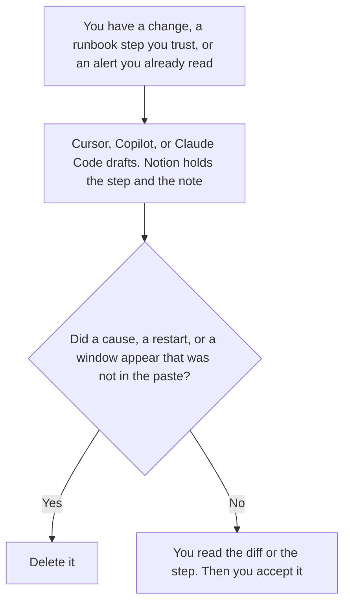

**A DevOps engineer should use AI to draft a diff they will read, to format one runbook step they already trust, and to write an alert note that states only what the alert already showed.** The model does not declare a root cause, restart production, or pick a maintenance window. The team's script, the drawn workflow, and the glue are [best AI tools for DevOps teams](/blog/best-ai-tools-for-devops-teams-2026/). This page is the engineer on the change: the diff, the step, and the note.

The people who live in incident review are [best AI tools for SRE teams](/blog/best-ai-tools-for-sre-teams-2026/). The person who schedules the window is [best AI tools for release managers](/blog/best-ai-tools-for-release-managers-2026/).

Cursor's Plus price is the October 24, 2026 help-center figure recorded in [Cursor pricing explained](/blog/cursor-pricing-explained-2026/). GitHub Copilot's prices are the October 16 directory card recorded in [GitHub Copilot pricing explained](/blog/github-copilot-pricing-explained-2026/). Claude Code is included on Claude Pro on the October 24 pricing table, recorded in [Claude Code pricing explained](/blog/claude-code-pricing-explained-2026/). Notion is the October 16 directory card. Published October 24, 2026. We did not score uptime. A green suggestion is not a change you have accepted.

## The engineer's three files

| The file | Start here | First paid step | The limit |
|---|---|---|---|
| A diff in the repo, which you will read | [Cursor](/tools/cursor/) | Plus is $8 a month, or $80 a year | Plus omits Cloud Agents and several other products, on the October 24 help page. You still run the tests you trust |
| Completions in the editor you already use on GitHub | [GitHub Copilot](/tools/github-copilot/) | Pro is $10 a month | Business is $19. Enterprise is $39. Neither is a reason to skip the diff |
| A terminal pass on the Claude seat | [Claude Code](/tools/claude-code/) | Included on Claude Pro, at $17 a month billed annually or $20 monthly | The same tests. A second editor is optional |
| The runbook step and the alert note | [Notion AI](/tools/notion-ai/) | Business is $20 a seat a month | A cause you did not confirm stays out |

The DevOps team page buys the glue: a script in the repo, a workflow you can draw, a cheap API job. This page assumes that glue exists or that you are editing it. The engineer reads the diff. Cursor Plus at $8 is the editor seat on the October 24 help page. Teams is $30, $100, or $200 a seat a month when the company needs a list price. Enterprise is contact sales. Those company rows are [Cursor Business pricing explained](/blog/cursor-business-pricing-explained-2026/) and [Cursor Enterprise pricing explained](/blog/cursor-enterprise-pricing-explained-2026/).

GitHub Copilot Pro at $10 is the individual seat on the October 16 card, with the cloud agent and code review on that card's description. Business at $19 adds the company controls that card lists. Enterprise at $39 is [GitHub Copilot Enterprise pricing explained](/blog/github-copilot-enterprise-pricing-explained-2026/). Use the Copilot-versus-Cursor refactor page when the argument is which of those two should touch a refactor: [Cursor vs GitHub Copilot for refactors](/blog/cursor-vs-github-copilot-for-refactors-2026/). This page does not re-rank them. It says the engineer still reads the diff.

Claude Code rides Claude Pro. It is the terminal pass, compared for refactors on [Claude vs Cursor for refactors](/blog/claude-vs-cursor-for-refactors-2026/). A vendor whose pricing URL no longer shows a table is [Tabnine Enterprise pricing explained](/blog/tabnine-enterprise-pricing-explained-2026/). This page does not invent that dollar.

The alert note says what fired, when, and what you already observed. Cause not confirmed stays in the note as those words. The packet you build after an incident is [how to create an AI incident postmortem with AI](/blog/how-to-create-an-ai-incident-postmortem-with-ai-2026/). The note is not the packet.

## What you are paying for

**Cursor Plus** is the diff in the editor. The review is [Cursor review](/blog/cursor-review-2026/).

**Copilot Pro** is completions on the GitHub seat. The company dollar, if you need it, is Business at $19 or Enterprise at $39 on the October 16 card.

**Claude Code** is included on Pro. You are paying for the Claude plan, not a second DevOps SKU.

**Notion Business** holds the runbook step you already trust and the alert note. The invoice is [Notion AI pricing explained](/blog/notion-ai-pricing-explained-2026/). The change you put in front of an approver is [how to write an AI change advisory brief with AI](/blog/how-to-write-an-ai-change-advisory-brief-with-ai-2026/).

A prompt that holds the line:

"Draft the diff description, the runbook step, or the alert note from the facts I pasted. If a cause is not confirmed, write Cause not confirmed. Do not add a restart. Do not add a maintenance window."

## What not to automate

Do not let an agent apply a change to production because an alert fired. Do not delete a test to make a pipeline green. Do not turn the alert note into a root cause. The engineer owns the diff. The approver, if the change needs one, is named on the brief.

## FAQ

### How is this different from the DevOps team page?

That page is the script, the drawn workflow, and the glue between systems. This page is the engineer's diff, one runbook step, and the alert note. You can use a team workflow and still refuse to let a model restart a service.

### How is this different from an SRE team's stack?

The SRE page is the incident practice for that role. This page is the engineer making or explaining a change, including the note that says what the alert showed. The postmortem packet comes after, and it keeps unknowns as unknowns.

### How is this different from a release manager?

The release manager coordinates the window and the people. The engineer produces the diff and the step the window will run. The brief that asks for approval is the change-advisory page. The engineer does not approve their own window by formatting it.

### Who may merge?

The person who owns the change, after they read the diff and run the tests they trust. Cause not confirmed stays in the note. A suggested command is not a restart you have run.

## Last verified

October 24, 2026 for Cursor's help page and for Claude Code on Claude's pricing table, via the posts cited above. October 16, 2026 for GitHub Copilot and Notion. Published October 24, 2026. We did not score uptime. Tabnine has no price on the sources read for its article.

**Sources:** [Cursor pricing](https://cursor.com/help/account-and-billing/pricing), [GitHub Copilot plans](https://github.com/features/copilot/plans), [Claude pricing](https://claude.com/pricing), [Notion pricing](https://www.notion.com/pricing).

*Published by Andrew for [AI Tools Optimizer](https://aitoolsoptimizer.com).*

[Cursor](/tools/cursor/) is in the [coding directory](/tools/category/coding/). Directory pages may use affiliate links. A purchase through them may earn us a commission at no extra cost to you.
