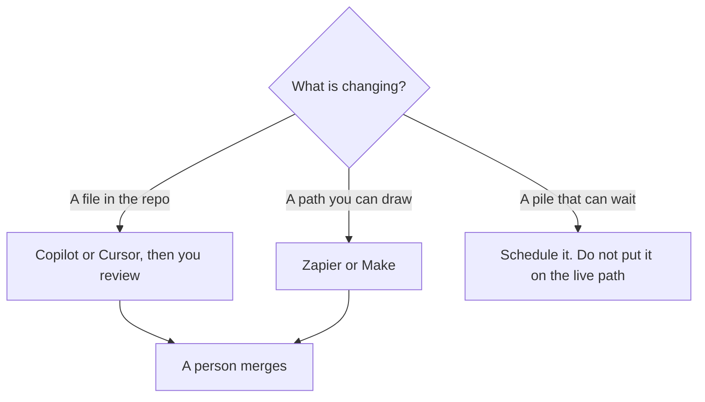

**A DevOps team should buy the tool that matches the change: a script in the repo, a workflow you can draw, or a cheap API job that can wait.** An agent that edits production because a prompt said "fix the alert" is not automation. It is an incident. This page is the pipeline and the glue. The people who write the tests in front of that pipeline are [best AI tools for QA engineers](/blog/best-ai-tools-for-qa-engineers-2026/). The diagram-versus-agent split is [AI orchestration vs automation](/blog/what-is-ai-orchestration-vs-automation-2026/).

Prices are US list prices excluding tax from directory pages checked October 16, 2026. n8n's cloud price was shown in euros. Published October 24, 2026. We did not score reliability.

## The change, then the tool

| The change | Start here | First paid step | The limit |
|---|---|---|---|
| A script, a manifest, or a pipeline file in git | [GitHub Copilot](/tools/github-copilot/) or [Cursor](/tools/cursor/) | Copilot Pro is $10. Copilot Free is 2,000 completions. Cursor Plus is $8 | You review the diff. The tool does not roll out |
| A wider edit from the terminal | [Claude Code](/tools/claude-code/) | Included with [Claude](/tools/claude/) Pro at $20, or $17 billed annually | No free Claude Code |
| A path you can draw: alert to ticket, form to row | [Zapier](/tools/zapier/) or [Make](/tools/make/) | Zapier Professional is $19.99/month annually for 750 tasks. Make Core is from $9/month annually for 10,000 credits | A branch you did not draw will not appear |
| The same glue, self-hosted | [n8n](/tools/n8n/) | Community Edition is free to self-host. Cloud Starter was €20/month annually | This page does not convert euros |
| A pile of API calls that can run off-peak | [DeepSeek](/tools/deepseek/) API | Flash off-peak is half of $0.30 input and $1.20 output per million tokens | Governance is part of the choice |

## The repo

[GitHub Copilot](/tools/github-copilot/) is the default when the team is already in GitHub. Pro is $10 a user a month, with $15 in credits. Business at $19 adds governance and IP indemnity. Enterprise is $39. The card is [GitHub Copilot pricing explained](/blog/github-copilot-pricing-explained-2026/). Suggestions in a pipeline file can hide a permission change. Read the diff the way you would read a teammate's. The definition is [what an AI copilot is](/blog/what-is-an-ai-copilot-2026/).

[Cursor](/tools/cursor/) Plus at $8 is the editor if you want the agent in that tree. The comparison is [Cursor vs GitHub Copilot](/blog/cursor-vs-github-copilot-2026/). A refactor of a module the pipeline calls is [Claude vs Cursor for refactors](/blog/claude-vs-cursor-for-refactors-2026/).

[Claude Code](/tools/claude-code/) is the terminal agent when the change spans files and you already want Claude. Pro is the first seat that includes it. The review is [Claude Code review](/blog/claude-code-review-2026/). The person who applies the change is [what human-in-the-loop AI is](/blog/what-is-human-in-the-loop-ai-2026/).

Do not host production in a prototype tool to avoid a pipeline. If you are generating an internal app, that is a different decision. The split between an editor and a hosted builder is [Cursor vs Replit Agent](/blog/cursor-vs-replit-agent-2026/).

## The glue and the pile

If you can draw every branch, draw it. [Zapier](/tools/zapier/) Free is 100 tasks a month. Professional at $19.99 billed annually is the multi-step plan. [Make](/tools/make/) Free is 1,000 credits. Core starts at $9 a month annually for 10,000 credits. The how-to is [how to automate work with Zapier and Make](/blog/how-to-automate-work-with-zapier-and-make/). The three-way is [Zapier vs Make vs n8n](/blog/zapier-vs-make-vs-n8n/).

[n8n](/tools/n8n/) Community Edition is the self-host path. Cloud Starter was €20 a month billed annually for 2,500 executions on October 16, 2026. Do not convert that to dollars in a budget slide. The review is [n8n cloud review](/blog/n8n-cloud-review-2026/).

A model step inside a Zap is still automation. It becomes a problem when the model is allowed to take a production action you did not list. Keep the action list short. A ticket, a draft, a notification. Not a change to a live rule, until a person confirms it.

[DeepSeek](/tools/deepseek/) is the cheap API for a job that can move to off-peak. Peak Flash is $0.30 per million input tokens and $1.20 per million output tokens. Off-peak is half. The directory records peak as 01:00–04:00 and 06:00–10:00 UTC on weekdays. The chat app is free. The company is based in China, and the directory says to check the docs before you build. A scheduled pile is [what batch inference is](/blog/what-is-ai-batch-inference-2026/). It is not a license to skip review. The review is [DeepSeek review](/blog/deepseek-review-2026/).

An internal FAQ over your runbooks is a docs problem, not a pipeline problem. Build it after the runbooks are current: [how to build an FAQ chatbot from docs](/blog/how-to-build-an-faq-chatbot-from-docs-2026/). The on-call note is still a status you write: [how to write a status update with AI](/blog/how-to-write-a-status-update-with-ai-2026/).

## FAQ

### What should a DevOps team pay for first?

Copilot Free or Pro, if the pain is files in GitHub. Cursor Plus if the pain is the editor. Zapier or Make Free if the pain is a path you can draw and you are still clicking it by hand. DeepSeek only for a job you can schedule and a governance review you have already had. One of those.

### Can an agent close alerts?

It can draft a ticket and a hypothesis. Closing an alert is a decision about the system. Keep a person on that click until the path is boring and reversible. The conductor, if you truly have several workers, is [what AI agent orchestration is](/blog/what-is-ai-agent-orchestration-2026/).

### Is n8n the cheaper Zapier?

It can be, if you will run the Community Edition. The cloud price we could read was in euros. Compare the execution you will actually run, not the logo.

### Should production prompts use a chat seat?

A chat seat is for a person. A pipeline should call an API with a key you can rotate, a log you can read, and a price you can see per million tokens. The split is [what an API for AI tools is](/blog/what-is-an-api-for-ai-tools-2026/).

## Last verified

October 16, 2026 for GitHub Copilot, Cursor, Claude, Zapier, Make, n8n's euro price, and DeepSeek rates named above. Published October 24, 2026.

**Sources:** [GitHub Copilot](https://github.com/features/copilot), [Zapier pricing](https://zapier.com/pricing), [DeepSeek API docs](https://api-docs.deepseek.com/).

*Published by Andrew for [AI Tools Optimizer](https://aitoolsoptimizer.com).*

[GitHub Copilot](/tools/github-copilot/) is in the [coding directory](/tools/category/coding/). Directory pages may use affiliate links. A purchase through them may earn us a commission at no extra cost to you.
