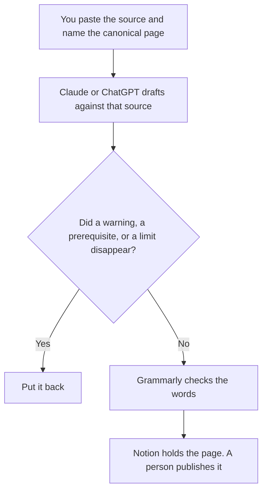

**Docs ops should use AI to draft a page from a source a person pasted, keep the canonical copy in the wiki the team already cites, and run a last pass that does not delete a warning.** The model does not decide which page is canonical, and it does not publish. The system that retrieves those pages for other people is a sibling job: [best AI tools for knowledge ops](/blog/best-ai-tools-for-knowledge-ops-2026/). How old a retrieved page may be is [what an AI retrieval freshness SLA is](/blog/what-is-ai-retrieval-freshness-sla-2026/).

Claude's prices are from claude.com/pricing on October 24, 2026. Notion, Grammarly, and the ChatGPT comparison seats below: Notion and Grammarly are directory pages checked October 16, 2026. ChatGPT Plus and Business are from learn.chatgpt.com/docs/pricing on October 24, 2026. Published October 24, 2026. We did not score documentation.

## The docs ops week

| The job | Start here | First paid step | The limit |
|---|---|---|---|
| The canonical page | [Notion AI](/tools/notion-ai/) | Business is $20 a seat a month | Plus at $10 is not the full AI tier |
| A long rewrite against a source | [Claude](/tools/claude/) | Pro is $17 a month billed annually, or $20 monthly | No step that was not in the source |
| A last pass on the words | [Grammarly](/tools/grammarly/) | Pro is $12 a member a month billed annually, or $30 monthly | A warning stays a warning |
| One page from a short paste | [ChatGPT](/tools/chatgpt/) | Plus is $20 a month | No procedure the paste did not contain |

Knowledge ops owns how people find and trust the set of pages. Docs ops owns the page: the source it follows, the review, and the publish. A retrieval bot that answers from a stale copy is their problem and yours. The page this roundup cares about is the one a human editor can point to. A schema you refuse to let a draft widen is [what an AI output schema lock is](/blog/what-is-ai-output-schema-lock-2026/), when the page is a reference with a fixed shape.

## What you are paying for

**Notion Business** is the full AI tier on the October 16 card, including search across connected apps. Free includes a trial. If two pages say different things, the model does not get to merge them. A person picks the canonical one and archives the other. The invoice is [Notion AI pricing explained](/blog/notion-ai-pricing-explained-2026/).

**Claude Pro** is the long-source seat. Put the rule in the Project: every step must appear in the source, and a missing step stays Missing. Team standard seats are $20 a seat a month billed annually when the docs are a company Project. The review is [Claude review](/blog/claude-review-2026/).

**Grammarly Pro** is the wording pass. If it changes "do not run this in production" into "use care in production," restore the original. The invoice is [Grammarly pricing explained](/blog/grammarly-pricing-explained-2026/).

**ChatGPT Plus** is the short-paste seat. Business is $20 a user a month billed annually for two or more users, or $25 monthly, on the October 24 page, when the source is internal and a personal login is against policy. The page says Business does not train on business data by default. The review is [ChatGPT review](/blog/chatgpt-review-2026/).

A prompt that holds the line:

"Revise this page using only the source I pasted. If the source is silent, write Not in source. Do not delete a warning. Do not add a step."

## What not to automate

Do not publish because the diff looks clean. Do not let a model choose the canonical page by length. Do not paste credentials or a customer export into a draft so the example looks real. The brief that starts a doc, when the doc is a project brief, is [Notion AI vs ChatGPT for project briefs](/blog/notion-ai-vs-chatgpt-for-project-briefs-2026/).

## FAQ

### How is this different from knowledge ops?

Knowledge ops owns the retrieval system, the ownership of the corpus, and the freshness rule. Docs ops owns the page people cite: the source, the edit, and the publish. A freshness SLA can fail because the page was never updated. That failure is a docs problem even when the bot is a knowledge problem.

### Do I need Grammarly and Claude?

Claude fits the rewrite against a long source. Grammarly fits the last pass on wording. Use both only if the second pass is not allowed to change meaning. If it changes a warning, the second pass lost.

### Is Notion Plus enough?

The October 16 card prices Plus at $10 a seat a month and puts the full AI set on Business at $20. A trial on Free may cover a draft. Do not describe Plus as that full set.

### Who may publish?

The docs owner named on the page. A finished draft is not a publish. If the source owner has not confirmed the steps, the page says Source unconfirmed and it stays a draft.

## Last verified

October 24, 2026 for Claude and for ChatGPT Plus and Business. October 16, 2026 for Notion and Grammarly. Published October 24, 2026.

**Sources:** [Notion pricing](https://www.notion.com/pricing), [Claude pricing](https://claude.com/pricing), [Grammarly plans](https://www.grammarly.com/plans), [ChatGPT and Codex pricing](https://learn.chatgpt.com/docs/pricing).

*Published by Andrew for [AI Tools Optimizer](https://aitoolsoptimizer.com).*

[Notion AI](/tools/notion-ai/) is in the [productivity and notes directory](/tools/category/productivity-notes/). Directory pages may use affiliate links. A purchase through them may earn us a commission at no extra cost to you.
