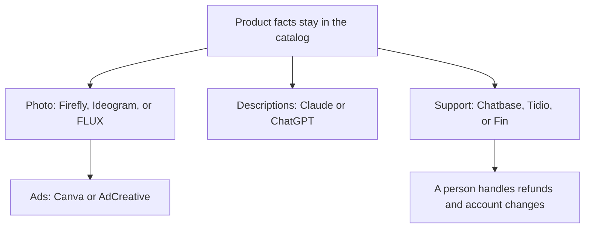

**Ecommerce AI should touch the photo, the ad size, or the repeated support question. It should not invent the product.** The catalog is the source of truth: title, price, materials, dimensions, and the claims you are willing to ship. Every tool below is a way to reuse those facts, with a USD entry price and a reason to leave it alone.

Prices are US list prices excluding tax, from vendor pages checked October 16, 2026, published here on October 24, 2026. A live refetch of those pages that day did not return numbers. We did not run a store on these tools, and we are not scoring conversion.

The catalogs that match the jobs: [image generation](/tools/category/image-generation/), [customer support](/tools/category/customer-support/), [marketing and SEO](/tools/category/marketing-seo/), and [writing](/tools/category/writing/).

## The store job, then the tool

| Job | Start | Entry price | Do not use it to |
|---|---|---|---|
| A commercial product still | [Adobe Firefly](/tools/adobe-firefly/) | Standard $9.99/month, unlimited standard images, 2,000 credits for premium features | Change the product's shape or claims |
| Words on a label or a promo badge | [Ideogram](/tools/ideogram/) | Free, 30 credits a week. Plus $15/month yearly for private images | Replace a legal label |
| A large catalog through an API | [FLUX](/tools/flux/) | From $0.008 an image at 768×768 | Skip a human check on a sample |
| Ad sizes and variations | [AdCreative.ai](/tools/adcreative-ai/) | Starter $39/month or $20 yearly. Credits spent on download | Invent an offer you will not honor |
| Resize and simple store graphics | [Canva](/tools/canva/) | Free, or Pro at $18/month | Generate a new product |
| A support widget trained on your policies | [Chatbase](/tools/chatbase/) | Hobby $32/month yearly, 700 message credits, 7-day trial | Guess an order status |
| Chat, tickets, and a small AI agent | [Tidio](/tools/tidio/) | Starter $24.17/month annually, 100 billable conversations | Replace a returns policy |
| Resolutions you pay for when they work | [Intercom Fin](/tools/intercom-fin/) | $49/month including 50 outcomes, then $0.99 each | Be the only system of record if you have no help desk |
| Product descriptions from facts you paste | [Claude](/tools/claude/) or [ChatGPT](/tools/chatgpt/) | Plus or Pro at $20/month | Add materials or guarantees |
| The customer list you already have | [HubSpot](/tools/hubspot/) | Free CRM. Starter has been offered from about $7 to $10 a seat in a limited-time price | Cold-email strangers |

## Photos: one master, then sizes

The shot workflow, including when [Midjourney](/tools/midjourney/) or [Leonardo.Ai](/tools/leonardo-ai/) is the better control, is [how to generate product photos with AI](/blog/how-to-generate-product-photos-with-ai-2026/). For a store, the short version is stricter than for a campaign.

Use a real reference image. Generate the scene, not a new SKU. Check the logo and the color at full zoom. Put any words that must be correct in [Ideogram](/tools/ideogram/) or type them in [Canva](/tools/canva/). Send the approved master to [AdCreative.ai](/tools/adcreative-ai/) if you need a dozen placements. AdCreative's previews are unlimited and the credit is spent on the download, which is the right order: approve, then download. The review is [AdCreative.ai review](/blog/adcreative-ai-review-2026/).

[FLUX](/tools/flux/) is the path when the catalog is large enough that a person cannot click Generate for each SKU, and a developer can call an API. Price the throwaway rate. A $0.036 4K image is cheap. A wrong label on 2,000 of them is not. [Adobe Firefly](/tools/adobe-firefly/) is the path when the buying conversation includes how the model was trained. The review is [Adobe Firefly review](/blog/adobe-firefly-review-2026/). The model tradeoffs are [Midjourney vs Leonardo vs Flux](/blog/midjourney-vs-leonardo-vs-flux-2026/).

[Adobe Express](/tools/adobe-express/) Premium at $9.99/month is the template editor if the store team is not going to learn a generation tool and only needs backgrounds, type, and stock.

## Words on the product page

Paste the catalog fields into [Claude](/tools/claude/) or [ChatGPT](/tools/chatgpt/) and ask for a description that uses only those fields. Tell it to leave a blank where a field is missing. A fluent description that adds "genuine leather" is a returns problem.

That is a writing workflow, and the steps for keeping facts attached to sentences are [how to write a blog post with Claude](/blog/how-to-write-a-blog-post-with-claude-2026/). [Jasper](/tools/jasper/) Pro at $59/seat yearly is the upgrade when many SKUs must share a brand voice and you will store that voice. It is wasted on ten products. The marketer's wider stack is [best AI tools for marketers](/blog/best-ai-tools-for-marketers-2026/).

Search, if organic traffic is the channel, is [Frase](/tools/frase/) or [Surfer SEO](/tools/surfer-seo/) on the content, and [Semrush](/tools/semrush/) on the research. A product grid is not a blog. Do not buy a 360-document Surfer plan for a store that publishes one buying guide a month. Frase Starter at $39 yearly includes 10 articles, which matches that calendar. The choice is [Surfer SEO vs Frase](/blog/surfer-seo-vs-frase-2026/).

## Support: policy pages, then a widget

[Chatbase](/tools/chatbase/) is the fastest docs-trained widget. Build it in the order in [how to build a support chatbot with Chatbase](/blog/how-to-build-a-chatbot-with-chatbase-2026/): policies you will honor, a refusal when the answer is missing, a test on real tickets, then the website. Hobby at $32 yearly is 700 message credits. The badge-removal add-on is $1,188 a year, which is optional and easy to underestimate.

[Tidio](/tools/tidio/) is the better first tool when you also want a human inbox and tickets. Starter's 50 one-off Lyro conversations are a pilot, not a holiday weekend. Growth begins at $49.17/month on annual billing when you need a larger conversation pool.

[Intercom Fin](/tools/intercom-fin/) is the better tool when you want to pay $0.99 for a resolution and you already have, or will have, a help desk. The $49 base includes 50 outcomes. It also runs on other help desks, not only Intercom. [Zendesk AI](/tools/zendesk-ai/) belongs here if Zendesk is already the queue. The survey of this aisle is [best AI chatbots for business](/blog/best-ai-chatbots-for-business-2026/).

None of these should process a refund, a cancellation, or an angry safety report without a person, until you have watched that path succeed on test tickets. Order status requires a connected action, not a confident paragraph.

## The customer you already know

[HubSpot](/tools/hubspot/)'s free CRM is enough to keep buyers, carts, and the questions the bot could not answer. The Starter price has been a limited-time offer, so cite the live checkout rather than a permanent $7. Credits for HubSpot's own AI features are metered. Set a cap.

Email to people who bought from you is a different legal situation from a scraped list. [Instantly](/tools/instantly/) is a cold-email product. It is the wrong default for a store's receipt list. Use the tool that matches consent.

[Zapier](/tools/zapier/) or [Make](/tools/make/) is how an order event creates a task a person sees. Zapier Professional is $19.99/month annually. Make Core is from $9/month annually. That glue is often worth more than another writing seat. The comparison is [Zapier vs Make vs n8n](/blog/zapier-vs-make-vs-n8n/).

## A small shop, in order

1. Real photos, Canva Free for the crops, Claude or ChatGPT for descriptions from the catalog fields.
2. Firefly or Ideogram when the scene or the words in the image are the bottleneck.
3. Tidio or Chatbase when the same five questions are filling the inbox.
4. AdCreative when you are spending on ads and need sizes.
5. FLUX only when the SKU count makes clicking unreasonable.

## FAQ

### What is the best AI tool for an online store?

There isn't one. Firefly or a real photo for the product, Canva for the layout, a chatbot for the repeated question, and a writing assistant fed by the catalog. Buy the row that matches the bottleneck.

### Can AI write my product descriptions?

Yes, from fields you paste, with a rule that it may not add claims. Review them the way you would review a new hire's first import. A wrong material is more expensive than a slow description.

### How much is an ecommerce support bot?

Chatbase Hobby is $32/month on yearly billing. Tidio Starter is $24.17/month on yearly billing. Fin starts at $49/month including 50 outcomes. Measure questions before you buy the largest pool.

### Are AI product photos allowed?

Only when you have rights to the reference, the channel's policy allows the image, and a person has checked the product. This page is a production workflow, not a marketplace's terms.

## Last verified

October 16, 2026 for prices. Published October 24, 2026. Pricing pages did not return a fresh fetch that day. HubSpot Starter's low seat price was a limited-time offer in the source we used.

**Sources:** [Adobe Firefly plans](https://www.adobe.com/products/firefly/plans.html), [Ideogram plans](https://docs.ideogram.ai/plans-and-billing/available-plans), [Black Forest Labs pricing](https://bfl.ai/pricing), [Chatbase pricing](https://www.chatbase.co/pricing), [Tidio pricing](https://www.tidio.com/pricing/), [Intercom Fin](https://fin.ai), [AdCreative.ai](https://www.adcreative.ai), [Canva pricing](https://www.canva.com/pricing/).

Directory pages may use affiliate links. A purchase through them may earn us a commission at no extra cost to you.
