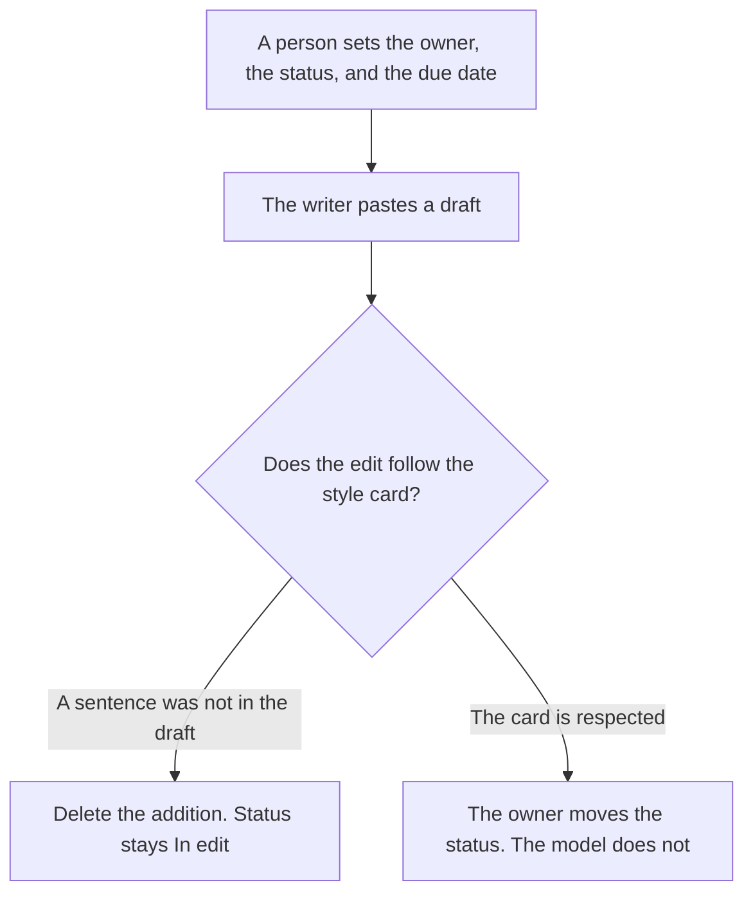

**Editorial ops should use AI to keep three things true: a status that matches where the piece actually is, an owner on every piece, and an edit that follows a style card a person wrote.** The brief, the draft, and the asset are the content desk. This page is the system that tells you the draft is late, the owner is missing, or the edit added a claim. A model that writes a beautiful draft and files it under "done" has skipped the job.

The desk that produces the piece is [best AI tools for content teams](/blog/best-ai-tools-for-content-teams-2026/). The card the edit obeys is [how to create a style guide with AI](/blog/how-to-create-a-style-guide-with-ai-2026/). The weekly issue, which is one artifact inside this system, is [how to create a newsletter with AI](/blog/how-to-create-a-newsletter-with-ai-2026/). The pass over a draft that already exists is [ChatGPT vs Claude for newsletter edits](/blog/chatgpt-vs-claude-for-newsletter-edits-2026/).

Prices are US list prices excluding tax from directory pages checked October 16, 2026. Published October 24, 2026. We did not measure traffic or editorial quality.

## The ops job

| The job | Start here | First paid step | The limit |
|---|---|---|---|
| The board: status, owner, due date | [Notion AI](/tools/notion-ai/) | Business is $20 a seat a month | The model may not mark a piece done |
| The line pass in the apps where people type | [Grammarly](/tools/grammarly/) | Pro is $12 a member a month billed annually, or $30 monthly | A correct sentence can still be a new claim |
| The edit against a long style card | [Claude](/tools/claude/) | Pro is $20 a month, or $17 billed annually | The Project holds the card. The edit adds no fact |
| A paste of one draft, filed by a person | [ChatGPT](/tools/chatgpt/) | Plus is $20 a month | The chat is not the board |
| The board already lives in ClickUp | [ClickUp Brain](/tools/clickup-brain/) | $9 a user a month on top of a ClickUp plan | If editors will not open ClickUp, the board is in the wrong home |

Status values you did not agree to will multiply. Pick a short list, such as Assigned, Drafting, In edit, Ready, Published, and keep the model from inventing "almost done."

## What you are paying for

**Notion Business at $20 a seat** is the board when the wiki and the calendar are already Notion. Each piece has one owner. "The team" is not an owner. The model can format a template. It cannot flip Ready because the prose looks finished. The seat article is [Notion AI pricing explained](/blog/notion-ai-pricing-explained-2026/).

**Grammarly Pro** is the pass that sits where the draft is typed. Annual at $12 is the price to compare. Monthly at $30 is the same Pro label at a higher bill. It will not catch a statistic the writer invented, if the statistic is grammatical. The invoice is [Grammarly pricing explained](/blog/grammarly-pricing-explained-2026/).

**Claude Pro** is the edit when the style card is long. Put the card in the Project. Ask for cuts and conflicts with the card, not for a new section. The review is [Claude review](/blog/claude-review-2026/).

**ChatGPT Plus** is the one-draft paste when the board is somewhere else and you will paste the result back. Business at $20 a user a month billed annually, with a two-user minimum, is the row when drafts are company material. The review is [ChatGPT review](/blog/chatgpt-review-2026/).

**ClickUp Brain** belongs here only when the editorial calendar is already a ClickUp list. Unlimited is $7 a user a month billed yearly before the $9 add-on. A second board in Notion that copies those statuses will drift by Friday. Pick one board.

A prompt that holds the line:

"Check this draft against the style card and the status rules I pasted. List conflicts. Do not add facts, and do not change the status. If the owner field is empty, write Owner missing."

## What not to automate

Do not let an agent publish. Published is a status a person sets after the checks you wrote. Do not buy a search-optimization suite on this page and call it ops. The checklist for search is the content-team shelf, including Surfer and Frase, and it is a different meter. Do not track "on time" with a percentage the model estimated. On time means the Ready date a person entered is on or before the due date a person entered.

## FAQ

### How is this different from the content-team roundup?

That page picks a tool for the brief, the draft, the line, the search checklist, or the asset. This page is the board those pieces move across: who owns the piece, which status is real, and whether the edit obeyed the card. A team of three needs the board before it needs a fourth drafting tool.

### Can the model assign the writer?

It can copy an assignment you made. It should not look at a calendar and decide who is free. Capacity is a person's call. A board that assigns work by itself will give the same editor every piece with a blank owner.

### Do we need both Claude and Grammarly?

Grammarly flags the sentence in the editor. Claude holds the long style card. If you only have one, use the one that matches the failure you had last month: typos in the tool, or drafts that ignore the card. Paying for both before you have a status field is the wrong order.

### What about the newsletter?

The newsletter is one row on the board, with an owner and a status. The edit comparison is the newsletter-edits article. This page does not become a writing guide for that issue. If the row has no owner, the issue is not in editorial ops yet. It is a draft in someone's chat.

## Last verified

October 16, 2026 for Notion AI, Grammarly, Claude, ChatGPT, and ClickUp Brain. Published October 24, 2026.

**Sources:** [Notion pricing](https://www.notion.com/pricing), [Grammarly pricing](https://www.grammarly.com/plans), [Claude pricing](https://claude.com/pricing), [ChatGPT pricing](https://chatgpt.com/pricing/), [ClickUp Brain](https://clickup.com/brain).

*Published by Andrew for [AI Tools Optimizer](https://aitoolsoptimizer.com).*

[Grammarly](/tools/grammarly/) is in the [writing directory](/tools/category/writing/). Directory pages may use affiliate links. A purchase through them may earn us a commission at no extra cost to you.
