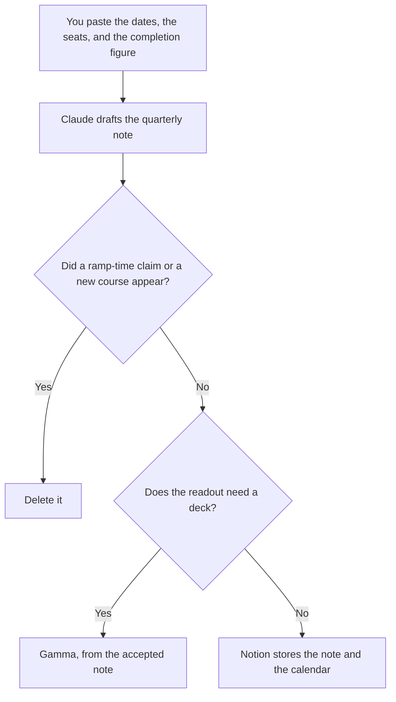

**An enablement lead should use AI to format the program calendar from dates they already set, the seat list from names they already have, and the quarterly note from a completion figure they already measured.** The model does not decide the curriculum, and it does not invent a ramp-time result. The people who produce the demo script and the battlecard are [best AI tools for enablement teams](/blog/best-ai-tools-for-enablement-teams-2026/). The people who design a lesson are [best AI tools for learning designers](/blog/best-ai-tools-for-learning-designers-2026/).

The deck a rep presents is [how to write a sales enablement deck with AI](/blog/how-to-write-a-sales-enablement-deck-with-ai-2026/). A module someone assigns is [HeyGen vs Synthesia for training modules](/blog/heygen-vs-synthesia-for-training-modules-2026/).

Notion, Gamma, and Synthesia prices are from directory pages checked October 16, 2026. Claude's prices are from claude.com/pricing on October 24, 2026. Published October 24, 2026. We did not score ramp time.

## The lead's week

| The job | Start here | First paid step | The limit |
|---|---|---|---|
| The calendar and the seat list | [Notion AI](/tools/notion-ai/) | Business is $20 a seat a month | Plus at $10 is not the full AI tier |
| The quarterly note, from numbers you paste | [Claude](/tools/claude/) | Pro is $17 a month billed annually, or $20 monthly | No completion rate you did not paste |
| The readout deck | [Gamma](/tools/gamma/) | Plus is $9 a seat a month, $108 a year | No metric that was not in the note |
| A module the field will be assigned | [Synthesia](/tools/synthesia/) | Starter is $29 a month billed monthly | The script is approved first. SCORM is a higher row |

This page is the lead. The team page is the artifact. If you are writing a battlecard, use that page. If you are deciding which seats to renew and what the quarter's number was, stay here. A lead who uses the model to invent the number has briefed their boss on a fiction.

## What you are paying for

**Notion Business** holds the calendar, the seat list, and the note. The invoice is [Notion AI pricing explained](/blog/notion-ai-pricing-explained-2026/). The Business-only buyer page, including what is still Enterprise, is [Notion AI Business pricing explained](/blog/notion-ai-business-pricing-explained-2026/).

**Claude Pro** is the narrative from figures you paste. Team standard seats are $20 a seat a month billed annually, or $25 monthly, when the note is a company record. The review is [Claude review](/blog/claude-review-2026/). The Team invoice is [Claude Team pricing explained](/blog/claude-team-pricing-explained-2026/).

**Gamma Plus** is the readout when a new deck is acceptable. Pro is $18 a seat a month, $216 a year, on the October 16 card. Business is contact sales. The invoice is [Gamma pricing explained](/blog/gamma-pricing-explained-2026/).

**Synthesia Starter** is a module when you already have a script. The October 24 pricing-page record puts SCORM on Enterprise, not on Starter. Do not buy the top row because the program is "official." Buy the export you actually assign. The invoice is [Synthesia pricing explained](/blog/synthesia-pricing-explained-2026/).

A prompt that holds the line:

"Draft the enablement note from the dates, the seat counts, and the completion figure I pasted. If a figure is missing, write Missing. Do not estimate ramp time. Do not add a course."

## What not to automate

Do not let a model mark a cohort complete. Do not paste a performance review into the prompt so the note "sounds specific." Do not renew a seat because the draft said the tool was essential. The lead renews it, from the list.

## FAQ

### How is this different from the enablement team page?

That page is the script, the battlecard, the deck, and the call library. This page is the lead's program: the calendar, the seats, and the number you already measured. The same person may do both on a small team. The templates stay different so a curriculum decision does not get written as a battlecard.

### How is this different from the learning designer page?

Learning designers build the lesson. Enablement leads decide the program those lessons serve, and the seats that pay for it. A module with no owner on the calendar is a file. It is not a program.

### Do I need Synthesia to be an enablement lead?

No. You need it when a module has to be assigned as video. A note and a calendar do not require an avatar. SCORM is a separate row. Read it before you assume Starter exports a package.

### Who may publish the quarterly number?

The lead, from the figure they measured. A formatted sentence is not a measurement. A missing figure stays missing.

## Last verified

October 24, 2026 for Claude, including Team seat prices. October 16, 2026 for Notion, Gamma, and Synthesia's monthly Starter price. The SCORM placement is the October 24 Synthesia pricing-page record used on the training-module article. Published October 24, 2026.

**Sources:** [Notion pricing](https://www.notion.com/pricing), [Claude pricing](https://claude.com/pricing), [Gamma pricing](https://gamma.app/pricing), [Synthesia pricing](https://www.synthesia.io/pricing).

*Published by Andrew for [AI Tools Optimizer](https://aitoolsoptimizer.com).*

[Notion AI](/tools/notion-ai/) is in the [productivity and notes directory](/tools/category/productivity-notes/). Directory pages may use affiliate links. A purchase through them may earn us a commission at no extra cost to you.
